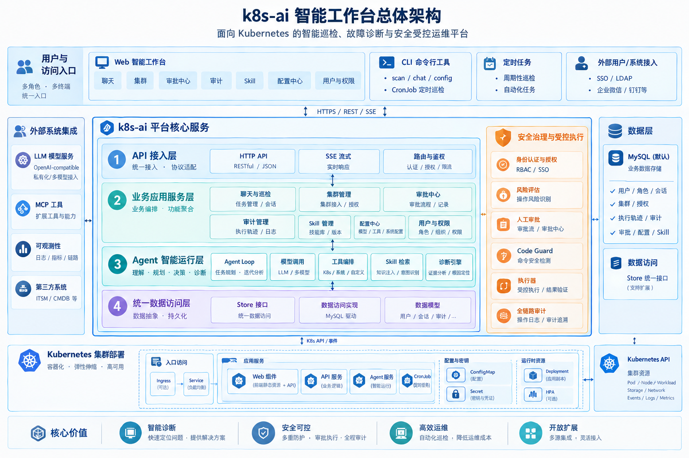
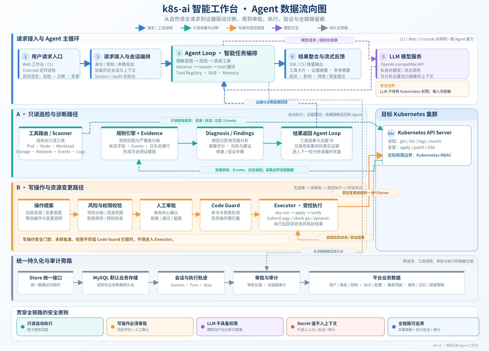
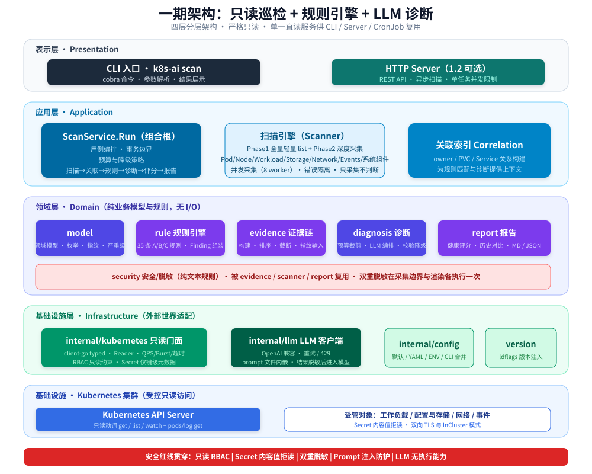
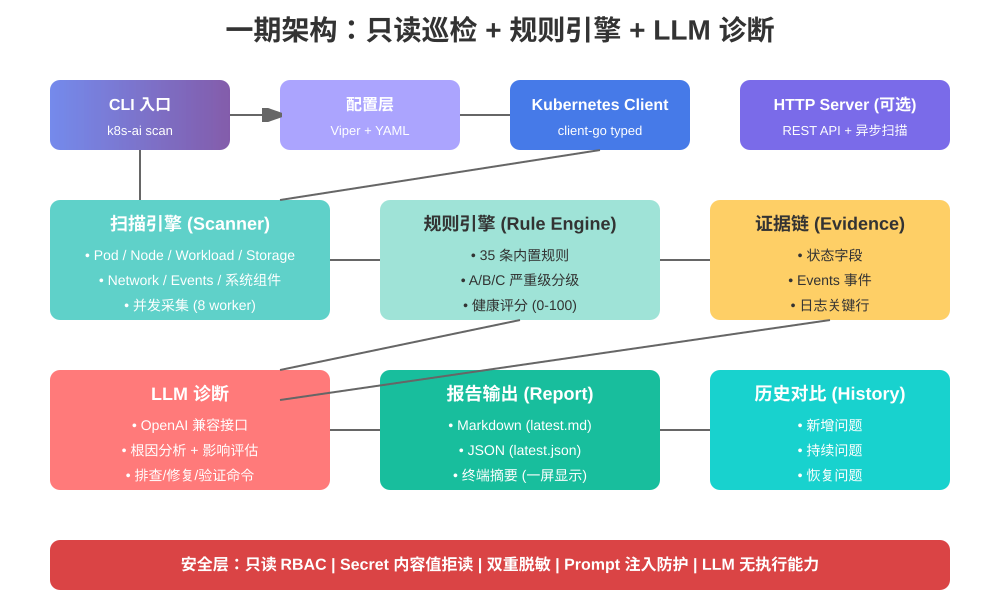
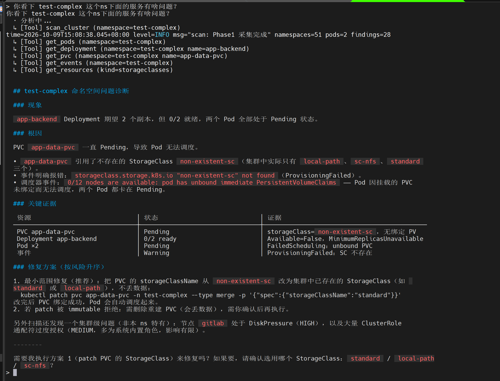
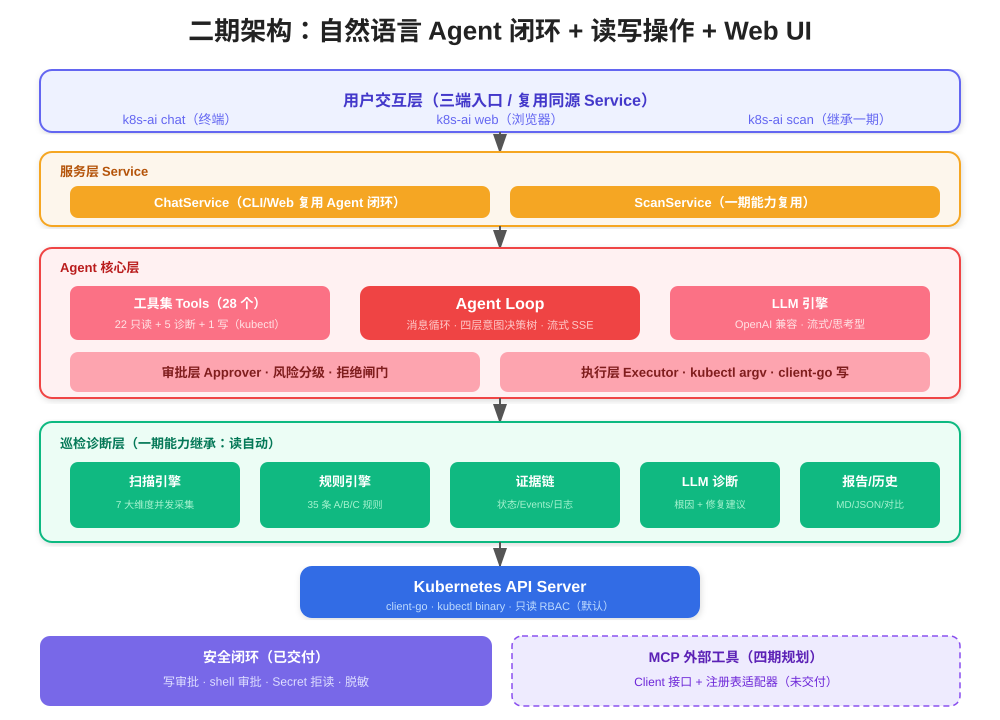
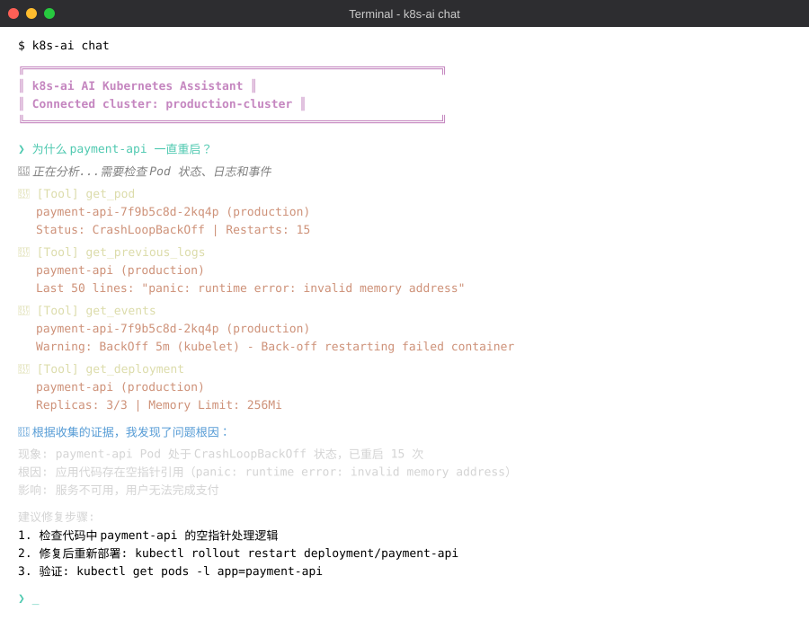
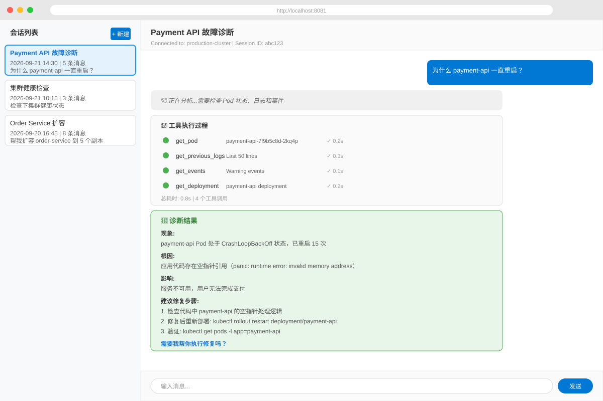
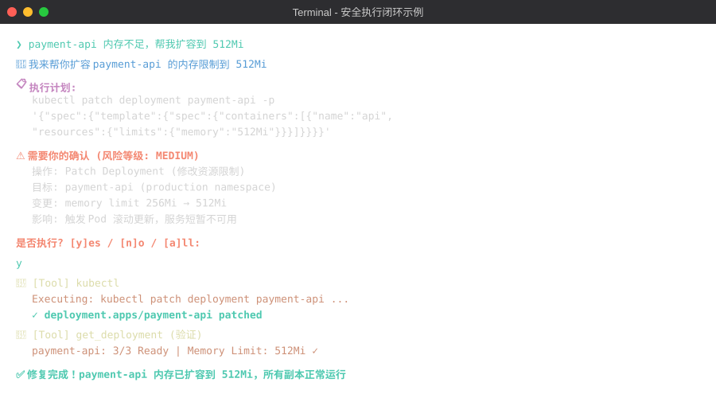
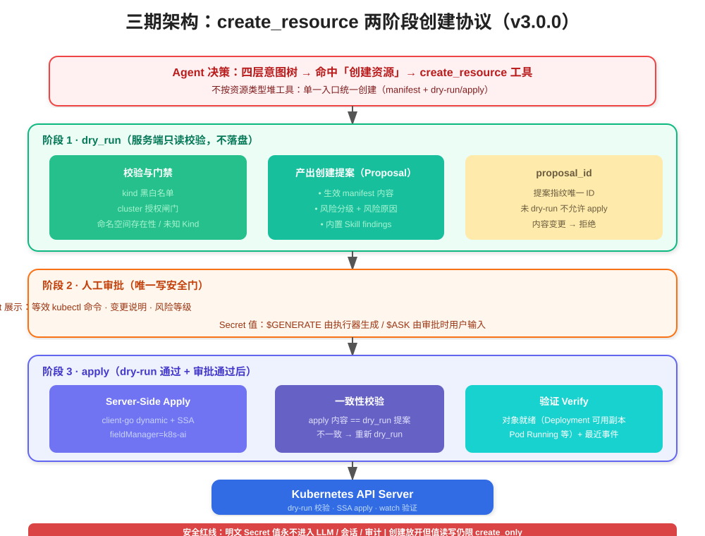

# k8s-ai 项目宣讲

> Kubernetes AI 智能巡检、故障诊断与自然语言运维 Agent

---

## 一、项目概述

### 1.1 定位

k8s-ai 是面向企业生产环境的 **Kubernetes AI 智能运维 Agent**：把资深运维的巡检规范、判定标准和排障经验产品化，变成一个**看得懂、敢执行、可审计**的自然语言运维助手。前三期已交付并作为**前期封版版本（v3.0.0）**，四期将演进为企业化/平台化的统一智能运维底座。

- **巡检诊断**：只读巡检 + 规则引擎 + 私有模型诊断 + 报告输出
- **智能交互**：chat 对话 Agent + Web UI + 读写操作 + 人工确认
- **资源执行**：自然语言资源创建（统一 create_resource、dry-run 提案、审批、SSA、verify）
- **平台化层（四期规划中）**：多集群接入、多租户与 RBAC、结构化技能 + SKILL.md 流程型技能双轨、MCP 外部工具、可观测与后端扩展

### 1.2 核心价值

**困境：**

当前 Kubernetes 运维面临三重困境：

- **技能门槛高**：集群操作、故障排查依赖资深工程师的经验沉淀和专业技术积累
- **效率瓶颈**：系统繁多、告警频发，巡检靠人肉、命令复杂易错，一次故障定位动辄数小时
- **大模型安全性不可控**：对生产集群，让 LLM 直接写命令等于交出控制权；模型能力参差、幻觉误判可能造成不可逆损失，企业难以承受

**破局：**

k8s-ai  agent的定位，不是替代人，而是把这套「老师傅经验 + 专业领域规范」沉淀成**可复制、可解释、有证据链、安全可控**的 AI 运维能力。 多个系统、各个系统管理员可自行解决各自业务问题，让运维从"人肉救火"走向"AI 巡检 + 人工决策"。

- **经验资产化，降低人员依赖**：把资深工程师的巡检清单、判定标准、排障路径固化为规则引擎 + 证据链 + LLM 诊断，组织经验不因人员流动而流失
- **巡检诊断一键完成，效率从小时级到分钟级**：一次 `k8s-ai scan`，输出"哪里有问题、为什么、影响什么、怎么排查、怎么修复"的完整结论，简单高效
- **自然语言运维闭环，门槛大幅降低**：通过 chat 或 web，用自然语言走完巡检、诊断、修复、验证，Agent 自动选择工具组合，并展示思考过程与工具卡片，谁都能与 Kubernetes 对话
- **安全可控，生产可用的前提**：写操作强制人工审批、LLM 永不成为权限主体、真实边界来自 Kubernetes RBAC、Secret 值零进入 LLM/会话/审计，拒绝闸门防止反复误操作，让团队既用得起也放心用
- **全链路留痕，满足审计合规**：会话、审批、执行全程脱敏落盘，每一次变更都可追溯、可问责，满足金融、政企等场景的合规要求
- **赋能提效业务人员**：效能平台业务规模庞大、30+业务系统混合运行、保障稳定安全运行，困难颇多。拥有我们的agent，各子系统业务人员亦可及时关注系统动向，业务情况变得触手可及，因此对业务系统的稳定性保障提升巨大！此外：各集群无时无刻都可能进行着各种业务作业，复杂的操作、环境的陌生、专业知识的缺失，针对业务人员困难很多，现在agent在手，与Kubernetes 对话不再陌生，自然语言chat即可解决！
- **减轻辅助系统依赖：** 监控系统、日志系统、工具集、分析软件，为了解决问题，保障安全稳定，我们可能引进了各种各样辅助三方系统和工具，维护学习成本都特别高，现在有了我们的k8s-ai agent，一定程度上即可减轻甚至替代他们！
- **数据不出域、平台化演进**：适配 OpenAI 兼容私有模型，可本地构建、二进制、容器化，以 CronJob 方式接入每日巡检，数据留在企业内部；三期满可封版（v3.0.0），四期向多集群、多租户、结构化技能 + SKILL.md 流程型技能与 MCP 生态演进，让今天的投入持续积累

---

## 二、整体架构

### 2.1 整体架构图



**架构分层说明**：

- **用户交互与任务入口层：** 提供 Web 智能工作台、CLI 命令行和定时任务等入口，支持自然语言对话、集群巡检、故障诊断及自动化运维任务，统一接入平台核心服务。
- **API 接入层：** 通过统一 HTTP API 提供业务接口，支持 REST 请求与 SSE 流式响应，承担请求接入、路由和必要的身份认证与访问控制。
- **业务应用服务层：** 负责聊天与巡检业务编排、会话管理、集群管理、Skill 管理、审批流程、审计管理、配置中心及用户与权限管理，为上层交互提供统一的业务能力。
- **Agent 智能运行层：** 以 Agent Loop 为核心，协同 LLM、工具注册与调用、Skill 检索、扫描引擎、规则引擎、证据链和诊断引擎，完成任务理解、规划、工具执行、结果观察与诊断分析。
- **统一数据访问层：** 通过 Store 统一管理平台业务数据的读写，默认使用 MySQL 持久化用户、角色、权限、会话、执行轨迹、审批、审计、配置、Skill 等数据，降低业务逻辑与具体存储实现之间的耦合。
- **安全治理与受控执行：** 作为贯穿业务处理和 Agent 工具调用的安全控制机制，覆盖身份与权限校验、风险评估、人工审批、Code Guard、受控执行、结果验证和全链路审计，确保智能决策与实际操作相分离。
- **外部依赖与部署层：** 通过 Kubernetes API Server 对接集群资源，通过 OpenAI 兼容模型接口接入私有或外部模型，并支持扩展工具集成；平台运行于 Kubernetes 集群环境，通过 Service、配置与密钥管理、定时任务等组件完成服务接入和运行管理。

整体设计采用分层解耦、职责分离的方式组织平台能力：业务服务负责任务编排，Agent 负责智能分析与工具决策，安全治理机制约束实际操作，统一数据访问层负责业务数据持久化，形成可扩展、可审计的智能运维平台。

### 2.2 Agent 数据流向图



**Agent 工作过程说明**：

1. **发起请求：** 用户通过 Web、CLI 或定时任务发起巡检、故障诊断、资源查询或变更请求。
2. **接入与会话恢复：** 请求进入平台服务层，完成必要的身份与权限校验，加载相关会话上下文，并记录请求及审计信息。
3. **意图理解与任务规划：** Agent Loop 结合用户目标、历史上下文及 LLM 能力理解任务，制定执行计划，选择合适的 Skill 与工具。
4. **工具调用与结果观察：** Agent 按计划调用工具，并根据实际执行结果持续分析和调整下一步动作；对于巡检与诊断任务，平台通过 Scanner 采集集群数据，结合规则引擎和 Evidence 证据链形成诊断依据，再由 LLM 综合分析根因、影响范围及处置建议。
5. **只读与写操作分流：** 只读操作在权限范围内自动执行，结果经过脱敏后参与分析；涉及资源变更的写操作必须经过风险评估、权限校验和人工审批，再由 Code Guard 与受控执行器执行，必要时采用 Dry-run、Apply 和 Verify 流程完成变更与验证。
6. **结果整合与流式回报：** Agent 汇总工具结果、诊断证据和执行验证信息，通过 Web 或 CLI 向用户返回处理进度、关键证据、诊断结论及操作结果。
7. **全链路持久化：** 平台对会话、工具调用轨迹、审批记录、执行结果和审计信息进行统一持久化与必要脱敏，确保任务过程可追踪、关键变更可核查。

整个过程遵循 **“只读自动、写操作必须审批、LLM 不作为权限主体”** 的安全原则。Agent 可以提出操作方案并组织工具调用，但不能绕过平台的安全控制直接执行未获授权的变更；Secret 的敏感内容值不得进入 LLM 上下文、会话或审计记录，关键运维行为均应保留可追溯记录。

---

## 三、一期：只读巡检 + 规则引擎 + LLM 诊断

### 3.1 一期架构图



**数据流向图**：



**一期核心组件**：

- **CLI 入口**：`k8s-ai scan` 命令
- **配置层**：Viper + YAML，支持 CLI > 环境变量 > YAML > 默认优先级
- **Kubernetes Client**：client-go typed client，只读 RBAC
- **HTTP Server（可选）**：REST API + 异步扫描
- **扫描引擎（Scanner）**：Pod / Node / Workload / Storage / Network / Events / 系统组件，并发采集（8 worker）
- **规则引擎（Rule Engine）**：35 条内置规则，A/B/C 严重级分级，健康评分（0-100）
- **证据链（Evidence）**：状态字段、Events 事件、日志关键行
- **LLM 诊断**：OpenAI 兼容接口，根因分析 + 影响评估，排查/修复/验证命令
- **报告输出（Report）**：Markdown（latest.md）、JSON（latest.json）、终端摘要（一屏显示）
- **历史对比（History）**：新增问题、持续问题、恢复问题
- **安全层**：只读 RBAC | Secret 内容值拒读 | 双重脱敏 | Prompt 注入防护 | LLM 无执行能力

一期的核心流程是一条直线：CLI 触发扫描 → Scanner 并发采集集群资源 → Rule Engine 匹配 35 条规则发现异常 → Evidence 收集证据链 → LLM 基于证据做根因分析 → Report 输出报告。全程只读，不操作集群。

### 3.2 一期核心能力

#### 全集群巡检

- **7 大维度**：Pod / Node / Workload / Storage / Network / Events / 系统组件
- **并发采集**：8 worker 并发，单集群 45s 完成
- **资源覆盖**：Deployment / StatefulSet / DaemonSet / Job / CronJob / Service / Ingress / PVC / ConfigMap / Secret（仅元数据）/ NetworkPolicy / HPA / PDB 等

#### 35 条内置规则

- **A 级（严重）**：Pod CrashLoopBackOff / OOMKilled / Node NotReady / PVC 绑定失败
- **B 级（中等）**：Deployment 副本不匹配 / Service 无 Endpoint / HPA 目标缺失
- **C 级（建议）**：CronJob 挂起 / 默认拒绝网络策略 / Ingress 主机冲突

#### 证据链驱动

- **每个异常带真实证据**：状态字段 / Events / 日志关键行
- **LLM 只能基于证据分析**：不能编造资源或证据
- **双重脱敏**：采集边界 + 报告渲染

#### LLM 诊断

- **OpenAI 兼容接口**：支持 OpenAI / Qwen / DeepSeek / vLLM / Ollama
- **输出内容**：根因分析、影响评估、排查/修复/验证命令（只展示，不执行）
- **降级策略**：LLM 不可用/超时自动降级为"规则初步判断 + 日志关键行"

#### 健康评分

- **0-100 分制**：根据问题严重级扣分
- **扣分明细**：每个问题列出扣分项
- **历史对比**：新增/持续/恢复问题追踪

#### 报告格式

- **Markdown**：概览 / 健康评分 / 异常摘要 / 分级问题 / 历史对比 / 资源汇总 / 系统组件
- **JSON**：机器可读，二期 Agent 的历史记忆契约
- **终端摘要**：一屏显示健康条、严重级计数、Top 10 重点问题

### 3.3 一期使用示例

```bash
# 生成配置
k8s-ai config init

# 校验配置 + 集群连通性
k8s-ai config validate

# 全集群巡检
k8s-ai scan

# 指定命名空间巡检
k8s-ai scan -n production

# 单 Pod 诊断
k8s-ai scan pod payment-api-7f9b5c8d-2kq4p -n production

# 日报模式
k8s-ai scan --report-mode daily

# CI 模式（达到 HIGH 返回退出码 2）
k8s-ai scan --fail-on HIGH
```

### 3.4 一期输出示例



**输出说明**：

- **健康评分**：72/100，根据问题严重级扣分
- **问题分级**：3 个 HIGH 级别问题，5 个 MEDIUM 级别问题
- **问题详情**：每个问题包含现象、根因、建议修复命令
- **报告路径**：reports/latest.md | reports/latest.json

---

## 四、二期：自然语言 Agent + 读写操作 + Web UI

### 4.1 二期架构图



**二期新增组件**：

- **用户交互层**：k8s-ai chat（终端）、k8s-ai web（浏览器）、k8s-ai scan（继承一期）
- **服务层**：ChatService（CLI/Web 复用）、ScanService（一期能力）
- **会话与审计**：Session（持久化）、Audit（脱敏落盘）
- **Agent 核心层**：Agent Loop（消息循环）、四层意图决策树、流式输出（SSE）
- **工具集**：22 只读工具 + 5 诊断工具 + 1 写工具（kubectl），共 28 个（二期口径）
- **审批层**：Approver 接口、风险分级（SAFE→CRITICAL）、批量审批面板、拒绝闸门（2次硬拦截）
- **执行层**：kubectl argv 直调（默认）、policy-gated shell（审批后）、client-go 写操作、执行后验证（Verify）
- **LLM 层**：OpenAI 兼容接口、流式/非流式、思考型模型
- **一期能力继承**：Scanner / Rule Engine / Evidence / Diagnosis / Report / History
- **平台扩展（四期规划）**：MCP 客户端接口、注册表适配器（未交付）
- **安全闭环**：审批唯一安全门 | 脱敏 | Secret 拒读

二期在一期基础上加了 Agent 闭环。用户用自然语言提问，Agent Loop 通过四层意图决策树选择工具，只读操作自动执行，写操作走审批层（风险分级 + 人工确认），Executor 执行后自动验证。同时新增 Web UI、会话持久化和审计日志，形成完整的"诊断→审批→执行→验证"闭环。

### 4.2 二期核心能力

#### Agent 工具集

**22 个只读工具**：

- Pod / Node / Workload / Storage / Network / Events / 日志 / ConfigMap / 节点资源用量
- 5 个诊断工具：scan_cluster / scan_pod / diagnose_pod / diagnose_node / diagnose_workload

**1 个写工具**：

- **kubectl**：唯一写入口，LLM 生成完整命令字符串
- 含 shell 构造走 `bash -c`，无 shell 走 argv 直调

#### 四层意图决策树

1. **诊断意图**：kubectl -o yaml + previous logs + events
2. **浏览意图**：结构化摘要工具
3. **ns 级健康**：scan_cluster(namespace=X)
4. **集群全景**：scan_cluster() + 健康检查协议

#### 流式输出

- **SSE 逐 token 推送**：`llm.stream: true` 开启
- **Web UI 增量渲染**：appendDelta 事件
- **流式失败自动降级**：兼容不支持 stream 的网关

#### Web UI

- **多会话管理**：侧边栏会话列表
- **流式输出**：SSE 流式处理
- **工具调用卡片**：Show output 折叠查看执行命令与结果
- **思考过程展示**：reasoning 内容展示 AI 的思考过程
- **流程时间线**：同一轮对话的思考→工具→结论竖向时间线展示
- **审批卡片**：等效 kubectl 命令 + 变更说明 + 风险等级
- **暗色主题**：现代化 UI 设计
- **会话持久化**：刷新后命令/参数/结果不丢失

#### 安全执行闭环

```
诊断 → 询问"需要我修复吗？" → 用户同意
  → 写操作审批卡片（等效 kubectl 命令 + 变更说明 + 风险等级）
  → 执行 → 验证
```

**拒绝闸门**：同一写操作被用户拒绝 2 次后自动硬拦截，要求 LLM 给出替代方案

**kubectl 命令归一化**：忽略 `--force`/`--grace-period` 等修饰性 flag，防止绕过

#### 会话与审计

- **会话持久化**：`--session` / `--new-session` / `--list-sessions` / `--delete-session`，落盘 `~/.k8s-ai/sessions`
- **审计日志**：用户输入 / LLM / 工具调用 / 审批 / 执行全部留痕 `~/.k8s-ai/audit/<session>.jsonl`（脱敏）
- **平台扩展（四期规划）**：MCP 客户端接口 + 注册表适配器（当前不连接外部服务器）

### 4.3 安全体系

| 检查项 | 保障机制 | 验证方式 |
|--------|----------|----------|
| 写操作必须审批 | Approver.Confirm + 风险分级 + 拒绝闸门 | agent 单测 |
| shell 命令需审批 | `HasShellSyntax()` → `IsReadOnly()=false` | approval 单测 |
| 不读 Secret 内容 | Secret 内容值禁止 + RBAC 仅元数据/键级读取 | AST 扫描 + fake Action 断言 |
| 脱敏 | 采集边界 + 报告渲染双重脱敏 | security 单测 + LLM 请求泄密测试 |
| api_key 不泄露 | 仅在 Authorization 头 + 错误显式剔除 | llm httptest |
| LLM 不编造 | Evidence ID 校验 + 命令白名单 | diagnosis 单测 |
| 交互式命令拒绝 | deny_ops 硬拒（edit/attach/port-forward 等） | executor 单测 |
| 单资源失败不中断 | collection_errors 隔离 | scanner 错误隔离测试 |
| RBAC 清单只读 | 解析 deploy/base/clusterrole.yaml 断言 | `tests/arch` RBAC 测试 |

### 4.4 二期使用示例

#### 终端 Chat 模式

```bash
# 交互模式
k8s-ai chat

# 单发模式
k8s-ai chat "为什么 payment-api 一直重启？"

# JSON 输出
k8s-ai chat --format json "检查下集群健康状态"

# 会话管理
k8s-ai chat --list-sessions
k8s-ai chat --new-session
k8s-ai chat --session <session-id>
```



**交互说明**：

- **用户提问**：为什么 payment-api 一直重启？
- **AI 思考**：正在分析...需要检查 Pod 状态、日志和事件
- **工具调用**：get_pod / get_previous_logs / get_events / get_deployment
- **诊断结果**：现象、根因、影响、建议修复步骤

#### Web UI 模式

```bash
# 启动 Web UI
k8s-ai web --addr 127.0.0.1:8081
```

**浏览器访问**：`http://127.0.0.1:8081`



**功能展示**：

- **会话列表**：侧边栏显示历史会话
- **工具执行过程**：时间线展示每个工具调用的状态和耗时
- **诊断结果**：现象、根因、影响、建议修复步骤
- **审批卡片**：询问用户是否执行修复操作

#### 安全执行闭环示例



**流程说明**：

1. **用户提问**：payment-api 内存不足，帮我扩容到 512Mi
2. **AI 分析**：生成执行计划（kubectl patch 命令）
3. **审批请求**：显示风险等级、操作、目标、变更、影响
4. **用户确认**：输入 y 确认执行
5. **执行工具**：调用 kubectl 工具执行 patch 操作
6. **验证结果**：调用 get_deployment 验证修复成功
7. **完成提示**：修复完成，所有副本正常运行

### 4.5 故障诊断示例

#### CrashLoopBackOff（配置错误）

**现象**：Pod 处于 CrashLoopBackOff 状态，已重启 15 次

**证据链**：

- 日志关键行：`nginx: [emerg] host not found in "80x" of the "listen" directive`
- Events：BackOff 5m (kubelet) - Back-off restarting failed container

**LLM 诊断**：

- **根因**：nginx 配置文件 listen 指令端口格式错误（"80x" 应为 "80"）
- **影响**：服务不可用，用户无法访问
- **修复建议**：修正配置文件，重新部署

#### OOMKilled

**现象**：容器被 OOMKilled，exitCode=137

**证据链**：

- lastState.reason=OOMKilled / exitCode=137 / memory.limit=256Mi
- 实际使用内存：312Mi

**LLM 诊断**：

- **根因**：内存限制 256Mi 不足，应用实际使用 312Mi
- **影响**：服务频繁重启，用户体验差
- **修复建议**：`kubectl set resources deployment/payment-api --limits=memory=512Mi`

#### PVC 绑定失败（StorageClass 不存在）

**现象**：PVC 处于 Pending 状态，无法绑定

**证据链**：

- Events：FailedBinding - storageclass "fast-ssd" not found
- PVC spec.storageClassName: fast-ssd

**LLM 诊断**：

- **根因**：StorageClass "fast-ssd" 不存在
- **影响**：Pod 无法启动，依赖该 PVC 的服务不可用
- **修复建议**：
  1. 创建 StorageClass：`kubectl apply -f storageclass.yaml`
  2. 或修改 PVC 使用现有 StorageClass

### 4.6 三期：资源创建能力（v3.0.0 封版）



**核心入口**：单条命令式 `create_resource`，不按资源类型堆工具。

- **两阶段创建协议**：先 `dry_run` 产出创建提案（manifest、风险、内置 Skill findings）→ 人工确认 → `apply` → `verify`
- **Server-Side Apply**：写入路径仍在 `internal/executor`，client-go dynamic + SSA（fieldManager=`k8s-ai`）
- **安全门禁**：kind 黑白名单、cluster 授权闸门、命名空间存在性、未 dry-run 拒绝、未知 Kind/危险字段升档
- **Secret 创建**：`$GENERATE` 由 Executor 生成、`$ASK` 由审批时用户输入；明文值永不进入 LLM/会话/审计
- **内置 Skill 元数据**：五域 YAML + `Registry` 读接口，为四期用户自定义 SKILL.md 流程型技能与结构化技能双轨冻结契约

**演示问法**：

```text
帮我在 k8s-ai-test 命名空间用镜像 rvm:5100/dbaas-system/mysql:8.0.20 创建 MySQL，
数据库 mysql，管理员密码走审批输入。
```

预期呈现：Agent 先补问缺失信息 → dry-run 提案卡 → 用户确认（Secret 密码带外输入）→ 创建成功 → verify 结果卡。

**用户自定义流程型技能（procedural）**：用户按标准 Agent 技能（SKILL.md + frontmatter）编写
方法论文本，导入为技能后，Agent 在聊天回合前做意图检索，命中则把 SKILL.md 渐进披露内容注入
系统提示词，再把方法论文本里的命令翻译为受信工具调用（结构化读 / 审批后写 / 审批后非交互 exec）
执行。SKILL.md 正文为不可信文本上下文，技能包 `scripts/` 一律 inert（不执行）；能力缺失时明确
拒绝并记入 `SKILL_RUN` 审计。例如用户编写的 MySQL 排障技能中 `kubectl logs <pod> -c mysql`
会走结构化 logs、`logs … │ grep …` 走结构化 logs 或人工审批的 shell、`kubectl exec` 仅支持
非交互形态且需审批，`exec -it` / `attach` / `port-forward` 等交互能力仍硬拒。

---

## 五、部署方式

### 5.1 本地构建

```bash
# Linux / macOS
make build
./bin/k8s-ai version

# Windows（无 make）
.\__build.cmd
.\bin\k8s-ai.exe version
```

### 5.2 Docker 镜像

```bash
make docker VERSION=v3.0.0
```

镜像基于 distroless static（非 root、小体积），prompts 已内嵌，无需挂载额外文件。

### 5.3 Kubernetes 部署（CronJob 每日巡检）

```bash
# 1. 创建命名空间、SA、只读 RBAC、配置、报告 PVC
kubectl apply -f deploy/base/namespace.yaml
kubectl apply -f deploy/base/serviceaccount.yaml
kubectl apply -f deploy/base/clusterrole.yaml
kubectl apply -f deploy/base/clusterrolebinding.yaml
kubectl apply -f deploy/base/configmap.yaml
kubectl apply -f deploy/base/pvc.yaml

# 2. 配置 LLM api_key
cp deploy/base/secret.example.yaml deploy/secret.yaml
# 编辑 secret.yaml 替换 REPLACE_ME
kubectl apply -f deploy/secret.yaml

# 3. 每日 08:00（Asia/Shanghai）巡检
kubectl apply -f deploy/scan/

# （可选）HTTP Server
kubectl apply -f deploy/allinone/deployment.yaml
kubectl apply -f deploy/base/service.yaml
```

**CronJob 特性**：

- `concurrencyPolicy: Forbid`（不并发）
- `restartPolicy: OnFailure`
- 报告写入 PVC `/reports`（`latest.md` / `latest.json` / 时间戳文件）
- 非 root（uid 65532）

### 5.4 RBAC

- **一期（只读）**：`deploy/base/clusterrole.yaml` 只授权只读动词（get/list/watch + pods/log get）
- **二期（写权限）**：参考 `deploy/rbac-write.example.yaml`（默认 clusterrole 保持只读）

---

## 六、配置说明

### 6.1 关键配置项

默认配置 `~/.k8s-ai/config.yaml`，优先级：CLI > 环境变量 > YAML > 默认。

| 配置 | 默认 | 说明 |
|------|------|------|
| `kubernetes.kubeconfig/context/namespace` | 空 | 连接集群；空 kubeconfig 走 KUBECONFIG 或 ~/.kube/config |
| `scan.concurrency` / `scan.phase2_concurrency` | 8 / 4 | 采集并发 |
| `scan.max_log_lines` / `max_log_bytes` | 500 / 65536 | 日志上限 |
| `scan.timeout` | 5m | 整次扫描超时（LLM 场景建议 10m） |
| `llm.enabled` / `endpoint` / `model` | true / localhost:8000 / qwen-plus | 大模型 |
| `llm.timeout` | 120s | 单次 LLM 调用超时（思考型模型建议保持） |
| `llm.stream` | true | chat 流式输出（true = SSE 逐 token 推送到终端/Web） |
| `llm.thinking` | `{type: enabled}` | chat 标准思考参数（OpenAI 兼容网关） |
| `scan.thinking` | `{type: enabled}` | 一期 Scan 诊断思考参数 |
| `report.directory` / `format` | ./reports / markdown | 报告输出 |

### 6.2 环境变量

- `KUBECONFIG`
- `K8S_AI_LLM_ENDPOINT`
- `K8S_AI_LLM_API_KEY`
- `K8S_AI_LLM_MODEL`

### 6.3 LLM 模型选型

- **巡检诊断**：建议用**快速的非思考型模型**（如 qwen-turbo/flash），单 Finding 秒级返回
- **Chat 对话**：建议用**思考型大模型**（如 Qwen3.5-397B），单次诊断约 1.5–2 分钟，需配合 `llm.timeout ≥ 120s`、`scan.timeout 10m`
- **思考控制**：`llm.thinking.type: enabled|disabled`；一期扫描诊断使用 `scan.thinking.type` 独立控制
- **降级策略**：LLM 不可用/超时自动降级为"规则初步判断 + 日志关键行"，scan 不失败

---

## 七、HTTP API（一期 1.2）

```bash
k8s-ai server --addr :8080
```

**接口**：

- `GET /healthz` - 健康检查
- `GET /readyz` - 就绪检查
- `GET /version` - 版本信息
- `POST /api/v1/scans` - 异步扫描（单任务并发限制，409 冲突）
- `GET /api/v1/scans/{id}` - 查询扫描状态

详见 [INSTALLATION.md](INSTALLATION.md) §4.7。

---

## 八、技术亮点

### 8.1 架构设计

- **分层清晰**：32 个 internal 包，职责单一，依赖方向单向
- **可测试性**：架构测试（AST 扫描 + 依赖方向 + RBAC 清单 + 泄密检测 + 请求量 + executor shell 守护）
- **可扩展性**：接线预留（MCP 客户端接口、注册表适配器）、规则可插拔、工具注册表、结构化技能 + SKILL.md 流程型技能双轨契约（四期落地）

### 8.2 安全设计

- **零信任**：LLM 不是权限主体，真实边界来自 Kubernetes RBAC
- **双重脱敏**：采集边界 + 报告渲染
- **审批唯一安全门**：写操作必须人工确认，shell 命令永不自动执行
- **拒绝闸门**：防止 LLM 反复重试被拒绝的操作

### 8.3 用户体验

- **流式输出**：SSE 逐 token 推送，Web UI 增量渲染
- **思考过程可见**：展示 AI 的推理过程，增强可信度
- **流程时间线**：思考→工具→结论竖向时间线，过程状态清晰
- **工具卡片结构化**：Pod/Event/Node 等表格化展示，信息密度高
- **会话持久化**：刷新后命令/参数/结果不丢失

### 8.4 故障诊断

- **证据链驱动**：每个异常带真实证据（状态字段 / Events / 日志），LLM 只能基于证据分析
- **四层意图决策树**：诊断/浏览/ns 级/集群全景，自动选择最优工具组合
- **历史对比**：新增/持续/恢复问题追踪
- **健康评分双轨**：规则评分 + LLM 综合评分（0-100）+ 差异解释

---

## 九、与 kubectl-ai 对比

| 能力 | kubectl-ai | k8s-ai 封版（v3.0.0） |
|------|------------|-------------|
| 工具执行 | shell 执行 kubectl | kubectl 二进制 argv 直调（无 shell）；写操作唯一入口为 kubectlTool，含 shell 构造的命令经人工审批后走 `bash -c` |
| 权限判断 | modifies yes/no/unknown | SAFE→CRITICAL 风险分级 + 人类确认 |
| 写操作 | 交互确认 / `--skip-permissions` | 默认确认；`--skip-permissions` 仅自动化显式开启 |
| 诊断 | 无（纯问答） | 一期 Scanner+Rules+Evidence+Diagnosis 全部 Tool 化 |
| 执行后 | 不验证 | Plan → Execute → Verify 闭环，失败继续调查 |
| 数据安全 | 原始数据进 LLM/落盘 | 截断 + 脱敏 + 不可信定界 + 审计零敏感值 |
| UI | terminal/tui/web | terminal（chat CLI）+ web（k8s-ai web） |
| 会话 | memory/filesystem | memory/filesystem + Web 会话管理 |
| 流式输出 | 支持 | 支持（SSE 逐 token + 自动降级） |
| 思考过程 | 支持 | 支持（reasoning 展示 + 动态展开/折叠） |
| 工具卡片 | 基础展示 | 结构化渲染（Pod/Event/Node 表格化） |
| 会话持久化 | 基础 | 完整（arguments/data 落库，刷新不丢失） |

**核心差异**：k8s-ai 在一期已具备专业的 Kubernetes 巡检诊断能力（Scanner + 规则引擎 + 证据链 + LLM 诊断），二期在此基础上构建自然语言 Agent，**不是从零开始的 chat 工具**，而是**有专业诊断能力的 SRE Agent**。

---

## 十、路线图

### 已完成 · 前期封版（v3.0.0）

- ✅ 一期：只读巡检 + 规则引擎 + 私有大模型诊断 + 报告（v1.x）
- ✅ 二期：chat 对话 Agent + web 浏览器界面 + 读写操作 + 人工确认（v2.x）
- ✅ 三期：自然语言资源创建（统一 create_resource、dry-run、审批、SSA、verify、内置 Skill 契约；v3.0.0 封版）

### 规划中 · 四期（企业化/平台化改造）

以下能力属于四期企业化/平台化改造方向，均为规划中，不属于前期封版交付：

- 🔲 多集群接入：集群注册/切换、统一准入
- 🔲 多租户与平台级 RBAC：租户隔离与授权
- 🔲 结构化技能 + SKILL.md 流程型技能双轨：内置/自定义/三方来源，Agent 回合前意图检索注入与显式调用
- 🔲 MCP 外部工具集成（连接外部 MCP 服务器）
- 🔲 可观测性集成（Prometheus/Grafana 等）与额外会话后端扩展

---

## 十一、总结

k8s-ai 是一个**专业的 Kubernetes AI 智能运维平台**：

- **一期（封版）**：执行一次 `k8s-ai scan`，快速知道集群哪里有问题、为什么、影响什么、应该怎么排查和怎么修
- **二期（封版）**：通过 `k8s-ai chat` 或 `k8s-ai web`，用自然语言与 Kubernetes 对话，自动诊断、修复、验证
- **三期（封版 · v3.0.0）**：让 Agent 能用自然语言创建资源，先出提案、审批后提交，并对 Secret 值保持不落上下文的安全红线
- **四期（规划中）**：企业化/平台化改造，朝多集群、多租户、结构化技能 + SKILL.md 流程型技能、MCP 外部工具方向演进

**核心优势**：

1. **专业诊断**：35 条内置规则 + 证据链 + LLM 诊断，不是简单的 kubectl 包装
2. **安全可控**：写操作必须人工确认，LLM 不是权限主体，真实边界来自 Kubernetes RBAC
3. **体验优秀**：流式输出、思考过程可见、流程时间线、工具卡片结构化
4. **架构清晰**：32 个 internal 包，职责单一，可测试、可扩展

---

**文档版本**：v1.0  
