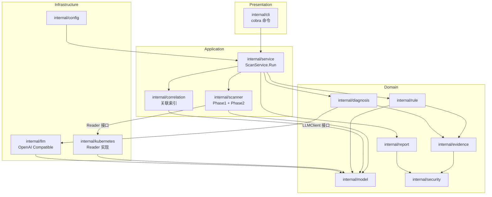

# k8s-ai 企业平台系统架构与技术方案

- 版本：v4.0.0
- 日期：2026-10-23
- 状态：四期企业平台落地中
- 依据：四期需求规格 v1.13、AGENTS.md、开发计划-四期、ADR-020~037

> 本文档是四期企业平台的总体架构总纲。扫描、Agent、审批与资源创建是平台内部能力域，
> 统一服务于 Web、CLI、Server、自动化和后续子 Agent；不按历史阶段拆分产品面。

## 0. 架构演进总览

平台分为 Presentation、Application、Domain、Infrastructure 与 Security Boundary 五类边界：

- Presentation：Web SPA、CLI、Server HTTP/SSE；
- Application：Scan、Chat、Cluster、Skill、Settings、User、Approval、Audit、Memory；
- Domain：Model、Rule、Evidence、Diagnosis、Session、Permission、Authz；
- Infrastructure：Kubernetes、LLM、Store、Executor、MCP 预留接口；
- Security Boundary：Permission Policy、Session owner、AuthzGrant + SAR、Approval、
  Code Guard、Executor 与 Kubernetes 准入控制。

企业平台只维护一套 `/api/v1` API 与一套 SSE 事件契约；前端、CLI、Server、自动化任务
复用同一应用服务，不按交付形态复制业务逻辑。总体架构图在功能面收敛后统一重画。

## 1. 目的与范围

本文档将评审通过的一期需求转化为可直接指导编码的技术架构。范围覆盖 1.1（MVP）；1.2（Server、趋势对比）只定义扩展边界，不进入本期实现。

## 2. 架构原则

1. **业务逻辑不依赖 CLI**（AGENTS.md）：CLI/Server/CronJob 复用同一个 `service.ScanService`。
2. **一期严格只读**：RBAC 只读动词 + 代码层只读门面 + 无 shell/exec + 架构测试证明。
3. **两阶段扫描**：Phase1 全量轻量 list，Phase2 只对异常对象深度采集（日志）。
4. **异常发现收敛到 Rule Engine**：Scanner 只采集，不判断；避免两套判断逻辑。
5. **小接口、消费方定义接口**：包之间通过最小接口协作，实现方返回具体类型。
6. **无循环依赖**：依赖方向单向，由 `model` 作为纯领域根。
7. **依赖最小化**：cobra / viper / client-go / slog，不引入无必要依赖。

## 3. 四层架构与模块映射

| 层 | 职责 | 包 |
|---|---|---|
| Presentation | 参数解析、命令注册、结果展示 | `cmd/k8s-ai`、`internal/cli` |
| Application | 用例编排、事务边界、预算与降级策略 | `internal/service`、`internal/scanner`、`internal/correlation` |
| Domain | 纯业务模型与规则，无 I/O | `internal/model`、`internal/rule`、`internal/evidence`、`internal/diagnosis`、`internal/security`（纯文本）、`internal/report`（评分与渲染编排） |
| Infrastructure | 外部世界适配：Kubernetes API、LLM HTTP、文件、配置、HTTP Server | `internal/kubernetes`、`internal/llm`、`internal/config`、`internal/server`（1.2）、`internal/version` |

说明：
- Domain 不 import Infrastructure；Application 通过 Domain 定义的端口（接口）调用 Infrastructure 实现。
- `internal/report` 同时承担"评分计算（纯逻辑）"与"渲染编排"，渲染器实现可视为 Domain 内部实现，不引入外部依赖。
- 目录保持扁平模块划分（与开发计划一致），依赖方向由规则约束并由架构测试守护。

## 4. 模块职责

| 模块 | 职责 | 依赖 | 被依赖 |
|---|---|---|---|
| model | 领域模型、枚举、指纹、严重级常量、ScanOptions、Budget | 仅标准库 | 全部 |
| config | 默认值/YAML/ENV/CLI 合并、`~` 展开、init/validate | model（可选） | cli、service、kubernetes |
| kubernetes | 客户端工厂（kubeconfig/InCluster）、Reader 实现、QPS/Burst/超时、只读约束 | model、client-go | scanner、service（工厂）、cli（validate） |
| scanner | Phase1 全量采集、Phase2 深度采集、worker pool、错误隔离、系统组件探测 | model、kubernetes.Reader（消费方接口） | service |
| correlation | 关联索引构建（owner/PVC/Service） | model | service、rule、diagnosis |
| rule | 规则注册表、Evaluate、严重级计算、Finding 组装 | model、evidence | service |
| evidence | 证据构建、排序、截断、ID 分配、指纹输入 | model、security | rule、diagnosis、service |
| security | 脱敏规则、敏感键识别（纯文本） | 仅标准库 | evidence、scanner、report |
| diagnosis | DiagnosisContext 构造、预算裁剪、LLM 编排、输出校验、降级 | model、evidence、llm（接口） | service |
| llm | LLMClient 接口 + OpenAI Compatible 实现、重试/429、prompt 文件（embed） | model、stdlib | diagnosis |
| report | 健康评分、Markdown/JSON/YAML 渲染、报告命名与写入 | model、security | service、cli |
| service | ScanService.Run 编排：扫描→关联→规则→深度采集→诊断→评分→报告 | 上述全部（组合根） | cli、server |
| cli | cobra 命令、flag→ScanOptions、控制台输出、退出码 | model、service、config、version | 无（入口） |
| server | 1.2：HTTP 路由、内存任务注册表 | model、service、config | 无 |
| version | 版本信息（ldflags 注入） | 无 | cli |

## 5. 依赖规则（架构测试守护）

允许的依赖方向：

```text
cli → service → {scanner, correlation, rule, evidence, diagnosis, report} → model
service → {kubernetes(工厂), config, llm(接口)}
scanner → kubernetes.Reader（消费方接口，scanner 定义）
diagnosis → llm.LLMClient（接口在 llm 包）
evidence → security
report → security
```

禁止的依赖（架构测试断言）：

```text
任何包 → cli
service/scanner/... → kubernetes 具体实现（除 service 组合根使用工厂创建）
model → 任何内部包
cli → scanner/kubernetes/llm/diagnosis/report（只能经 service）
kubernetes → rule/evidence/diagnosis/llm/report/cli
```

禁止的 import / 调用（架构测试断言）：

```text
os/exec（生产代码）
k8s.io/client-go/kubernetes/fake（生产代码）
dynamic.Interface（一期禁止，避免任意动词）
client-go 的 Create/Update/Patch/Delete/Apply/Scale/Exec 方法调用
Secret 内容值读取（元数据/键级读取仅限 internal/kubernetes 只读门面）
```

## 6. 总体架构图



## 7. 数据流图

```mermaid
flowchart LR
    A["CLI 解析<br/>flags+config → ScanOptions"] --> B["ScanService.Run"]
    B --> C["scanner.Phase1<br/>全量 list"]
    C --> D["ClusterSnapshot"]
    D --> E["correlation.Build<br/>关联索引"]
    E --> F["rule.Engine<br/>[]Finding + Evidence"]
    F --> G["scanner.Phase2<br/>仅异常对象取日志"]
    G --> H["证据补全/排序/脱敏"]
    H --> I["diagnosis.Diagnose<br/>预算内调用 LLM"]
    I --> J["[]Diagnosis<br/>校验+降级"]
    J --> K["report<br/>健康评分 + 渲染"]
    K --> L["ScanResult<br/>Markdown/JSON + 退出码"]
```



## 8. 目录结构（P0 落地目标）

```text
cmd/k8s-ai/main.go
internal/
  model/
  config/
  kubernetes/
  scanner/
  correlation/
  rule/
  evidence/
  security/
  diagnosis/
  llm/
  report/
  service/
  server/          # 1.2 占位（本期不实现业务）
  cli/
  version/
prompts/
configs/
deploy/
tests/arch/        # 架构测试（只读/RBAC/依赖方向/泄密/请求量）
Dockerfile
Makefile
go.mod
README.md
```

## 9. 关键架构决策（详见 ADR.md）

| 决策 | ADR |
|---|---|
| 两阶段扫描，Phase1 无 N+1 | ADR-001 |
| Scanner 不产 Finding，异常收敛到规则 | ADR-002 |
| Finding 指纹含 owner 归一化，支撑 1.2 趋势 | ADR-003 |
| 严重级与评分仅由规则计算 | ADR-004 |
| LLM 输出必须程序化校验并支持降级 | ADR-005 |
| 脱敏在采集边界 + 渲染两次执行 | ADR-006 |
| 单一 ScanService 供 CLI/Server/CronJob 复用 | ADR-007 |
| 删除应用内 schedule 配置，调度归 CronJob | ADR-008 |
| Phase1 只用 list，不用 watch/informer | ADR-009 |
| Events 按 namespace 一次 list + 本地索引 | ADR-010 |

## 10. 平台扩展能力

Agent、审批与资源创建能力按同一套分层原则实现，设计见本目录 10/11/12 方案文档：

- `internal/server`：HTTP 路由 / REST + SSE / 会话管理，复用同一个 `ScanService.Run`。
- `internal/agent`：Agent Loop（reason → tool → observe → reason）+ `createProtocol`（dry_run → apply）。
- `internal/approval`：Approval v2（Policy.Evaluate / Grant / Code Guard）与 `agent.secret.access=create_only`。
- `internal/executor`：kubectl parsed-argv 默认执行 + 审批后 shell 路径 + dynamic 创建（SSA）。
- `internal/session` / `internal/audit` / `internal/store`：会话与审计落盘（脱敏）。
- `internal/sessionapi`：会话（Chat Session）HTTP/SSE API，原 `internal/webui`；旧内嵌单文件页面已删除，见 ADR-039。
- `llm.ChatRequest.Tools` / `kubernetes.Reader.Get*` / `CommandExecutor`：由一期的接口预留演进为可实现。

## 11. 四期平台底座（落地中，M3）

企业平台在统一分层与安全红线下提供以下底座。任务跟踪见
`docs/04-项目管理与规范/planning/开发计划-四期.md`，里程碑 M3 平台能力进度如下
（M1/M2 已交付）：

| 模块 | 落地状态 | 说明 |
|---|---|---|
| 前端工程（P1.1） | 已完成 | `web/` Vite + Vue3 + TS 单仓工程，含 7 个侧栏路由入口与登录路由；lint/typecheck/build 通过 |
| 统一 Store（P1.2/P1.3） | 已完成 | `internal/store` 统一 `Store` 接口 + SQLite 驱动 + MySQL 方言层 + 幂等迁移（schemaVersion=3） |
| HTTP 中间件（P1.4） | 已完成 | request_id（X-Request-ID）、统一响应信封、分页、CORS、认证占位 |
| 认证与账号（P1.5） | 已完成 | User/Role 模型、argon2id 密码哈希、内存 Session Token（24h）、`/api/v1/auth/login\|logout\|me` |
| 权限门禁（P1.6） | 已完成 | `internal/permission` Role→Permission→Policy 判定 + `internal/server` 门禁（未登录 401 / 越权 403 / 未登记 403） |
| Session/Turn/Step（P1.7） | 已完成 | 三模型状态机（Turn 6 态 / Step 4 态）+ 入库与回放存储（`turns`/`steps` 表） |
| Agent 生命周期（P1.8） | 已完成 | `agent.Tracer` 观察者接入：Reason/Tool/Observe/Approval/Response Step 落库，Turn 终态推进；`service.NewChatWithStore` 持久化接入 |
| SSE 事件路由（P1.9） | 已完成 | 平台统一事件（`internal/sse`，15 类 EventType + 信封）+ 序列化/帧解包；service 通过统一 sink 广播事件，出站负载统一 `store.RedactJSONPayload` 脱敏 |
| Config Service（P1.10） | 已完成 | `internal/settings` 配置中心应用服务：§15 七组目录（model/skill/approval/memory/retention/mcp/ops）+ 键定义（类型/默认值/枚举/范围/敏感标记）+ 默认值合并读视图 + 先整批校验再落库；`GET|PATCH /api/v1/settings/{group}`（`settings.read`/`settings.write`），敏感键只写不读，变更写 CONFIG_CHANGE 审计（载荷不含取值） |
| Audit 落库（P1.11） | 进行中 | `internal/store/audit_event.go` 承载 §19 事件类型枚举与「动作 → 事件分类」映射；`AuditEvent` 补齐 eventType/resourceKind/resourceName/operation/risk/decision/approvalId/grantId/matchReason/parameterSummary/resultSummary/status，schemaVersion 3 补列并回填历史；`service.AuditService` 写前脱敏 + 事件分类，LOGIN/LOGOUT/CONFIG_CHANGE/TOOL_CALL/SKILL_RUN 落库，CLUSTER_CHANGE 随 P3.2 集群管理 API 落地 |
| Skill 平台（P3.5–P3.8, P3.8.1–P3.8.4） | 已完成 | Skill 两维正交：`type=structured\|procedural`、`source=builtin\|custom\|third-party`。structured 为资源创建确定性规则，`internal/skills` 模型 + `SkillPlatform`/Store `skills` 表 + `GET\|POST\|PATCH /api/v1/skills`，create_resource dry-run 消费 findings 与 `Escalations`、Approval Risk 只升不降（P3.5–P3.8 已实现）；procedural（标准 SKILL.md 文本/技能包，正文为不可信文本上下文、`scripts/` inert 不执行）导入与静态资产存储、Chat 回合前意图检索注入已完成（`import.go` `ParseProceduralDocs`/`ParseProceduralZip` + `POST /api/v1/skills/import-procedural\|import-zip` + chat `buildSkillContext` 注入 `SkillContext`，见开发计划-四期 v1.30） |

> 四期功能面收敛（P6）后统一重画 `architecture-phase4.svg`；当前平台底座以代码与上述
> 模块清单为准。

### 11.1 身份与权限分层

企业平台统一采用三层授权，不允许用一层代替另一层：

| 层 | 权威数据 | 解决的问题 |
| --- | --- | --- |
| 平台 Permission | Role → Permission → API Policy | 是否可进入用户/配置/审计/Skill 等平台管理面 |
| 会话所有权 | Session.ownerUserId | 是否可列出、读取、运行控制、审批、改名或删除某个会话 |
| 资源授权 | AuthzGrant → Kubernetes RBAC + 执行前 SAR | 是否可对某集群、namespace 与资源执行具体动作 |

- `user / operator` 的平台 Permission 默认为空，登录与会话基础能力由认证态和 owner 规则提供；
- 两者默认没有任何 Kubernetes 资源权限，admin 按集群和 namespace 显式授权；
- operator 不因角色自动跨 namespace；跨 namespace 必须逐个授权；
- admin 对全部会话拥有完整读写、运行控制与审批能力；
- 前端路由、菜单与按钮显隐仅用于 UX，所有权限结论由后端强制校验。

### 11.2 部署形态：默认一体化 + 可选前后端分离

工程结构上，前端 `web/` 独立开发与构建、后端为 Go 模块化单体；交付上支持两种部署形态，
共享同一套业务代码与 `/api/v1` API 契约（ADR-029 / ADR-036）：

| 形态 | 前端交付 | 后端职责 | 定位 |
|---|---|---|---|
| A 一体化（默认） | `web/dist` 经 `go:embed` 内嵌进二进制 | 同进程同端口提供 `/api/v1`（含 Chat SSE）与 SPA | 单机、POC、测试、企业常规、离线交付、快速升级；优先维护与验证 |
| B 前后端分离（可选） | 独立 Nginx（或既有静态托管/网关/CDN）托管 `web/dist` | 关闭静态路由，只提供 `/api/v1` 与探活端点 | 前后端独立发布/回滚、企业统一静态托管规范 |

分离形态默认同域名、按路径分流（`/assets/*` 与 `/` → 前端，`/api/v1/*` → 后端），前端使用
相对路径 `/api/v1`（构建期可用 `VITE_API_BASE` 覆盖），跨域与独立子域不作为当前强制需求；
后端 SSE 反代需关闭缓冲并放大超时。为支持分离形态只允许最小改动（静态托管开关、静态镜像与
Ingress），不得拆微服务、重写前端 API 层或改变既有业务行为。两种形态的进程默认单副本，
多副本/高可用/分布式任务协调不属于四期目标（ADR-030）。
