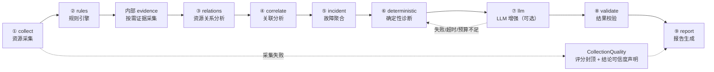
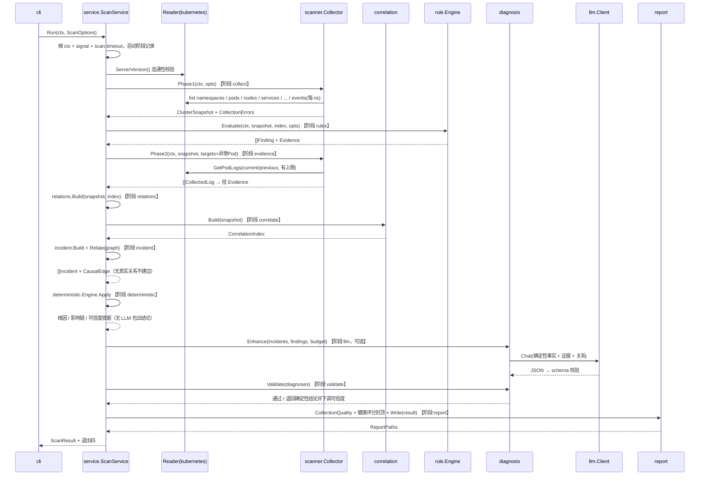
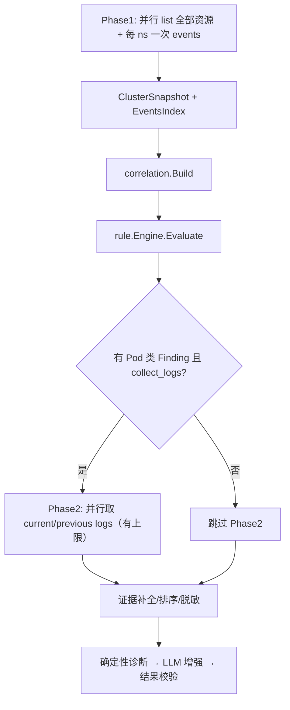
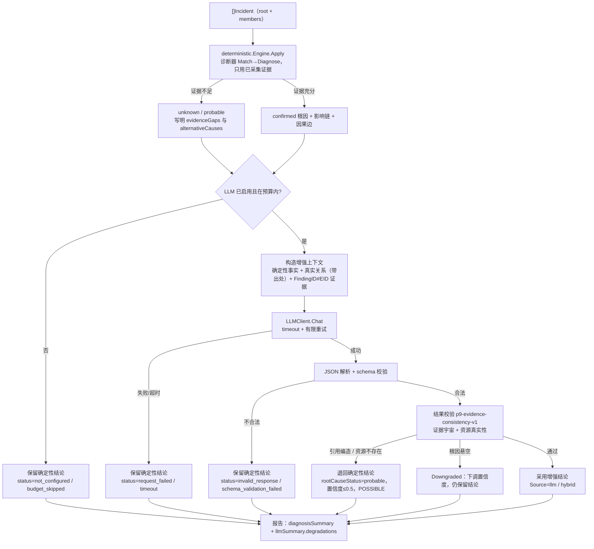

# k8s-ai 采集与扫描流程设计

- 版本：v2.1
- 日期：2026-08-12（首版）/ 2026-11-04（按「体检诊断体系升级」重写；同日补 §9 产物格式单选、阶段进度与停止）/ 2026-11-05（v2.1 补采集资源、canonical 证据引用、最终诊断事实源与退出码 0 语义）
- 状态：四期 P9 落地口径，取代 v1.0「一期扫描流程设计」
- 关联：`18-方案-体检诊断体系升级-四期.md`（权威口径）、`01-系统架构与技术方案.md` §6/§7

## 1. 流水线总览

一次体检是一条**结论逐级收敛**的流水线。对外九段与架构图方框一一对应，
`evidence` 是实现里的第十个内部阶段（不产出新结论，只补规则声明需要的证据）：

| 段 | 阶段 id | 实现 | 产出 |
|---|---|---|---|
| ① | `collect` 资源采集 | `internal/scanner` + `internal/kubernetes` 只读门面 | `ClusterSnapshot` + `CollectionErrors` |
| ② | `rules` 规则引擎 | `internal/rule` | `[]Finding` + `Evidence` |
| 内部 | `evidence` 按需证据采集 | `internal/scanner`（Phase2 取日志） | 日志证据挂到 Finding |
| ③ | `relations` 资源关系分析 | `internal/relations.Build` | 真实资源关系图 |
| ④ | `correlate` 关联分析 | `internal/correlation.Build` | `CorrelationIndex`（UID/Key 事件索引） |
| ⑤ | `incident` 故障聚合 | `internal/incident.Build` + `Relate` | `Incident` + `CausalEdge` |
| ⑥ | `deterministic` 确定性诊断 | `internal/deterministic` | 根因 / 影响链 / 可信度依据 |
| ⑦ | `llm` LLM 增强（可选） | `internal/diagnosis`（`enhance.go`） | 增强结论 |
| ⑧ | `validate` 结果校验 | `internal/diagnosis`（`validation.go`） | 校验标记 / 退回确定性结论 |
| ⑨ | `report` 报告生成 | `internal/report` | `InspectionReport` → JSON / Markdown / 归档 |

阶段 id 与标题的单一来源是 `internal/service/stages.go`；职责分工的硬边界是：
Correlation 只发现关联、不宣布根因；Incident 只组织故障与成员。确定性诊断优先给出根因；
确定性层未覆盖时，LLM 可提出候选，但不能覆盖已确认事实。合并与校验后的最终 `Diagnosis`
是根因唯一事实源，Incident 根因字段只是投影；结果校验保证最终结论有证据支撑。



CLI 与 Web 走同一条流水线：`internal/cli` 与 `POST /api/v1/scans` 都进
`service.ScanService.Run`，档位差异只是采集与 LLM 开关，不改流水线形状。

### 1.1 一次 scan 的完整执行流程



## 2. 采集阶段与深度证据采集边界

代码里两个方法名仍叫 `Phase1` / `Phase2`（`scanner.Collector`，保持兼容不改名），
对应流水线口径里的 `collect` 与 `evidence` 两段。

| 维度 | Phase1 | Phase2 |
|---|---|---|
| 目的 | 全量快照 + 异常筛选 | 异常对象深度证据（日志） |
| 请求类型 | 只 list | 只 get logs |
| 触发 | 每次 scan 必执行 | 规则产出 Pod 类 Finding 后执行 |
| 并发 | 默认 8 | 默认 4 |
| 数据 | 状态/条件/事件（本地索引） | current + previous logs |
| 失败影响 | 记 collection_errors，继续 | 记 collection_errors，继续 |
| 预算 | scan.timeout 全局 | min(剩余 scan.timeout, Phase2 上限) |

Phase2 判定标准：规则产出的 Finding 中，`Resource.Kind == Pod` 且规则声明 `NeedsLogs=true`（如 CrashLoopBackOff/OOMKilled/ImagePullBackOff）；Node/Storage/Network/Workload 类 Finding 数据已在 Phase1 齐备，不取日志。



## 3. Phase1 各资源 list 策略（无 N+1 论证）

约定：`namespace=""` 表示一次全集群 list；分页 `Limit=500 + Continue`，走 apiserver 缓存（`ResourceVersion="0"`）。

| 资源 | API 组 | Scope | 请求数 | 备注 |
|---|---|---|---|---|
| Namespaces | core | 全集群 | 1 | 最先执行，决定事件采集范围 |
| Pods | core | 全集群（或指定 ns） | 1（+分页） | 带精简字段归一化 |
| Nodes | core | 全集群 | 1 | |
| Services | core | 全集群（或指定 ns） | 1 | |
| EndpointSlices | discovery.k8s.io | 全集群（或指定 ns） | 1 | |
| Deployments/RS/STS/DS | apps | 全集群（或指定 ns） | 各 1 | 4 类 |
| Jobs/CronJobs | batch | 全集群（或指定 ns） | 各 1 | 2 类 |
| PVC / PV / SC / VolumeAttachment | core/storage | 全集群（或按 ns） | 各 1 | 4 类 |
| Ingress / NetworkPolicy | networking.k8s.io | 全集群（或指定 ns） | 各 1 | 2 类 |
| HPA / PDB | autoscaling / policy | 全集群（或指定 ns） | 各 1 | 2 类，只读 status/spec 摘要 |
| Roles / RoleBindings | rbac.authorization.k8s.io | 全集群（或指定 ns） | 各 1 | 2 类，只读规则与主体声明 |
| ClusterRoles / ClusterRoleBindings | rbac.authorization.k8s.io | 全集群 | 各 1 | 2 类，只读规则与主体声明 |
| ConfigMaps | core | 全集群（或指定 ns） | 1（+分页） | **只采对象元数据/名称，不读 data/二进制值**；规则按引用关系取证 |
| Secrets | core | 全集群（或指定 ns） | 1（+分页） | **只采名称/type/键名/immutable，不读 value/stringData** |
| Events | core | **每 namespace 1 次** | N | 并发受限；本地建索引 |
| Metrics | metrics.k8s.io | 不采集（1.2） | 0 | |

请求数推导：

```text
全集群模式：Phase1 请求 ≈ 1 + 24 + N_namespaces（+ 分页附加页）
指定 namespace：Phase1 请求 ≈ 1 + 24 + 1（events 1 次）
与 Pod 数量无关 → 无 N+1
```

示例：1000 Pod、50 namespace → Phase1 ≈ 75 次 list（未分页时），而非 1000+ 次。

## 4. Events 采集与本地索引

```text
ListEvents(namespace) × N_namespaces（并发 ≤ scan.concurrency）
→ 每条 Event 按 involvedObject.UID 放入 EventsIndex
→ 规则/证据按 ResourceRef.UID 查询 O(1)
```

- 只采核心组 `corev1.Event`（含 count/firstTimestamp/lastTimestamp，ADR-011）。
- 事件消息进入索引前脱敏（ADR-006）。
- 内存控制：按 namespace 丢弃超过阈值（如单 ns 5000 条）的旧事件，只保留最近 + Warning 优先。

## 5. 深度证据采集清单（Phase2）

对每个异常 Pod 的每个异常容器：

```text
GetPodLogs(current, TailLines=500, 字节上限 64KiB, 单行 1KiB)
GetPodLogs(previous, 同上)   // 无 previous 时静默跳过
```

深度字段（restartCount/lastState/exitCode/restartPolicy/resources/QoS/annotations，以及
readiness/liveness/startup 探针的 path/port/action/timing）已包含在 Phase1 的 Pod 对象中，
**不需要额外请求**。

## 6. 预算与提前终止

- 总预算：根 ctx = `scan.timeout`（默认 5m）。
- Phase2 截止：`min(scan.timeout 剩余, 配置的 phase2_timeout)`；超时后未采集的日志记 `collection_errors{operation: get_logs_skipped_timeout}`。
- LLM 预算：见 CONCURRENCY.md §5。
- 取消语义：ctx 取消后，所有在途请求立即中止；已产出的快照/Findings 保留，报告标注"扫描被中断"。

## 7. CollectionErrors 与采集完整性

| 场景 | Operation | 处理 |
|---|---|---|
| list 某资源失败 | list_xxx | 该资源类型整体记错，其余继续 |
| events 某 ns 失败 | list_events | 该 ns 无事件索引，其余继续 |
| 日志权限拒绝 | get_logs | 记错，证据缺失，仍生成 Finding |
| previous logs 不存在 | get_previous_logs | 静默跳过，不记错 |
| Phase2 超时跳过 | get_logs_skipped_timeout | 记错 |
| LLM 不可用 | 不记入 | 走 `Diagnosis.Error` 与 `LLMSummary.degradations`，不进 collection_errors |

`CollectionErrors` 只回答「哪里坏了」，`scanner.CollectionQuality` 回答「这份报告还能信几分」：
它按**计划采集项**（`collectionKindGroups` + `plannedCalls`）与实际失败/跳过项对照得出，
不是错误条数的简单换算。三条容易做错的地方已在代码里定死：

1. 集群级 list 失败按「影响全部命名空间」记账，不能被读成「只坏了一个 ns」；
2. 未登记的采集操作必须显式出现在 `failedKinds`（形如 `other:get_xxx`），不允许静默消失；
3. 完整性直接参与健康评分封顶：`insufficient`（Pod/Node/工作负载/Events 缺）封顶 60、
   `partial` 封顶 85、存在任何失败或跳过类型则不给满分，封顶原因写入 `capReason`
   并在 `conclusion.dataCaveats` 里对人说明。

**采集失败永远不等于资源正常**：缺数据时结论级别降到 `unknown`/`attention`，
而不是「本次体检未发现异常」。

## 8. 确定性诊断、LLM 增强与结果校验

诊断链的因果顺序是「先确定性、后增强、再校验」，LLM 不在结论链的最上游：



证据宇宙只由 canonical 引用组成：根 Finding 的 `rootID#EID` + 成员 Finding 的
`memberID#EID`。新输出、校验、报告和 Web 定位不得再产生裸 `EID`；入口兼容旧裸引用时只按
当前根 Finding 归一化一次。`ns/name` 形状的资源引用只在 namespace 真实存在时才判资源真实性，
避免把 `linux/amd64`、`apps/v1` 误判成不存在的资源。

故障链在 Incident 内从根生长，每个症状最多一条入边。关联层写
`method=correlation` + `confidence=probable`；只有确定性诊断器可以写
`method=deterministic` 并在证据充分时标记 `confirmed`。

容器 `restartCount` 高但上次 `lastState.reason=Completed`、`exitCode=0` 时，只能先确认
“进程正常结束并被再次拉起”，不能写成“异常崩溃”。必须结合 `restartPolicy`、previous logs
和启动命令判断是一次性任务误部署还是应用主动退出；原因未确认前不得建议盲目的
`rollout restart`。

## 9. 产物格式单选、阶段进度与停止（P9.11~P9.13）

**产物格式单选**。页面发起体检时选 `json` 或 `markdown`（`format`，空按 `json`），流水线只归档
选中的那一种：`model.ReportAttribution.ReportArtifact` 决定归档产物种类，归档形状从「一轮两行
（`latest-md` + `latest-json`）」变成「一轮一行」。要另一种格式时走
`GET /api/v1/reports/{id}/export`，由同一份数据当场渲染，不写回对象存储。
`opts.ReportFormat` 与它无关：那个字段管的是 CLI `report.directory` 的本地落盘格式，而页面体检
的 `ReportMode` 为空、根本不落容器本地盘（见 `17-方案` §7.3）。

**阶段进度**。`stageRecorder` 每进一段就写一条 `StageRecord`，`ScanJob.stages` 把它随
`GET /api/v1/scans/{id}` 回给页面，报告里的 `stages` 数组用的是同一份结构：同一条阶段账既喂
页面进度也喂报告，不可能出现「页面上跑完了、报告里说没跑」。状态只有
`running`/`done`/`failed`/`skipped` 四态，配真实耗时与子步骤文字，没有百分比字段。
用户可见阶段账为 **13 项**：`connect → collect → rules → evidence → relations → correlate →
incident → deterministic → llm → validate → report → write → archive`；核心逻辑仍是方案 18
所述的十段，另外三项是连接、本地写入与对象存储归档。

**停止体检**。`POST /api/v1/scans/{id}/cancel` 取消任务的 run context，取消信号沿同一条 ctx
传到每一次 API Server 调用，正在飞的那次请求由 client-go 收尾，因此扫描器不需要为取消实现协作逻辑。
停止后的口径：任务状态写 `cancelled`（不复用 `failed`：中断与失败在报告口径上是两件事）、
还挂在 `running` 的阶段冻结为 `failed` + 「已停止」、**本次不产出报告**、`s.running` 等 goroutine
真正退出才放开（否则「停止」当场放行第二次体检，两个采集器同时打同一个 API Server）。
每次停止落一条 `scan.cancel` 审计。
