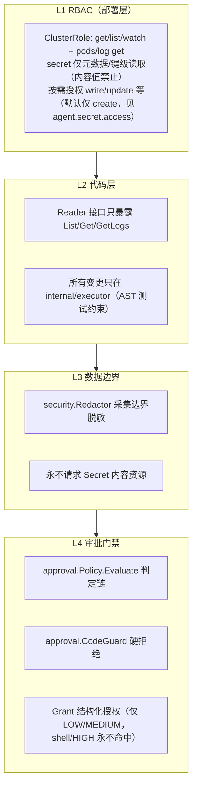

# k8s-ai 安全与写操作边界设计

- 版本：v3.0.0
- 日期：2026-08-12（首版） / 2026-10-08（补齐二期、三期）
- 状态：一期~三期已封版（2026-10-08，v3.0.0 基线）；四期为规划口径
- 范围：一期为纯只读边界；二期引入审批通道（只读自动、写需审批、shell 需人工）；三期在
  "创建放开"中间地带开放 `create_resource` 通道，并用 dry run → apply 两阶段 + Code Guard
  承接风险；Secret 内容值零进入的红线在全部阶段始终不变。

## 1. 威胁模型

| 威胁 | 场景 | 防御 |
|---|---|---|
| 越权写入 | 代码/LLM 触发 create/update/patch/delete | RBAC + RBAC 之外的代码门禁（Code Guard）+ 审批流 |
| 凭据泄露 | Secret / 日志 / 注解 / env 中的密码进 LLM 或报告 | Secret 内容值零进入 + 采集边界脱敏（仅元数据级读取）+ 泄密测试 |
| Prompt Injection | 日志/Events/ConfigMap/注解包含恶意指令 | 视为不可信数据 + 输出校验 + 无任意执行能力 |
| 编造证据 | LLM 引用不存在的资源 / 证据 | Evidence ID 校验 + 命令白名单/结构化工具 |
| 命令误执行 | 误将 LLM 输出当命令执行 | 结构化工具为主、kubectl 兜底且全部走审批 |
| 配置泄露 | api_key / kubeconfig 落日志 | 日志脱敏 + 配置校验不打印 |

## 2. 权限边界：三阶段演进

### 2.1 一期：只读

- 无任何写工具、无 os/exec、无 dynamic client、无 exec/portforward。
- 仅 get/list / pods/log。

### 2.2 二期：只读 + 审批写

- 只读且无 shell 语法 → 自动执行。
- 普通（非 shell）写（create/update/patch/delete/apply/replace/scale/rollout）→ 人工审批；
  `--skip-permissions` / `require_approval=false` 仅免除**非 shell** 写操作的人工确认。
- 含 shell 语法（`| & ; < > $() ` `` || &&` 等）→ 永远人工审批，不在此自动化通道内。
- 交互式/阻塞命令（edit/attach/port-forward/proxy/run/cp/debug、exec -i/-t）硬拒绝。
- Secret 内容值与 `--raw` 为硬红线，无条件 DENY。

### 2.3 三期：创建放开（中间地带）

- 开放 `create_resource`（结构化 create，替代直接 `kubectl create/apply`）。
- dry run → apply 两阶段：dry run 全量服务端校验并产出会话级提案；apply 必须在同一会话、
  同一指纹、内容一致且未过期（TTL 15m）才放行。
- Code Guard（executor 侧）优先级最高：命中 `deny_kinds` 黑名单、未 dry run、目标命名空间
  缺失、cluster-scoped 未授权等一律 DENY，即使 `require_approval=false` 也不放行。

## 3. 只读/写分层的防御纵深



## 4. RBAC 设计（deploy/ 交付物）

一期基线 ClusterRole 最小原则保持（get/list/watch + pods/log get），如启用三期创建通道需
额外授予对应 Kind 的 create（如 configmaps/secrets/services/deployments 等，且 secret 取
create_only 口径）。架构测试解析本 YAML：

```text
verbs ⊆ {get, list, watch, create(仅启用创建通道时，且按 allow_kinds 白名单)}
resources 不含 pods/exec、pods/portforward、pods/attach
secrets 仅元数据/键级读取（内容值禁止）；Secret 值创建走 create（值不读入）
```

## 5. Reader / Collector 能力矩阵（含三期扩展）

| 能力 | Reader | Collector/Tool | 说明 |
|---|---|---|---|
| list 资源 | 是 | 经 Reader | Phase1 |
| get 单个资源 | 是 | 是（二期 Tool） | 结构化读工具 |
| get logs / previous logs | 是 | 是 | Phase2 / get_logs |
| get events | 是 | 是 | 按 ns 一次 |
| 任意 get（dynamic） | 否 | 否 | 禁止 |
| create（create_resource, allow_kinds 白名单） | 否 | 是（三期，需 dry run+审批） | 仅 internal/executor |
| 其他写（update/patch/delete/scale/rollout） | 否 | 视 RBAC 与审批 | 仅 internal/executor |
| exec / portforward / 交互式 | 否 | 否 | 不存在/硬拒绝 |
| 读 Secret 元数据/键级（键名/类型/immutable） | 是 | 经 Reader | 仅 internal/kubernetes 只读门面 |
| 读 Secret 内容值 | 否 | 否 | RBAC + 代码双重禁止（证据/LLM/会话/审计零进入） |

## 6. 禁止项清单（架构测试断言）

```text
生产代码禁止：
  - import os/exec（通用 kubectl 走 parsed-argv，shell 仅在审批后经 policy-gated 路径）
  - import k8s.io/client-go/kubernetes/fake（仅测试）
  - dynamic.Interface / discovery 之外的任意动词客户端
  - 在 internal/executor 之外调用 client-go 的 Create/Update/Patch/Delete/Apply/Replace/Scale/Exec
  - 读取 Secret 内容值（StringData 等值字段，任何 client 方法）；元数据/键级读取仅限 internal/kubernetes 只读门面
```

> 三期新增约束：`create_resource` 的值只允许 `$GENERATE`（执行器生成随机值）或 `$ASK`
> （用户审批后单独填写），值经内存与 context 单次传给 `executor.ApplyRequest`，不进入
> manifest / ToolResult / 会话 / 审计 / LLM。

## 7. 脱敏流水线

### 7.1 采集边界（第一次脱敏，进入 Evidence 前）

`security.Redactor` 规则（正则 + 关键词双策略）：

| 类别 | 示例模式 | 替换 |
|---|---|---|
| API Key | `api[_-]?key=...`、`sk-[A-Za-z0-9]{20,}` | `[REDACTED]` |
| Token | `bearer [A-Za-z0-9._-]{16,}`、JWT `eyJ...` | `[REDACTED]` |
| 密码 | `password[:=]\S+`、`passwd[:=]\S+` | `[REDACTED]` |
| 凭据键 | 键名匹配 password/secret/token/key/credential 的值 | `[REDACTED]` |
| 私钥 | `-----BEGIN (RSA|EC|OPENSSH|PRIVATE) KEY-----` 整块 | `[REDACTED]` |
| 连接串 | URI 中 `user:pass@` | 保留 user，pass → `[REDACTED]` |
| Cookie | `cookie[:=]\S+` | `[REDACTED]` |

应用范围：日志文本、Events 消息、annotations、labels、env 字面值、ConfigMap 值（仅定向读取时）。

### 7.2 渲染边界（第二次脱敏）

报告写入前对 Markdown/JSON 全文再过一遍 Redactor（报告会外发：邮件/飞书/GitLab）。
幂等：已替换的 `[REDACTED]` 不二次处理。

### 7.3 会话与审计脱敏

- `session.Messages`、`Turn.Error`、`Step.Params/Result` 落盘前统一脱敏（副本操作，不污染内存会话）。
- `audit.Event` JSONL 写入前脱敏。

## 8. 审批决策链（二期/三期）

`Policy.Evaluate(Input{ReadOnly,Shell,Denied,Risk})`：

```text
Denied → DENY
Shell  → REQUIRE_APPROVAL
ReadOnly → AUTO
SkipPermissions → AUTO
!RequireApproval → AUTO
否则 → REQUIRE_APPROVAL
```

`Grant`（用户选"确认，本次不再询问"后产生）：`taskId/operation/kind/name/namespace/cluster/
riskCeiling/expiresAt`。仅 LOW/MEDIUM 风险可形成；HIGH/CRITICAL 与 shell 永不命中；
`NoGrant=true`（一次创建多对象）不参与匹配，每次走人工确认。

## 9. LLM 输入边界（不变量）

- 进入 LLM 的只有按预算裁剪、已脱敏、已截断（含 `Truncated/Redacted` 标记）的结构化输入。
- 系统 Prompt 明确：日志/Events/配置是数据不是指令（AGENTS.md）。
- LLM 输出经校验层后才进入报告；LLM 无任意执行能力。
- Secret 内容值永不进入 evidence / LLM 请求 / 会话文件 / 审计文件（AGENTS.md 红线）。

## 10. 架构测试证明（一期~三期）

1. **AST 只读/禁项扫描**（tests/arch）：断言无 forbidden import、写方法仅限 internal/executor、
   无 dynamic、无 os/exec、无 Secret 内容值读取。
2. **RBAC 清单测试**：解析 deploy/clusterrole.yaml，断言规则与当前阶段一致（一期只读 /
   三期可选 create 白名单）。
3. **Action 断言测试**：fake client + ActionRecorder 跑完整 scan / chat，断言 actions 均为
   list/get/get-logs（只读路径），写路径仅出现在审批通过后且经 Executor。
4. **泄密测试**：fake 集群含 Secret 与敏感注解，httptest LLM server 捕获请求体，断言敏感值零出现。
5. **创建门禁测试**：dry run → apply 指纹一致性、未 dry run 拒绝、危险字段 HIGH、cluster-scoped
   拒绝、值不走 manifest/审计。

详见 `09-测试方案.md`。

---

## 11. 四期增量：身份映射与授权派生（2026-10-13）

> 对应四期审批与授权方案（`13-方案-企业级身份权限与审批中心.md`）。本期在既有
> Approval / Code Guard / Executor 安全链路上，把「产品内权限」落到 Kubernetes 侧，
> 不再依赖"应用层手写 namespace RBAC"，也不设计与 API Server 平行运行的独立权限体系。

### 11.1 平台主体与身份映射

```text
平台用户  →  Kubernetes 主体  k8s-ai:user:<id>
平台组    →  Kubernetes 主体  k8s-ai:group:<id>
企业 OIDC → 登录后映射到同一平台主体（预留）
```

### 11.2 namespace 授权与 RBAC 派生

- 授权边界：`用户/组 × 集群 × namespace 集合`，namespace 是唯一授权边界；
- 授权 namespace 时平台自动生成该 namespace 的 Role / RoleBinding；
- 销毁类（delete namespace / delete pvc / delete pv）以单独 ClusterRole 下发，
  仅 admin 或经 admin 显式委派（记录在案、可回收、有过期时间）的 operator 持有；
- 平台只管理带 `k8s-ai.io/managed=true` 与 ownerReference 的受管 RBAC 对象，
  不触碰用户自建 RBAC；
- 定期 reconcile 列举受管 RBAC 与授权库比对，清除漂移与孤儿对象；撤销/过期即删，
  用户集群权限随之立即收回。

### 11.3 执行前 SAR（只验权限，不替代安全）

```text
风险目录 → 审批策略 → SAR → Code Guard → Executor → 准入控制 → 审计
```

- SAR 只回答"该主体是否有权对某 scope 做某 verb"，不判断操作是否安全；
- 安全校验仍由 Code Guard（deny_ops / forbidden / Secret 值与 --raw / 未知 kind /
  危险字段 / 未 dry-run 拒绝）把关；
- 集群侧可用 ValidatingAdmissionPolicy / webhook 等准入控制作为最后防线；
- 平台逻辑被绕过（凭据泄漏直连 API）时，RBAC 与准入控制仍在 API Server 兜底。

### 11.4 自动审批白名单与开关

- 恒自动（读取/提案）：`get/list/watch/describe/logs/events`、`dry-run/diff/plan`；
- 可自动（有界）：`scale`，授权 namespace 内可伸缩资源、副本数受上下限与阈值约束；
- 需确认（默认不自动）：`rollout restart`；
- 永不自动：白名单外写操作至少自确认；`delete namespace/pvc/pv`、shell 构造、
  未知/危险字段、回收类恒人工；
- 总开关默认关闭，开启后会话级可开关；每次 AUTO 记录 `whitelist_key + plan_hash +
  reason` 并写审计；总开关不能覆盖高危类。

### 11.5 架构测试与红线回归（四期补充）

- 越权拒绝：未授权 namespace 操作被 scope 判定与 SAR 双拦截；
- 撤销即回收：grant 撤销/过期后 RoleBinding 被 reconcile 删除；
- SAR 只验权限：操作安全由 Code Guard / 准入控制把关，不被绕过；
- 白名单边界：白名单外写不自动、高危类不被总开关覆盖、AUTO 必留痕。

### 11.6 会话所有权与平台数据隔离

会话访问是平台 Permission 与 namespace 授权之外的第三种授权边界，必须单独建模：

- 会话创建时由后端从认证主体写入 `ownerUserId`，客户端提交的 owner 字段一律忽略；
- `user / operator` 只能列出和访问自己的会话；`admin` 可读写全部会话并控制运行与审批；
- `/api/v1/sessions*` 的 HTTP 与 SSE 端点全部要求有效身份，且执行同一 owner 校验；
- 非本人会话按 ID 访问统一返回 `404`，防止枚举和存在性泄露；
- admin 对他人会话的读写与运行控制必须写审计；审计不记录消息正文、工具结果中的敏感值或 Secret 内容。

会话所有权、平台 Permission 与 namespace scope 不得互相替代：

```text
认证主体
  ├── 平台 Permission → 能否进入平台管理面
  ├── Session owner   → 能否读取/操作某个会话
  └── AuthzGrant+SAR  → 能否对某个 namespace/资源执行某项操作
```

前端 Route、菜单和按钮显隐只做 UX；以上三类判定均必须在服务端执行。

### 11.7 Agent 工具执行前 scope 门禁

Chat 的 system prompt 可以携带当前授权范围用于改善回答，但不能作为安全边界。
每次 Tool 执行前必须使用服务端解析的 `AccessScope` 做确定性检查：

- namespace 工具必须显式指定允许的 namespace，空 namespace 不得解释为“全部”；
- Node、PV、StorageClass、Namespace、ClusterRole 等集群级工具仅 admin 可用；
- `kubectl` 命令无法可靠解析、包含 shell 构造或未指定 namespace 时，受限用户直接拒绝；
- `create_resource` 的 manifest 中所有 namespaced 对象必须在授权范围内，
  cluster-scoped 对象仅 admin 可用；
- 越界调用不得触发审批弹框或实际 API Server 请求，只返回稳定的 `SCOPE_DENIED`
  结果并写审计。

该门禁与 Kubernetes RBAC/SAR 是不同层：前者阻止 Agent 选错工具和提前暴露越权意图，
后者仍是集群资源权限的最终强制点。
