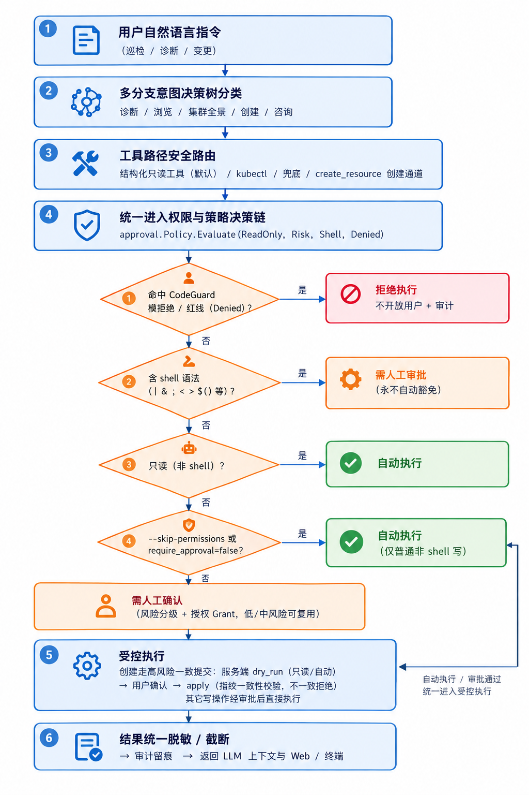

# Approval v2：Risk-based Approval / 减少审批疲劳（已落地）

- 版本：v3.0.0
- 日期：2026-10-08
- 状态：已封版（二期 Approval v2 / 三期 Secret 与资源创建门禁，v3.0.0 基线）

> 相关已落地能力：Phase B Tool Schema metadata、Phase C Code Guard shell 防护、
> Phase D Prompt 安全规则去重、三期 Code Guard 资源创建门禁与 `agent.secret.access=create_only`。
> 正文中保留的 CURRENT / TARGET / MIGRATION 标注用于记录设计论证过程，不代表当前仍未实现。

---

## 1. 当前 Approval v1 真实行为

以当前代码为准：

```text
internal/approval/risk.go       → Risk 五级 + kubectl 命令风险分类
internal/approval/policy.go     → Approval Policy：require_approval / skip_permissions / deny_ops / Secret/--raw 红线
internal/executor/kubectl.go    → 最终执行：deny_ops → forbidden → ParseCommandDetail → argv/shell 执行
internal/agent/loop.go          → Agent Loop 写操作审批入口
internal/service/chat.go        → chatApprover：skip/autoApprove 时直接返回 ChoiceYes
internal/session/session.go     → 会话级已授权/已拒绝写操作记录
internal/tools/write.go         → kubectl Tool：IsReadOnly / Risk 动态判断
```

当前判断链（现状，不含 v2 新组件）：

```text
Tool Call
    ↓
Tool.IsReadOnly / Tool.Risk
    ↓
Agent executeTool
    ├─ 非只读 → Approver.Confirm / 批量审批 / Session.Approved
    ├─ 只读   → 跳过审批
    ↓
Executor.RunKubectl
    ├─ deny_ops            → DENY
    ├─ Secret / --raw      → DENY（LLM 数据安全红线）
    ├─ ParseCommandDetail  → 交互式命令/未知动词/exec -i/-t → DENY
    └─ argv / bash -c      → 执行
```

当前 Risk 实际使用情况：

- `SAFE`：只读 get/describe/logs/events/top/explain/api-resources/version、rollout history/status、带 `--dry-run` 的已知写动词。
- `LOW`：枚举存在，但当前 kubectl classifier 基本不使用，设计上暂不启用。
- `MEDIUM`：scale/annotate/label/set/rollout（非 undo）、autoscale/expose/taint 等有限写操作。
- `HIGH`：patch/apply/create/exec/drain/cordon/uncordon/reconcile/certificate、rollout undo、delete 普通资源、shell 中 maxRisk 为 HIGH 的情况。
- `CRITICAL`：edit/attach/port-forward、delete deployment/statefulset/service/pvc/pv/storageclass/namespace/clusterrole/secret 等、无法可靠解析的未知命令、shell 中没看到 kubectl 的复杂注入。
- `Shell`：`approval.HasShellSyntax` 命中或 `sh -c / bash -c / eval` 等显式包装时，永不归类为只读。

当前 Approval v1 行为归纳：

```text
SAFE / READ ONLY
    → AUTO

WRITE（非 shell）
    → REQUIRE_APPROVAL

SHELL
    → 默认 REQUIRE_APPROVAL（当前 chatApprover 在 skip/autoApprove 时会返回 ChoiceYes，
       这是 v2 要修复的 shell 自动放行漏洞，不作为设计保留项）

Code Guard / forbidden / deny_ops / 不允许执行的命令
    → DENY
```

当前已经存在“本次会话不再询问”的能力：

- `Session.AddApproved(key)` 记录会话级授权。
- `Session.Declined(key)` 累计拒绝次数，同一写操作被拒 2 次后不再打扰用户，直接要求换方案。
- 当前是粗粒度 key：结构化工具用 `toolName:frozens JSON`，kubectl 命令用归一化后的 `verb/resource/name/-n namespace`。
- 这是 v2 `Authorization Grant` 的前身，但缺少精确 scope、TTL、cluster/context、task 绑定。

---

## 2. 为什么需要 strict / smart 两种模式

Approval v2 不该直接替换当前 Approval v1。

引入顶层配置：

```yaml
agent:
  approval_mode: strict
```

```text
strict
smart
```

默认必须是 `strict`。

原因：

- 现有用户、CLI、Web 的审批行为已经稳定，升级后不应无感改变。
- `smart` 是“减少重复审批”，不是“降低安全等级”，需要显式开启。
- 未来 `smart` 出问题或审计不满意时，用户可以通过配置直接退回 `strict`。

---

## 3. approval_mode 与 --skip-permissions / require_approval=false 的优先级

不能把 `approval_mode=smart` 当成新的“自动执行开关”。

优先级设计：

```text
                 Code Guard
                    ↓
              Shell Gate
                    ↓
       ┌────────────┴────────────┐
       │                         │
skip_permissions            normal flow
       │                         │
       ↓                         ↓
普通 WRITE 可跳过          approval_mode
                               ↓
                         strict / smart
                               ↓
                         Approval Policy
                               ↓
                         Authorization Grant
                               ↓
                          Executor
```

解释：

- `Code Guard` 永远最先/最后兜底：deny_ops、Secret/--raw、interactive、unknown verb、无法证明安全的 shell 都先 DENY。
- `Shell Gate` 在 skip_permissions 之前独立生效：无论 `skip_permissions` 还是 `require_approval=false`，Shell 都不能被放行；Shell 必须走审批或由 Code Guard 拒绝。
- `skip_permissions` 只作用于“普通 WRITE”：它可以跳过 approval_mode 层，让非 shell 写操作进入免审批流程；但它不新建职责，不绕过 Shell Gate 与 Code Guard。
- `normal flow` 才进入 `approval_mode`：`strict` 保持 v1；`smart` 只决定是否使用 Authorization Grant 减少重复审批。
- `approval_mode=smart` 不是自动执行开关：
  - MEDIUM 首次仍 REQUIRE_APPROVAL；
  - HIGH 首次仍 REQUIRE_APPROVAL；
  - CRITICAL 默认不复用；
  - 只有“已经授权且精确匹配”的 Grant 才可能让 MEDIUM 免重复审批。
- 最终顺序：Code Guard 否决权 > Shell Gate > skip_permissions 对普通 WRITE 的免审批 > approval_mode/strict/smart > Approval Policy > Authorization Grant > Executor。

## 4. strict 模式完整规则

strict 的目标是保留当前 Approval v1 行为：

```text
SAFE / READ ONLY
    → AUTO

WRITE
    → REQUIRE_APPROVAL

SHELL
    → REQUIRE_APPROVAL

Code Guard / forbidden / deny_ops / 不允许执行的命令
    → DENY
```

strict 模式明确：

- 不使用新的 Authorization Grant 自动放行逻辑。
- 不因为 Risk 是 MEDIUM/HIGH 而减少首次审批。
- 不开放 `LOW`。
- 任何写操作仍然经过人工审批。
- 任何 shell 仍然经过人工审批。
- Code Guard 始终有效，不能因为用户确认而绕过硬安全边界。
- 不要把 `DENY` 理解成“必须审批”；Code Guard 明确禁止的命令直接拒绝。

`strict + --skip-permissions / require_approval=false`（设计口径）：

- 对非 shell 写操作，`--skip-permissions` 的意义可以保留为“非交互自动化放行”。
- 对 shell 命令，任何配置都不能自动放行；Shell 必须保持人工审批边界。
- 当前 `chatApprover` 的 `skip/autoApprove` 会直接返回 `ChoiceYes`，这在 v2 Phase B/C 中被视为需要修正的边界，不纳入最终设计。

---

## 5. smart 模式才启用 Approval v2

smart 模式走：

```text
Tool Call
    ↓
Risk Classifier
    ↓
Approval Policy
    ↓
Authorization Context
    ↓
Code Guard
    ↓
Executor
```

目标不是降低安全等级，而是：

> 对风险明确、范围明确、用户已经授权过的操作减少重复审批。

smart 不改变：

- Risk 分类
- Code Guard
- Secret / --raw 红线
- deny_ops
- shell 永不自动执行
- CRITICAL 默认不自动复用

smart 只改变：

- 在 Approval Policy 与 Code Guard 之间增加 Authorization Context / Grant。
- 在满足精确匹配的条件下，允许已经授权的 MEDIUM（或极小范围 HIGH）操作跳过重复确认。

---

## 6. Risk / Approval / Grant / Code Guard 边界

必须严格分离四层语义：

```text
Risk
= 操作本身的风险等级

Approval Policy
= 当前上下文是否需要用户确认

Authorization Grant
= 用户之前授予的有限授权

Code Guard
= 最终执行安全边界
```

```text
Risk
    ↓
Approval Policy
    ↓
Authorization Grant
    ↓
Code Guard
    ↓
Executor
```

特别明确：

```text
CRITICAL ≠ DENY
```

CRITICAL 可能是：

```text
CRITICAL + REQUIRE_APPROVAL
```

也可能是：

```text
CRITICAL + DENY
```

例如 Code Guard 明确禁止的操作应该 `DENY`，而不是让用户确认后执行。

---

## 7. 统一 Approval Decision

最终统一为三个决策结果：

```text
AUTO
REQUIRE_APPROVAL
DENY
```

语义：

```text
AUTO
= 当前上下文可以直接执行

REQUIRE_APPROVAL
= 必须等待用户确认

DENY
= 无论用户是否确认都不能执行
```

Risk 不等同于 Approval Decision：

```text
Risk + Mode + Approval Policy + Authorization Context + Code Guard
                         ↓
                 ApprovalDecision
```

---

## 8. smart 模式默认矩阵

| Risk     | smart 默认行为              | 授权复用                              |
| -------- | --------------------------- | ------------------------------------- |
| SAFE     | AUTO                        | 不需要                                 |
| LOW      | 暂不启用                    | -                                     |
| MEDIUM   | REQUIRE_APPROVAL            | 允许受限 Grant 复用                     |
| HIGH     | REQUIRE_APPROVAL            | 仅非常严格的 task/resource/operation 范围 |
| CRITICAL | REQUIRE_APPROVAL 或 DENY    | 默认不复用                             |

重点：

```text
MEDIUM → 第一次
    ↓
REQUIRE_APPROVAL
    ↓
用户明确确认并授权
    ↓
后续完全匹配 Authorization Grant
    ↓
AUTO
```

不允许：

```text
MEDIUM → 第一次就自动执行
```

smart 的核心不是“低风险写操作全部自动执行”，而是：

> “用户已经明确授权的安全范围内操作，减少重复审批。”

---

## 9. LOW 为什么暂不启用

当前 `RiskLow` 枚举存在，但 kubectl classifier 实际基本不使用。

原因：

- kubectl 动词语义没有稳定的“LOW 写操作”分类。
- 强行启用 LOW 需要新规则，容易让模型误以为 LOW 表示“可以自动写”。
- v2 最小改动目标不包含扩大自动执行面。
- 未来如果有明确的低风险结构化操作，如幂等 retry、健康检查修复，再单独设计 LOW 启用条件。

结论：

```text
LOW 保持枚举存在，但当前不进入 Approval Policy，不映射到 AUTO。
```

---

## 10. Authorization Grant 精确匹配规则

Grant 不允许只绑定 `risk`，也不允许只绑定 `operation`。

至少需要包含：

```text
operation
resource kind
resource name
namespace
cluster/context
task/session
risk ceiling
scope
created_at
expires_at
```

匹配原则：

- 默认严格匹配，所有能确定的字段必须一致。
- `cluster/context` 不一致时不能复用。
- `namespace` 不一致时不能复用。
- `task/session` 不一致时默认不能复用；除非用户显式选择跨任务授权。
- `risk ceiling` 必须小于等于授权时的等级。
- `scope` 明确这段授权是 task/session/resource/operation 中的哪一种。
- `created_at / expires_at` 用于 TTL 上限，过期后必须重新审批。

### HIGH 授权必须 operation-specific

例如允许：

```text
scale + deployment/nginx + namespace=test + current task
```

不能因此自动允许：

```text
patch deployment/nginx
delete deployment/nginx
rollout undo deployment/nginx
scale deployment/redis
```

即：

> 不能因为用户允许过一个 HIGH 操作，就把其他 HIGH 操作一起放行。

### CRITICAL

默认：

```text
不跨 task 复用
不自动复用
```

除非未来明确设计持久授权，并且必须经过更严格的用户配置。

---

## 11. Shell 必须单独处理

保持当前 C 阶段安全边界，不得因为 smart mode 而削弱。

明确：

```text
任何 Shell
    → 不允许 AUTO
```

即使：

```bash
kubectl get pods | grep nginx
```

看起来是只读，也不能因为 Risk 最终较低而自动执行。

复杂 shell：

```bash
kubectl get pods | xargs kubectl delete pod
```

继续由 Code Guard / Risk Classifier 保守处理。

无法可靠解析的 shell：

```text
→ 不允许 AUTO
→ REQUIRE_APPROVAL 或 DENY
```

另外必须明确：

```text
--skip-permissions
require_approval=false
```

不能绕过 Shell 的人工审批要求。

也就是说：

```text
smart + skip-permissions
```

也不能把 Shell 直接 AUTO。

---

## 12. Code Guard 优先级

最终决策遵循：

```text
Risk
    ↓
Approval Policy
    ↓
Authorization Grant
    ↓
Code Guard
    ↓
Executor
```

但 Code Guard 是最终硬边界：

```text
用户确认
≠
允许绕过 Code Guard

Authorization Grant
≠
允许绕过 Code Guard

smart mode
≠
允许绕过 Code Guard

--skip-permissions
≠
允许绕过 Code Guard
```

任何：

```text
deny_ops
forbidden command
Secret / --raw 红线
interactive command
unsafe shell
parser 无法证明安全的情况
```

都必须服从 Code Guard 规则。

不要削弱 B/C 阶段已经完成的安全能力。

---

## 13. 什么时候 WRITE 可以 AUTO

写操作自动执行只允许在以下组合下发生：

```text
approval_mode=smart
+ Risk ∈ { MEDIUM, 极少数明确授权的 HIGH }
+ 第一次已经由用户明确确认
+ Authorization Grant 存在且 TTL 未过期
+ Grant 字段精确匹配
+ Approval Policy 允许
+ Code Guard 允许
+ 非 shell
```

更严格地说：

- SAFE 只读永远是 AUTO。
- MEDIUM 第一次不是 AUTO。
- MEDIUM 只有命中精确 Grant 才可能 AUTO。
- HIGH 几乎不自动；即使自动也只允许 operation-specific、task/resource/namespace 精确匹配，且必须由未来配置显式开启。
- CRITICAL 默认不自动。
- Shell 永远不自动。

---

## 14. 什么时候 WRITE 必须审批

必须审批：

```text
approval_mode=strict 下的任何非 SAFE 写操作

approval_mode=smart 下：
  MEDIUM / HIGH / CRITICAL 首次执行
  Shell
  无匹配 Grant
  Grant 过期
  Grant 字段不一致
  Approval Policy 要求本次确认
```

---

## 15. 什么时候必须 DENY

必须 DENY：

```text
Code Guard 判定：
  deny_ops 命中
  Secret 资源 / --raw 红线
  edit / attach / port-forward / proxy / run / cp / debug
  exec -i / -t
  未知 verb（不允许执行的命令）
  shell 中解析或扫描发现禁止动词
  parser 无法证明安全的保守拒绝
```

DENY 不进入用户确认；用户确认不能把 DENY 改成执行。

---

## 16. 迁移路线

### Phase A：只增加测试、审计、decision 观测

- 保持当前行为完全不变。
- 记录 `risk / readonly / shell / approval_mode / existing_grant / decision`。
- 增加 bypass 场景测试，形成安全基线。
- 不改执行行为。

### Phase B：引入 ApprovalPolicy，默认 strict

- 新增 `ApprovalPolicy` 抽象，但 `approval_mode=strict` 时严格保持当前 v1 行为。
- 修正 `chatApprover skip/autoApprove` 对 shell 直接返回 ChoiceYes 的路径，保证 shell 始终要求人工审批。
- 保持 Risk Classifier / Code Guard 不变。
- 增加 strict 兼容测试。

### Phase C：实现 approval_mode=smart 第一版

- 第一版仍然：
  - `SAFE → AUTO`
  - `MEDIUM/HIGH → 首次 REQUIRE_APPROVAL`
  - `CRITICAL → REQUIRE_APPROVAL / DENY`
  - `SHELL → REQUIRE_APPROVAL`
- 暂不开放 Grant 自动放行。
- 只增加 decision 审计与观测。

### Phase D：增加 Authorization Grant

- 增加 task / resource / operation / TTL / scope 授权。
- 仅对明确授权的 MEDIUM 减少重复审批。
- HIGH 必须 operation-specific。
- CRITICAL 默认不跨 task 复用。
- 每一步都可独立测试、独立 Git commit。

---

## 17. 15 个必须回答的问题

1. 为什么需要 `strict / smart` 两种模式？
   - strict 保持当前 v1 兼容；smart 是显式开启的 v2 授权减少重复审批能力。

2. 默认为什么必须是 `strict`？
   - 保证升级后现有用户行为不发生变化，安全边界不因新设计被静默放开。

3. strict 如何保证完全兼容当前 v1？
   - strict 走当前 SAFE→AUTO、WRITE/SHELL→REQUIRE_APPROVAL、Code Guard→DENY 的路径，不启用 Authorization Grant。

4. smart 到底改变了什么？
   - 只改变“已经明确授权的精准范围是否减少重复审批”，不改变 Risk、Code Guard、Shell、CRITICAL 策略。

5. Risk 与 Approval Policy 如何分离？
   - Risk 是操作危险度，Approval Policy 是上下文是否要确认，Authorization Grant 是用户已经授予的有限授权，Code Guard 是最终执行硬边界。

6. 为什么 LOW 暂不启用？
   - 当前 kubectl 分类器基本不使用 LOW，且启用 LOW 会扩大自动执行语义，违背最小改动原则。

7. 什么情况下 WRITE 可以 AUTO？
   - 仅 smart + 非 shell + 已有精确且未过期的 Authorization Grant + Approval Policy 与 Code Guard 全部放行。

8. 什么情况下 WRITE 必须审批？
   - strict 下任何非 SAFE 写操作；smart 下首次 MEDIUM/HIGH/CRITICAL、Shell、无匹配 Grant、Grant 过期或字段不一致。

9. 什么情况下必须 DENY？
   - Code Guard 拒绝项：deny_ops、Secret/--raw、交互命令、未知 verb、无法证明安全的 shell。

10. Authorization Grant 的精确匹配规则是什么？
    - operation / resource kind / resource name / namespace / cluster/context / task/session / risk ceiling / scope / created_at / expires_at 必须一致。

11. HIGH 授权为什么不能泛化到其他 HIGH 操作？
    - HIGH 破坏面大；允许过一个 HIGH 不等于允许其他 HIGH，否则用户一次授权会变成整类操作放行。

12. CRITICAL 为什么默认不复用？
    - CRITICAL 接近不可逆或高爆炸半径；默认必须逐次确认，持久授权需要未来更严格的用户配置。

13. Shell 为什么不能被 smart mode 或 `--skip-permissions` 自动放行？
    - shell 可以组合任意命令、重定向、base64/编码、多层包装，无法仅凭表面 risk 证明安全；必须保留人工审批或 Code Guard 拒绝。

14. Code Guard 为什么始终拥有最终否决权？
    - 因为用户确认、授权、smart 都只能表达“执行意图”，不能证明“命令在安全边界内”；只有代码最终判断 deny_ops、红线、解析器安全。

15. 如何保证 smart mode 出问题时可以通过配置直接退回 strict？
    - 顶层 `agent.approval_mode: strict` 是默认兼容模式；smart 的所有能力都挂在同一个策略接口上，不引入独立执行通道，配置改成 strict 即回到 v1 行为。

---

## 18. 最终目标架构



上图串联了自然语言指令解析、多分支意图路由、工具路径选择、统一
`approval.Policy.Evaluate` 权限决策、受控执行与结果脱敏审计。图中第 5 步的
`create_resource` 创建操作采用 `dry_run → 用户确认 → apply` 两阶段协议，
并在提交前校验资源指纹一致性；其它写操作在审批通过后直接进入执行器。

```text
                    ┌──────────────┐
                    │ approval_mode│
                    └──────┬───────┘
                           │
                 ┌─────────┴─────────┐
                 │                   │
              strict               smart
                 │                   │
                 │             Risk Classifier
                 │                   │
                 │             Approval Policy
                 │                   │
                 │          Authorization Context
                 │                   │
                 └─────────┬─────────┘
                           ↓
                      Code Guard
                           ↓
                        Executor
```

核心原则：

```text
strict = 当前行为兼容模式
smart  = 新 Approval v2

两种模式都必须经过 Code Guard。
```

---

## 19. CURRENT → TARGET → MIGRATION

### CURRENT

```text
SAFE / READ ONLY
    → AUTO

WRITE
    → REQUIRE_APPROVAL

SHELL
    → 默认 REQUIRE_APPROVAL，但 skip/autoApprove 路径存在 shell 自动放行漏洞

Code Guard
    → deny_ops / Secret / --raw / interactive / unknown verb → DENY
```

### TARGET

```text
approval_mode=strict → 完全兼容 CURRENT（并修复 shell 自动放行漏洞）
approval_mode=smart  → Risk Classifier → Approval Policy → Authorization Context → Code Guard → Executor
skip_permissions     → 仅影响普通 WRITE；Shell Gate 永不绕过；Code Guard 永不绕过

SAFE       → AUTO
LOW        → 暂不启用
MEDIUM     → 首次 REQUIRE_APPROVAL；精确 Grant 后可 AUTO
HIGH       → 首次 REQUIRE_APPROVAL；仅 operation-specific 极窄 Grant 可 AUTO
CRITICAL   → REQUIRE_APPROVAL 或 DENY；默认不复用
SHELL      → 永不 AUTO
Code Guard → 最终否决权，任何授权都不能绕过
```

### MIGRATION

- Phase A：只加测试/审计/decision 观测，行为不变。
- Phase B：引入 ApprovalPolicy，默认 strict，修复 shell skip/autoApprove 路径。
- Phase C：实现 smart 第一版，仍无 Grant 自动放行。
- Phase D：增加 Authorization Grant / TTL / scope / task / resource / operation 授权。

---

## 20. 决策结论（已确认）

1. `agent.approval_mode`，默认 `strict`；兼容旧 `require_approval / skip_permissions`。
2. **YES**：Shell 永远不能被 `skip_permissions / require_approval=false` 绕过。
3. **YES**：Phase C 只观测，不开放 Grant AUTO。
4. **YES**：MEDIUM Grant 默认绑定 `task + namespace + operation + kind + name`。
5. 允许架构支持 HIGH Grant，但 Phase D 第一版 HIGH 仍默认 `REQUIRE_APPROVAL`。
6. CRITICAL 默认不跨 task；第一版不开放持久复用；未来保留管理员策略扩展空间。
7. 升级为结构化 `AuthorizationGrant`；旧 `ApprovedWrites` key 仅做兼容迁移。
8. 必须审计 `grant_id + match_reason + decision`。

以上决策已纳入 Approval v2 设计基线。实现阶段再细化：Grant 持久化格式、审计 JSON schema、配置兼容迁移。

---

## 21. 四期增量：审批与授权方案修订（2026-10-13）

> 本增量对应用户在四期讨论中的意见与架构评审结论，权威口详见
> `13-方案-企业级身份权限与审批中心.md`。四期代码按本增量实现，但不推翻三期
> Approval v2 既有链路，冲突口径以本增量与 13 号方案为准。

### 21.1 审批主体：只有本人自确认或子 agent 自动

- 会话内"自确认"与当前版本"会话用户确认"复用三期同一交互通道（`Approver.Confirm` +
  WebUI `/api/sessions/{id}/approve` pending 通道），四期不另造确认层；
- 引入独立**审批子 agent（Approval Agent）**承担自动审批，作为唯一接管自动审批路径
  的执行主体；自动路径的决策主体是非人类，落 `decided_by=approval-agent` 与 AUTO 记录；
- 废弃"交互聊天中选择 operator/admin 作为他人审批人"的模型，任何情况下不能审批自己的
  请求；审批人必须持有对应 scope 的 `approval.execute` 且不能是请求发起人
  （修正原 P4.8"非 admin 不能执行审批"口径，会话内操作者自确认是其自身操作不受该约束）；
- 定时任务 / CI / MCP 等无人在线的执行面由审批中心统一定义决策主体。

### 21.2 自动审批白名单（显式枚举，不依赖"可逆"）

- 恒自动（读取/提案）：`get/list/watch/describe/logs/events`、`dry-run/diff/plan`；
- 可自动（有界）：`scale`，仅授权 namespace 内可伸缩资源，副本数受上下限与单次变动
  阈值约束；
- 需确认（默认不自动）：`rollout restart`（可能引发雪崩）；
- 永不自动：白名单外写操作至少自确认；`delete namespace/pvc/pv`、shell 构造、
  未知/危险字段、回收类（GC/reclaim）、无法可靠解析的命令恒人工；
- 自动审批总开关默认关闭，开启后会话级可开关；每次 AUTO 放行必须写审批中心记录并
  落审计，白名单/总开关决策以 `whitelist_key + plan_hash + reason` 留痕；
- 总开关不能覆盖高危类。

### 21.3 Grant 平台化与 RBAC 派生

- 平台新增 `AuthzGrant` 模型（`user/group × cluster × namespace 集合`），并将既有
  `AuthorizationGrant` 的应用层存储迁移至平台授权库；
- Grant 字段新增/调整：`scope / expiresAt / planHash / policyVersion`，为后续
  `approval.execute` scope 判定与对账提供依据；
- Kubernetes RBAC 为派生结果：授权 namespace 时平台自动生成受管 Role/RoleBinding，
  `k8s-ai:user:<id>` / `k8s-ai:group:<id>` 作为主体；受管对象带 `k8s-ai.io/managed=true`
  与 ownerReference，平台不触碰用户自建 RBAC；
- 定期 reconcile 列举受管 RBAC 与授权库比对，清除漂移与孤儿对象；撤销/过期即删；
- 执行前 SubjectAccessReview 只验权限，不判断操作安全；操作安全仍由 Code Guard +
  准入控制把关（完整序列：风险目录 → 审批策略 → SAR → Code Guard → Executor →
  准入控制 → 审计）。

### 21.4 与三期兼容及代码落点

- 会话内自确认、审批推送、pending 通道保持三期实现，仅接入新的决策层；
- `internal/store` Approval 增加 21.3 字段与迁移（schemaVersion 提升）；
- `internal/approval` 引入 approval-agent 作为 auto_approval 决策执行体；
- `internal/agent` 保留主 Agent 单循环，审批决策收敛到中心与 Approval Agent（详见
  `10-方案-Agent总体架构.md` 的多 Agent 扩展口）；
- 写入路径仍只在 `internal/executor`，架构测试持续守护。
