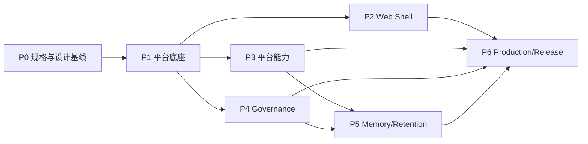

# k8s-ai 四期开发计划：平台化升级（Platform）

- 版本：v1.20
- 日期：2026-10-15
- 状态：执行中（**P2 Web Shell 已完成，M2 出口达成**；新前端 Chat 问题修复与"历史视图同构"已完成并实测通过，见 §10；下一步进入 M3 的 P3.1，再排 P6 部署）
- 需求输入：[四期需求规格（平台化）v1.4](../../01-产品与需求/03-需求文档-PRD-四期-平台化.md)、AGENTS.md、三期设计文档与代码现状
- 编号说明：本计划主线用 **P0–P6** 表示，任务编号为 `P0.1`、`P1.1` 等。P0 是规格与设计基线，P1/P2 是平台底座与 Web Shell，P3/P4 是平台能力与治理，P5/P6 是 Memory/Retention 与生产准出。任务状态表格可用于内部汇报在线表格逐格映射。
- 目标版本线：v4.0（平台底座 + Web Shell + 平台能力）、v4.1（治理能力）、v4.2（Memory/Retention），最终发布按 v1.3 §31 版本规划执行。

## 修订记录

| 版本 | 日期 | 修订人 | 说明 |
| --- | --- | --- | --- |
| v1.0 | 2026-09-30 | | 初版：基于四期需求 v1.2 拆分 P0–P6，71 条任务，估 57.50 人日（串行口径） |
| v1.1 | 2026-09-30 | | P2 补充会话 Token 用量持久化与展示任务；任务数 72，估 58.00 人日 |
| v1.2 | 2026-10-08 | | 开始四期代码落地：P1.2 Store 接口与 SQLite 驱动完成（含统一 migration 与 CRUD 单测）；后续每完成一个小阶段同步回写状态 |
| v1.3 | 2026-10-08 | | P1.1 Vite+Vue3+TS 工程骨架完成（web/ 工程、src 骨架、7 个侧栏路由入口与登录路由；`npm run lint`/`typecheck`/`build` 通过） |
| v1.4 | 2026-10-08 | | P2.1 信息架构调整：侧栏按 工作区/治理/平台管理 三组分栏；Admin 不再作为侧栏一级菜单，当前用户信息与「管理控制台」移入右上角 User Menu |
| v1.5 | 2026-10-08 | | P1.3 MySQL 驱动与统一迁移完成：抽出共享 `dbStore` + dialect 方言层（SQLite/MySQL 共用 schema 与 CRUD），新增 `OpenMySQL(dsn)`、迁移入口统一与两驱动等价测试；MySQL 集成用例由 `K8S_AI_TEST_MYSQL_DSN` 环境变量启用 |
| v1.6 | 2026-10-08 | | P1.4 HTTP 基础中间件完成：request_id 生成/透传（X-Request-ID）、统一响应信封（request_id/timestamp/data/error/pagination）、分页解析（page/page_size，兼容 pageSize）、CORS（默认放行 localhost:5173）、认证占位（Bearer/Cookie，仅注入上下文不拒请求）；含中间件与信封单测 |
| v1.7 | 2026-10-08 | | P1.5 用户/角色模型与登录认证完成：argon2id 密码哈希、内存 Session Token（24h）、`/api/v1/auth/login|logout|me`、server 命令 SQLite 首次引导（`K8S_AI_ADMIN_PASSWORD` 初始化 admin 角色与用户）；含认证服务与 handler 单测，全量门禁通过 |
| v1.8 | 2026-10-08 | | P1.6 Permission Middleware 完成：新增 `internal/permission`（Role→Permission→Policy 判定，通配与路由匹配）与 `internal/server` 权限门禁（API 未登录 401、越权 403、`/api/v1` 未登记路由默认 403）；默认角色权限对齐标准 Permission 常量，越权中间件门禁测试通过，全量门禁通过 |
| v1.9 | 2026-10-08 | | P1.7 Session/Turn/Step 模型与存储完成：`internal/session/turn.go` 状态机（Turn 6 态/Step 4 态 + token 用量），Store 增加 `Turns()`/`Steps()` 与 `TurnStore`/`StepStore`（Create/Get/Update/ListBySession|ListByTurn/Delete），schemaVersion 提升到 2（`turns`/`steps` 表与索引），写前脱敏与可空时间字段落地；含状态机与双方言 CRUD 单测，全量门禁通过 |
| v1.10 | 2026-10-10 | | P1.8 Agent Runtime 生命周期接入完成：Agent 每 Turn 经 `Tracer` 落库 Session/Turn/Step，覆盖 Reason/Tool/Observe/Approval/Response 埋点与 Turn 终态推进；`internal/service` Chat 接入 SQLite Session 快照（落库失败仅告警不阻塞 Agent，兼容旧 `NewChat` 签名）；含 Agent 生命周期时序与持久化断言单测，全量门禁通过 |
| v1.11 | 2026-10-11 | | P1.10 Config Service 完成：新增 `internal/settings`（§15 分组目录 model/skill/approval/memory/retention/mcp/ops，键定义含类型/默认值/枚举/范围/敏感标记与三期 config 路径映射）、`GET|PATCH /api/v1/settings/{group}`（PATCH 先整批校验再落库，任一非法整批拒绝；变更写 CONFIG_CHANGE 审计，载荷只含分组与键名）、`ImportConfig` 旧配置导入（等同默认值不入库）；敏感键 `model.api_key`/`ops.kubeconfig`/`mcp.servers` 只写不读，读视图恒回 `value:null` + `hasValue`；权限登记 `settings.read`/`settings.write`；`cli server` 改用 `server.NewWithPlatform` 装配配置中心与 `service.AuditService`（此前配置端点在真实进程不可达）；含服务层与 API 红线单测，全量门禁通过。同批落地 P1.11 主体（§19 审计字段与事件类型枚举、schemaVersion 3 补列与历史回填、LOGIN/LOGOUT/CONFIG_CHANGE/TOOL_CALL/SKILL_RUN 落库与写前脱敏），CLUSTER_CHANGE 写入随 P3.2 集群管理 API 落地，P1.11 记为进行中 |
| v1.12 | 2026-10-13 | | 审批与授权方案推翻重组（见 `docs/02-架构与设计/13-方案-企业级身份权限与审批中心.md`）：产品角色收敛为 user/operator/admin 三角色（废弃 viewer）；授权边界改为“namespace 即边界”，用户零权限起步、admin 划分 namespace；销毁类（delete namespace/pvc/pv）仅 admin，未授权操作确定性拒绝并提示联系管理员、不建审批申请、不阻塞等待；审批主体只有本人自确认或审批子 agent（Approval Agent）自动，废弃“他人选择审批人”模型并修正原 P4.8；自动审批采用显式白名单（默认关闭 + 会话开关 + scope 判定），白名单外写操作一律至少自确认、高危类永不自动；新增 AuthzGrant 模型/RBAC 派生与对账/执行前 SAR；平台演进为多 Agent 编排架构并预注册 agent 注册表；任务数 73（新增 P4.10），预估 59.00 人日 |
| v1.13 | 2026-10-13 | | P2.3 API Client 与分页类型完成：新增 `web/src/api`（`types.ts` 统一信封/分页/认证契约与后端 `internal/server/response.go`、`auth.go` 一一对应；`request.ts` 基于 fetch 的 `/api/v1` 客户端，统一 Bearer 认证头、`page`/`page_size` 分页序列化、信封解析、错误码归一，401 清除会话并跳登录；`auth.ts` 认证端点客户端），`stores/auth.ts` 接入真实 `/api/v1/auth/login|logout|me`（启动用 `/me` 恢复会话并校正角色，`LoginView` 显性展示统一错误）；`npm run lint` / `typecheck` / `build` 通过。同批回写状态：P1.11（CLUSTER_CHANGE 随 P3.2 落地）、P1.12、P1.13 已完成，P2.1、P2.2 已完成 |
| v1.14 | 2026-10-13 | | P2.4 会话列表与历史会话加载完成：新增 `web/src/api/sessions.ts`（webui `/api/sessions` 端点客户端，`SessionSummary`/`SessionDetail` 对齐后端 SessionStore，裸对象/数组非 `/api/v1` 信封单独封装）、`web/src/utils/format.ts`（相对时间与 Agent 状态徽标映射）、`web/src/components/chat/ConversationList.vue`（新建/选择/删除/重命名/刷新，展示 messageCount、lastModified、state）、`ChatView.vue` 两栏布局接入真实会话端点并可切换历史会话；`npm run lint` / `typecheck` / `build` 通过 |
| v1.15 | 2026-10-13 | | P2.5 SSE Client 与事件归一完成：新增 `web/src/api/sse.ts`（fetch 式 SSE 传输 + 帧解析 + 历史快照判别 + 三期旧 ChatEvent → 统一 AgentEvent 映射，与后端 `internal/sse/legacy.go` 同源）、`web/src/composables/useChatStream.ts`（会话级连接生命周期：切换会话中止旧连接、断线指数退避重连、历史快照为断点重建并清空实时事件去重）、`sessions.ts` 补全 send-message/approve/cancel 端点客户端，`ChatView.vue` 接入 SSE 流（连接状态徽标 + 重连控制 + 历史消息/归一事件流展示）；`npm run lint` / `typecheck` / `build` 通过 |
| v1.16 | 2026-10-14 | | P2.6 MessageTimeline 与消息流展示完成：新增 `web/src/components/chat/MessageTimeline.vue`（历史快照与实时 SSE 归一事件统一时间线；message.delta 按 turn+role 聚合成单个消息块、message.completed 以事件携带全文收敛并标记完成，状态完全由事件驱动不猜状态；旧事件仅在该 role 尚无 turn 级块时兜底，避免 legacy 全文与 stream 增量重复累加；工具/审批/回合等事件逐条展示，Summary 只取非敏感字段、Secret 值永不进时间线；新增消息自动滚动到底部），`ChatView.vue` 移除内联 timeline 逻辑改为组件化渲染；`npm run lint` / `typecheck` / `build` 通过 |
| v1.17 | 2026-10-14 | | 部署与交付口径修订（不涉及代码，D-12 改写、新增 D-19/D-20、新增 ADR-029/ADR-030）：Kubernetes 为四期唯一生产形态，单进程 `nohup` 跑法降为三期兼容与本地开发调试口径；四期平台主进程 = `k8s-ai server`（`/api/v1` + Chat SSE + 内嵌 `web/dist` SPA 同源单端口），`k8s-ai web` 与 `internal/webui` 冻结为三期封版兼容入口；新增平台进程默认单副本约束与扩副本前置条件；补齐此前无人认领的前端静态资源交付通道（新增 P6.11）。P6.1/P6.2 交付物与准出口径同步，任务数 74、预估 59.50 人日。**部署架构尚未进入开发阶段**：当前顺序为先完善新前端（Chat 渲染/流式稳定性）问题 → 再做 P2 剩余任务 → P3/P4/P5 → P6 部署与准出 |
| v1.18 | 2026-10-14 | | 新前端 Chat 问题修复落地 + 两条契约/配置面方案定稿（新增 D-21/D-22、ADR-031/ADR-032、P6.12）。① 修复：报告塌成纯文本（DOMPurify 误用 `USE_PROFILES:{html:false}` 及被掩盖的代码块包装 `replaceWith` 顺序 BUG）、一个回合渲染出 3 块重复报告（分片 index 参与展示 key）、永久"正在生成…"（终态事件早于末段正文）、刷新后不订阅 SSE（`watch` 缺 `immediate`）、思考正文全丢（`reason.started` 晚于 reasoning 增量）；后端补契约测试 `TestChatServiceEventOrdering`。② 方案：ADR-031 定平台配置面（`platform:` 段 + 全量 `config init` 模板 + 敏感值只走环境变量）、ADR-032 定 SSE 展示与顺序契约（分片不等于展示单元、终态必须最后、增量统一脱敏、思考面板语义），并把前端契约测试写入 P2.12 交付物。任务数 75、预估 61.00 人日；`platform` 段与全量模板尚未实现（P6.12） |
| v1.19 | 2026-10-15 | | 新增 §10「已完成修复与优化记录」，把本阶段实际完成的 9 项 Chat 修复、历史视图同构、测试基建落盘为可追溯清单。补齐 ADR-032 第 5 条契约「历史视图与实时视图同构」：思考改为按「每轮 LLM 调用一条消息」就地落库（`persistRoundReasoning`），删除整轮汇总后插到报告前的 `persistReasoning`，刷新后保持「思考→工具→观察→思考→报告」；新增 `TestChatServicePersistsReasoningInRoundOrder` 与前端历史顺序用例，前端契约用例累计 8 条。真模型端到端实测通过。§10.5 同时登记 P2.4/P2.5/P2.6 历史会话前端能力（已完成）；任务数与预估不变（75 条 / 61.00 人日） |
| v1.20 | 2026-10-15 | | **P2 Web Shell 收尾（P2.7–P2.13 全部完成，M2 出口达成）**，与 v1.18/v1.19 的 Chat 修复/契约成果合并入库：P2.7 AgentStep 卡片（AgentStepper/TurnBlock/ReasoningPanel + 回合内用户诉求回显；思考框推理中自动展开、推理结束折叠为摘要且用户手动开合优先）+ P2.8 ToolCallCard（工具名/命令摘要/风险/耗时/复制 + 表格·KV·事件·YAML·日志·原始 JSON 结构化渲染，结果即时展开并保持、无 `[object Object]`；新增 `maskSensitiveValues` 兜底遮蔽，Secret 值在结构化视图与原始 JSON 都不回显）+ P2.9 ApprovalCard（风险/Tool/参数摘要/资源/命中策略 + 批准·拒绝·Secret 占位输入；新增 `web/src/utils/permission.ts` 与后端 `internal/permission` 同语义的角色权限口径，只读角色隐藏审批按钮，后端仍独立强校验）+ P2.10 ComposerBox（Enter 发送/Shift+Enter 换行、运行中切换停止并回传 cancel、模型与 Secret 策略提示、每轮执行状态重置）+ P2.11 三期 Chat 行为回归 + P2.12 前端测试门禁（vitest/@vue/test-utils/jsdom/tsconfig.vitest；含 v1.18/v1.19 的 MessageTimeline 聚合与 MarkdownView 渲染契约用例，合计 14 个测试文件；`npm run test`/`lint`/`typecheck`/`build` 全绿）+ P2.13 会话 Token 用量持久化与展示（`TurnStore.SumTokensBySession` + `service.SessionTokenizer` 可选能力 + webui 下发 token/model；`k8s-ai web --db` 装配 SQLite Store；TokenUsageBadge 改为右下角会话级统计，刷新/重开仍可读、未持久化时隐藏而非显示 0）。同批按原型逐项对齐视觉（设计令牌与 `prototype/index.html` 同源、`html.dark` 覆盖修正 Element Plus 回落默认蓝；新增 `web/tools/mock-backend.mjs` 与 `web/tools/visual-check.mjs`，18 项关键视觉量差异 0）；`go test ./...`/`go vet ./...` 全绿。任务数与预估不变（75 条 / 61.00 人日） |

---

## 1. 范围与非目标

**范围内**

- Vue 3 + TypeScript + Vite SPA，Web 入口平台化；
- `/api/v1` API Contract、`request_id`、统一错误/分页；
- Store 抽象 + SQLite/MySQL 双驱动 + 统一 migration；
- 产品内用户与角色：user / operator / admin 三角色（废弃 viewer）；授权以 namespace 为唯一边界，用户零权限起步、admin 划分 namespace；权限只作用于 Web/API，不进入 CLI；
- Session / Turn / Step / SSE 事件模型，并兼容三期 WebChat 旧事件；
- 单集群管理、kubeconfig 上传/粘贴/校验/安全存储；
- Skill 平台：内置 Skill 完整支持、custom YAML 导入、third-party Loader/Validation Contract 预留；
- 配置中心：模型 / Skill / Approval / Memory / Retention / MCP 展示位 / 运维；
- Approval v2 平台化：审批中心、策略可视化、Authorization Grant、审批审计；
- Audit 中心：登录、Session、Tool Call、Approval、Grant、写操作、配置、Skill、集群；
- Memory：Session Summary、长期记忆、作用域、策略；
- Retention：Session / Audit / Scan / Skill Run / Memory / Config History / Credential 的清理与归档；
- 单进程部署、K8s Deployment 部署、一键安装脚本；
- 四期写执行决策：镜像内写执行统一走 client-go（推荐，待签收），不因平台化新增 shell 写通道；
- 三期资源创建、SSA、Approval、Code Guard、Executor 能力继续复用。

**非目标（本计划不做）**

- CLI 登录 / CLI 用户体系 / CLI RBAC；
- 多集群 Web UI；
- MCP 真实接入；
- Redis；
- 多租户 / 组织管理 / 复杂 IAM / Skill 在线市场 / Skill 远程仓库完整实现；
- 应用层手写 namespace RBAC（如手动编辑 RoleBinding / ClusterRole）：真实资源权限由平台 AuthzGrant 派生、下行到 Kubernetes RBAC 并在 API Server 强校验，不设计与应用库平行运行的独立权限体系；也不做多租户/组织管理/复杂 IAM；
- 为 Deployment、StatefulSet、Service 等逐资源新增大量写 Tool；
- 把旧 HTML 直接拆成 Vue 文件的“低质量迁移”作为主方案。

---

## 2. 决策基线

| 编号 | 决策 | 结论 | 状态 |
| --- | --- | --- | --- |
| D-01 | 前端技术栈 | Vite + Vue 3 + TypeScript + Vue Router + Pinia + Element Plus | 已定 |
| D-02 | Web 集群范围 | 单集群接入，数据模型预留 `cluster_id`，UI 不做多集群 | 已定 |
| D-03 | API 形态 | 统一 `/api/v1`，Chat 走 SSE；CLI 直接调用 Application Service，不走 HTTP | 已定 |
| D-04 | Store 后端 | SQLite 默认 + MySQL 可选；业务层仅依赖 Store 接口；共用统一 schema 与 migration | 已定 |
| D-05 | 产品内身份 | Web/API 有产品内用户体系；CLI 不进入该用户体系 | 已定 |
| D-06 | 镜像写执行 | 推荐镜像内写执行统一走 client-go（与三期 `create_resource` 一致）；kubectl 受控通道仅保留给显式配置 `kubectl_path` 的非容器场景 | 推荐值待签收 |
| D-07 | Skill 定位 | Skill 是方法论/校验/风险约束，不是执行器；所有写操作必须走 Tool → Approval → Code Guard → Executor | 已定 |
| D-08 | SSE 兼容 | 四期 Event Catalog 与三期旧事件兼容，迁移期提供事件映射层，未完成映射不得移除旧事件 | 已定 |
| D-09 | 用户角色 | 三角色 user / operator / admin（废弃 viewer）；授权以 namespace 为唯一边界，用户零权限起步、admin 划分 namespace；销毁类（delete namespace/pvc/pv）仅 admin，operator 销毁能力由 admin 显式委派；审批与角色解耦，审批主体只有本人自确认或审批子 agent（Approval Agent）自动 | 已覆盖：见 D-16 / D-17 / D-18 |
| D-10 | Memory/Retention | 四期真实实现 Session Summary、长期记忆、保留策略与调度器，不是假开关 | 已定 |
| D-11 | MCP | 保留配置页面与接口展示位，真实接入不入本计划 | 已定 |
| D-12 | 部署 | Kubernetes Deployment 为四期唯一生产形态；单进程二进制运行降为三期兼容与本地开发调试口径（不再作为四期生产部署目标）；默认只读 RBAC，写权限显式开启；见 ADR-029 / ADR-030 | 已定（v1.17 修订） |
| D-13 | 数据迁移 | 四期 migration 不得导致三期 session/audit/skill/config/报告无提示丢失；无法迁移的数据必须显式说明 | 已定 |
| D-14 | 版本规划 | v4.0 平台基础、v4.1 治理、v4.2 长期数据；按里程碑释放 | 已定 |
| D-15 | 侧栏信息架构 | 侧栏按 工作区（聊天/集群）、治理（审批中心/审计）、平台管理（Skill/配置中心/用户与权限）三组分栏；Admin 不作为侧栏一级菜单，当前用户（admin/角色）展示在右上角 User Menu，管理控制台为用户菜单入口 | 已定 |
| D-16 | 授权边界 | namespace 是唯一授权边界：用户/组 × 集群 × namespace 集合；获得授权的 namespace 内拥有全部操作（除销毁类），未授权 namespace 零操作 | 已定 |
| D-17 | 销毁类权限 | delete namespace / delete pvc / delete pv 仅 admin；operator 需要时由 admin 显式委派（记录在案、可回收、有过期时间）；未授权销毁类操作确定性拒绝并提示联系管理员，不发起审批申请、不进入等待状态；有授权销毁类二次确认并强制留痕 | 已定 |
| D-18 | 审批主体与自动审批 | 审批与角色解耦：谁确认由平台统一策略决定，只有本人自确认或审批子 agent（Approval Agent）自动两类；自动审批采用显式白名单（读取/提案恒自动、scale 有界可自动、rollout restart 需确认、白名单外至少自确认、高危/shell 永不自动），总开关默认关闭 + 会话开关 + scope 判定，AUTO 落审批中心记录并写审计 | 已定 |
| D-19 | 平台主进程 | 四期平台主进程是 `k8s-ai server`，同进程同源提供 `/api/v1`（含 Chat SSE）与 SPA 静态资源（`go:embed web/dist` + history fallback）；`k8s-ai web` / `internal/webui` 冻结为三期封版兼容入口，只回归不新增能力 | 已定（见 ADR-029） |
| D-20 | 平台进程副本策略 | 默认 `replicas: 1`；扩副本前置条件 = MySQL 驱动 + 会话/Token 持久化 + SSE 与审批 pending 通道跨副本方案（本期不引入 Redis） | 已定（见 ADR-030） |
| D-21 | 平台配置面 | 配置文件新增 `platform:` 段承载平台级非敏感参数（`server.addr`/`server.tls.*`/`store.driver`/`store.sqlite_path`/`store.dsn`/`auth.admin_username`/`auth.token_ttl`）；敏感值（admin 首启口令、LLM api_key、DSN 口令）只走环境变量/Secret；`server` 必须支持 `--config`，`--addr`/`--db` 降级为覆盖手段；`config init` 输出全量模板并由测试锁定模板键 = Config 键 | 已定（见 ADR-031；实现待 P6.12） |
| D-22 | SSE 展示与顺序契约 | ① `message.delta` 是传输分片，展示层按 turn 聚合成单块报告，`index` 仅表同一 role 内分片序号、不得进展示 key；② 顺序固定 delta… → `message.completed`（权威全文）→ `session.completed/failed`，`turn.completed.output` 只兜底不成块；③ SSE 内容（含增量）统一脱敏；④ `reason.started` 早于本轮 reasoning 增量，空思考面板不占位 | 已定（见 ADR-032；已落地并有后端契约测试） |

---

## 3. 里程碑

| 里程碑 | 内容 | 可演示成果 | 大概任务数 |
| --- | --- | --- | --- |
| M1 | P0 全部 + P1 全部 | API Contract、Store/SQLite/MySQL、Auth/Permission、Session/Turn/Step、SSE Event、Config、Audit、Migration 命令运行成功 | 19 |
| M2 | P2 全部（**已达成**：P2.1–P2.13 全部完成，Chat 渲染/流式修复同步入库） | Vue SPA 登录 + 聊天 + SSE + Agent 时间线 + Tool Card + Approval Card + Token 用量展示，三期 Chat 行为可完整运行 | 13 |
| M3 | P3 全部 | 集群接入、Skill 管理/导入/命中、配置中心、用户与权限管理 | 13 |
| M4 | P4 全部 | 审批中心、Approval v2 可视化、授权模型与 RBAC 同步、自动审批白名单、Approval Agent、Audit 时间线 | 10 |
| M5 | P5 全部 | Session Summary、长期记忆、Retention 调度与清理、安全红线测试 | 8 |
| M6 | P6 全部 | 平台进程（SPA + `/api/v1`）K8s 部署、平台配置面收口、一键安装、安全/E2E/Migration 测试、文档与版本准出 | 12 |

---

## 4. 依赖与并行



并行建议：P0 冻结后，P1.1 Vite 脚手架可与 P1.2 Store 并行；P2 的布局/登录可先于 Agent Runtime 完成后端接口启动前端开发（用 mock 契约）；P3 的 Skill 与 Cluster、P3 的用户权限与 P4 的审批中心可并行；P5 建议在 P3 配置中心与 P4 审批中心落定后再排。

---

## 5. 任务分解

> 列说明：规模 S≈0.25d / M≈0.5d / L≈1d / XL≈1.5d；状态取值：未开始 / 进行中 / 已完成 / 阻塞。

### P0 规格与设计基线（约 3.50d）

| 编号 | 任务项 | 交付物 | 验收标准 | 依赖 | 规模 | 预估 | 里程碑 | 状态 |
| --- | --- | --- | --- | --- | --- | --- | --- | --- |
| P0.1 | 四期需求与范围复审、决策签收 D-01~D-18 | 本文档 §2、需求 v1.3 决策状态回写 | D-06 等推荐值有结论并回写文档；D-15~D-18 审批/授权新增决策纳入并在需求文档标注 | 需求 v1.3 | M | 0.5d | M1 | 未开始 |
| P0.2 | `/api/v1` API Contract v1 冻结 | docs/API_V4.md：认证、集群、Skill、配置、用户、Approval、Audit、Chat SSE 与通用错误/分页 | 前端可基于该 Contract mock 开发；错误码与权限码定义完整 | P0.1 | L | 1d | M1 | 未开始 |
| P0.3 | Store Interface 与 migration 策略冻结 | internal/store 接口草案、SQLite/MySQL schema 与版本迁移策略 | 业务层依赖接口；migration 可升级，不无提示丢数据 | P0.1 | L | 1d | M1 | 未开始 |
| P0.4 | SSE Event Catalog v1 与旧事件映射冻结 | docs/SSE_EVENT_V4.md：session/turn/step 事件 + 三期 answer-delta/reasoning-delta/tool-call/tool-result 映射 | 每个事件必有 session_id/turn_id/step_id/timestamp/event_type；迁移映射可用 | P0.2 | M | 0.5d | M1 | 未开始 |
| P0.5 | 前端信息架构与目录规范 | web/ 目录、页面侧栏、权限前端三视图（Route/Component/Button）设计 | 一级路由与 v1.3 §10/§11 对应；侧栏按 D-15 三组分栏，Admin 入右上角 User Menu；权限仅 UX，后端强校验原则写明 | P0.2 | M | 0.5d | M1 | 未开始 |
| P0.6 | 三期数据/配置迁移基线 | docs/MIGRATION_V4.md：旧 config.yaml、旧 Skill、旧 Session/Chat、旧 Approval、旧 Report、旧配置目录 | 每个数据源都有迁移/显式拒绝两条结论；验收用例可追踪 | P0.1 | M | 0.5d | M1 | 未开始 |

### P1 平台底座（约 12.00d）

| 编号 | 任务项 | 交付物 | 验收标准 | 依赖 | 规模 | 预估 | 里程碑 | 状态 |
| --- | --- | --- | --- | --- | --- | --- | --- | --- |
| P1.1 | Vite + Vue3 + TS 工程骨架 | web/ 工程、package.json、lint/format、CI build 步骤 | `npm run build` 与 `npm run lint` 通过；基础路由可访问 | P0.5 | L | 1d | M1 | 已完成 |
| P1.2 | Store 接口与 SQLite 驱动 | internal/store：User/Session/Role/Audit/Settings/Skill/Approval/Memory/Retention/Cluster/Credential Store；SQLite 实现与迁移 | 各 Store CRUD 单测覆盖；SQLite 迁移幂等 | P0.3 | L | 1d | M1 | 已完成 |
| P1.3 | MySQL 驱动与统一迁移 | MySQL 实现、迁移入口与测试库用例 | SQLite/MySQL 共用 schema 版本；两驱动业务测试等价 | P1.2 | XL | 1.5d | M1 | 已完成 |
| P1.4 | HTTP 基础中间件 | request_id、统一 error envelope、分页、CORS、认证占位 | 所有 `/api/v1` 响应含 request_id/error.code/timestamp；分页字段稳定 | P0.2 | M | 0.5d | M1 | 已完成 |
| P1.5 | 用户/角色模型与登录认证 | User/Role 模型、argon2 密码哈希、Session Token、/auth/login/logout/me | 可登录、可退出、可获取当前用户；密码/Token 不以明文落日志 | P1.2 | L | 1d | M1 | 已完成 |
| P1.6 | Permission Middleware | Role→Permission→Policy 判定与中间件 | API 越权返回 401/403；业务代码不散落 `role == "admin"` | P1.5 | M | 0.5d | M1 | 已完成 |
| P1.7 | Session/Turn/Step 模型与存储 | Agent Session 三模型入库、列表/详情、状态更新 | 多轮 Agent 运行可回放；状态推进有单测 | P1.2 | L | 1d | M1 | 已完成 |
| P1.8 | Agent Runtime 生命周期接入 | service/agent 每 Turn 创建 Session/Turn/Step；Reason/Tool/Observe/Approval/Response 埋点 | Agent 循环仍保持动态 Reason→Tool→Observe，Step 记录完整；审批暂停/恢复可续跑 | P1.7 | XL | 1.5d | M1 | 已完成 |
| P1.9 | SSE 事件路由与旧事件映射层 | SSE 路由、事件序列化、三期旧事件映射 | Chat SSE 收到统一新事件；旧事件在映射期内仍可消费 | P0.4, P1.8 | L | 1d | M1 | 已完成 |
| P1.10 | Config Service | SettingsStore 与 groups API：模型/Skill/Approval/Memory/Retention/MCP/运维 | 配置 CRUD 走 Store；敏感字段只在写接口接收，读接口脱敏 | P1.2 | L | 1d | M1 | 已完成 |
| P1.11 | Audit 模型与系统事件写入 | AuditStore、Audit Event 枚举、登录/工具/审批/写/配置/Skill/集群事件落库 | 记录字段满足 v1.3 §19；无 Secret/kubeconfig 明文 | P1.2, P1.8 | M | 0.5d | M1 | 已完成（CLUSTER_CHANGE 随 P3.2 落地） |
| P1.12 | Migration 命令与旧数据导入 | 新增 `k8s-ai migrate`，处理旧 config/session/audit/skill/report | 三期数据可导入或显式报告不可迁移；导入过程不丢数据 | P0.6, P1.3 | L | 1d | M1 | 已完成 |
| P1.13 | Store/Auth/Agent/SSE 测试集 | internal/store、auth、agentsession、sse、migrate 单测 | `go test ./...` 相关包绿；红线专项无 Secret/kubeconfig 内容值 | P1.12 | M | 0.5d | M1 | 已完成 |

### P2 Web Shell（约 9.00d）

| 编号 | 任务项 | 交付物 | 验收标准 | 依赖 | 规模 | 预估 | 里程碑 | 状态 |
| --- | --- | --- | --- | --- | --- | --- | --- | --- |
| P2.1 | App Layout 与侧边栏 | 侧栏按 D-15 三组分栏：工作区（聊天/集群）、治理（审批中心/审计）、平台管理（Skill/配置中心/用户与权限）；右上角 User Menu 展示当前用户（admin/角色），管理控制台为用户菜单入口 | 侧栏分组与路由可跳转；Admin 不入侧栏一级菜单；移动端布局不重叠 | P1.1 | M | 0.5d | M2 | 已完成 |
| P2.2 | 登录页与前端路由守卫 | /login、/app/* 路由守卫、401 跳登录 | 未登录不可访问业务页；登录后保留路由 | P1.5 | M | 0.5d | M2 | 已完成 |
| P2.3 | API Client 与分页类型 | web/src/api、通用 request 封装、错误解析 | 统一错误可展示；分页类型与后端 Contract 一致 | P0.2, P2.2 | M | 0.5d | M2 | 已完成 |
| P2.4 | 会话列表与历史会话加载 | ConversationList、创建/选择/删除会话 | 可切换历史 Session；列表与后端 SessionStore 一致 | P1.7, P2.3 | M | 0.5d | M2 | 已完成 |
| P2.5 | SSE Client 与事件归一 | EventSource/fetch SSE、重连、消息归一到 Agent Event 类型 | 断线重连不重复丢失消息；旧事件可被映射层译为统一事件 | P1.9, P2.3 | L | 1d | M2 | 已完成 |
| P2.6 | MessageTimeline 与消息流展示 | timeline、message.delta/message.completed 渲染 | 最终报告与流式增量一致；不直接猜状态 | P2.5 | M | 0.5d | M2 | 已完成 |
| P2.7 | AgentStep 卡片 | Reason/Thinking Tool Observation Approval Error 类型组件 | Agent 有多少 Step，UI 展示多少 Step；思考框推理中展开、报告后折叠 | P2.5 | L | 1d | M2 | 已完成 |
| P2.8 | ToolCallCard | 工具名、输入输出摘要、展开/收起、敏感值脱敏展示 | 工具卡结果即时展开并保持；Secret 值/凭据不回显 | P2.7 | M | 0.5d | M2 | 已完成 |
| P2.9 | ApprovalCard | 审批卡：风险、Tool、参数摘要、资源、审批/拒绝、Secret 占位输入 | 可完成 approve/reject；无权用户按钮隐藏且后端仍强校验 | P1.6, P2.7 | L | 1d | M2 | 已完成 |
| P2.10 | Composer 与消息发送流程 | 输入框、发送、停止、Session 绑定 | 发送后进入 Turn，SSE 驱动状态更新；每轮步进器/执行状态重置 | P2.6 | M | 0.5d | M2 | 已完成 |
| P2.11 | 三期 Chat 行为回归 | 工具卡、思考框、审批卡、结论折叠与展开行为对比 | 迁移期 Web Chat 可完整运行；与三期行为一致 | P2.8, P2.9 | M | 0.5d | M2 | 已完成 |
| P2.12 | 前端测试与构建门禁 | 引入 vitest + @vue/test-utils（当前 `web/` 无测试框架）；优先补两条契约测试：① MessageTimeline 事件聚合（给定 SSE 事件序列断言块数量/顺序，含"迟到分片不追加成两份""终态后不残留 streaming"）② MarkdownView 渲染（断言产出 h2/table/pre 等标签，且 `class="language-*"` 保留）；再补路由/store 与 E2E 冒烟；lint/build | D-22 的四条契约在前端有自动化回归；路由与 store 关键交互有测试；`npm run lint`/`typecheck`/`build` 绿 | P2.11 | L | 1.5d | M2 | 已完成 |
| P2.13 | 会话 Token 用量持久化与展示 | Session/Turn 记录 `llm.TokenUsage`；Web 右下角会话级 Token 统计 | 刷新/重开会话后 Token 用量仍可读；随 `answer` 事件 usage 更新；不含 Secret/敏感数据 | P1.7, P1.8 | M | 0.5d | M2 | 已完成 |

**P2 出口记录（2026-10-15）**

- 网关：`go test ./...` / `go vet ./...` 全绿；`npm run lint` / `typecheck` / `build` / `test`（vitest）全绿。
- 行为回归：思考框「推理中自动展开 → 推理结束折叠为摘要 → 手动开合优先」；工具卡「结果即时展开并保持、同一步骤只渲染一张卡」；审批卡「approve/reject 可用、Secret 占位输入不回显、只读角色按钮隐藏」；报告富文本（Markdown 结构标签/表格/引用/代码块复制）与逐轮 token 展示；每轮步进器与执行状态随回合重置；报告块唯一、终态后不残留「正在生成…」（ADR-032 契约，见 §10）。
- 视觉验收：`web/tools/visual-check.mjs` 对原型（`docs/02-架构与设计/prototype/index.html`）逐项比对 18 个关键视觉量，当前差异 0；截图产物在 `web/.visual/`（不入库）。
- 人工确认点：真实集群端到端（登录 → 对话 → 审批 → 创建 → 审计）由 P6.7 E2E 冒烟覆盖；P2 阶段前端联调使用 `web/tools/mock-backend.mjs`。

### P3 平台能力（约 11.00d）

| 编号 | 任务项 | 交付物 | 验收标准 | 依赖 | 规模 | 预估 | 里程碑 | 状态 |
| --- | --- | --- | --- | --- | --- | --- | --- | --- |
| P3.1 | Cluster/Credential 模型与安全存储 | internal/cluster：Cluster/Credential、加密存储 | kubeconfig 加密落库；Credential 与 Cluster 分离；不进入 LLM/Session/Audit | P1.2 | L | 1d | M3 | 未开始 |
| P3.2 | kubeconfig 上传/粘贴/校验/连接测试 | POST /clusters、POST /clusters/test | 可解析、可校验、可连接测试；错误路径清晰 | P3.1 | L | 1d | M3 | 未开始 |
| P3.3 | 集群状态 API | GET /clusters、GET /clusters/current、版本/Context/健康 | 单集群状态可读；多集群数据模型预留 | P3.2 | M | 0.5d | M3 | 未开始 |
| P3.4 | 集群管理 UI | 上传/粘贴/连接测试/展示状态/删除 | 页面上看不到 kubeconfig 明文；断连与失败可展示 | P3.2, P2.3 | L | 1d | M3 | 未开始 |
| P3.5 | Skill 平台模型与 Store | internal/skills：Builtin/Custom/ThirdParty、版本、来源、enabled、validation_status、运行统计 | 支持 v1.3 §13 字段；Skill 无执行动作字段；架构测试继续锁定 | P1.2, 三期 R5.9 | L | 1d | M3 | 未开始 |
| P3.6 | Skill 导入与校验 | POST /skills/import、YAML schema 校验、来源标记 | 非法 YAML 明确报错；custom Skill 可入库；third-party 仅 Contract | P3.5 | L | 1d | M3 | 未开始 |
| P3.7 | Skill 启停与命中记录 | PATCH /skills/{name}/enabled、hit_count/last_hit/last_validation 更新 | 启停生效；命中与风险结果记录完整 | P3.6 | M | 0.5d | M3 | 未开始 |
| P3.8 | Skill 接入资源创建校验与风险升档 | create_resource dry-run 消费 Skill findings；Approval Risk Escalations 只升不降 | Pod 危险字段、StorageClass 缺失、IngressClass 等由 Skill 给出 findings 并可提升风险 | P3.5, 三期 R5.7/R4.1 | L | 1d | M3 | 未开始 |
| P3.9 | 配置中心 API 与分组管理 | Settings groups CRUD：模型/Skill/Approval/Memory/Retention/MCP/运维 | 分组可读可改；模型 api_key 等敏感字段加密存储且读接口脱敏 | P1.10 | L | 1d | M3 | 未开始 |
| P3.10 | 敏感字段安全展示 | API Mask 规则、前端不回显、日志脱敏 | 页面/日志/接口不含 api_key、Secret 值、kubeconfig 明文 | P3.9 | M | 0.5d | M3 | 未开始 |
| P3.11 | 用户/角色管理后端（三角色） | /users、/roles、user/operator/admin（废弃 viewer）、namespace 授权与销毁能力委派（AuthzGrant）、Token 管理 | 可建用户、分配角色；Admin 可为用户/组按 namespace 授权并分配销毁能力（含有效期），用户零权限起步；权限矩阵可按 Permission 校验 | P1.5, P1.6 | L | 1d | M3 | 未开始 |
| P3.12 | 用户/权限管理前端（含授权页） | 用户列表、角色列表、权限矩阵、namespace 授权与销毁委派页面、路由/按钮显隐 | 页面可用（选用户/组 → 选集群 → 勾 namespace → 保存；销毁委派设置有效期）；未授权操作后端仍拦截 | P3.11, P2.3 | L | 1d | M3 | 未开始 |
| P3.13 | 平台能力测试与红线回归 | Cluster/Skill/Config/User 测试集 | `go test ./...` 相关包绿；Secret/kubeconfig/API key 隔离测试通过 | P3.12 | M | 0.5d | M3 | 未开始 |

### P4 Governance（约 7.50d）

| 编号 | 任务项 | 交付物 | 验收标准 | 依赖 | 规模 | 预估 | 里程碑 | 状态 |
| --- | --- | --- | --- | --- | --- | --- | --- | --- |
| P4.1 | 待审批列表 API 与页面 | Pending 列表、筛选、分页 | 与 ApprovalStore 数据一致；页面可读风险/资源/集群 | P1.2 | M | 0.5d | M4 | 未开始 |
| P4.2 | 审批详情 Drawer | 风险、Tool、参数摘要、资源、Cluster、Grant、关联 Audit | 一个审批能从“为什么”角度完整解释 | P4.1, P1.11 | L | 1d | M4 | 未开始 |
| P4.3 | Approve/Reject 后端与暂停恢复 | POST /approvals/{id}/approve、reject；Agent 暂停/恢复 | 拒绝后可重新生成方案；审批结果回写 Audit | P1.8, P4.1 | M | 0.5d | M4 | 未开始 |
| P4.4 | 审批历史与决策解释 | History 列表、Decision AUTO/REQUIRE_APPROVAL/DENY 说明 | 每条审批可展示 Risk/Mode/Grant/MatchReason | P4.3 | M | 0.5d | M4 | 未开始 |
| P4.5 | Approval Policy 可视化配置（含自动审批白名单） | Strict/Smart、Risk Policy、Shell Policy、DenyOps、Secret Policy、Grant Policy、自动审批白名单（总开关 + 会话开关）UI | 白名单外写操作至少自确认、高危/shell 永不自动；配置保存后立即影响决策；Code Guard DENY 不被绕过；每次 AUTO 落审批中心记录并写审计 | P1.10, P4.4, 三期 approval | L | 1d | M4 | 未开始 |
| P4.6 | 授权模型与 RBAC 同步 | AuthzGrant 模型（scope/expires_at）、RBAC 派生（k8s-ai:user:<id> 主体 → Role/RoleBinding）、对账与回收（reconcile / 撤销即删 / 孤儿清扫）、执行前 SAR、Grant API 与 UI | Grant 命中与不命中有明确原因；平台 AuthzGrant 为权威、RBAC 为派生，删除/过期即回收集群 RBAC；SAR 只验权限、操作安全仍由 Code Guard + 准入控制把关 | P1.2, P4.5 | L | 1d | M4 | 未开始 |
| P4.7 | Audit 中心页面与时间线 | AuditStore 查询 API、页面筛选 user/cluster/session/event/time | 可回放一次 Agent 操作链路；无明文敏感值 | P1.11 | L | 1d | M4 | 未开始 |
| P4.8 | 审批/Grant/Audit 越权与一致性测试 | API 越权用例、审批恢复用例、风险升档用例、自动审批白名单边界用例 | 任何情况下不能审批自己的请求；审批人必须持有对应 scope 的 approval.execute 且不能是请求发起人；白名单外写不自动、高危不可被总开关覆盖、撤销授权后 RoleBinding 被回收；风险只升不降 | P4.7 | L | 1d | M4 | 未开始 |
| P4.9 | Observability 关联回填 | request_id/session_id/turn_id/step_id 在 Agent/API/Approval/Audit 全链路关联 | 能找到“谁发的、为什么执行、命中什么、结果如何” | P1.8, P4.7 | M | 0.5d | M4 | 未开始 |
| P4.10 | 多 Agent 注册与 Approval Agent | agent registry（agent_id/name/description/capabilities/scope/executor/policy_binding/lifecycle）、审批子 agent 接入、主 Agent 按 capability+scope 路由 | 审批子 agent 仅接管自动审批路径，只处理白名单“可自动”项；其决定带 whitelist_key/plan_hash/reason 并落审计；所有子 agent 写仍走统一风险目录→审批策略→SAR→Code Guard→Executor→准入控制→审计 | P4.5, P4.6, 三期 Approval | L | 1d | M4 | 未开始 |

### P5 Memory/Retention（约 7.00d）

| 编号 | 任务项 | 交付物 | 验收标准 | 依赖 | 规模 | 预估 | 里程碑 | 状态 |
| --- | --- | --- | --- | --- | --- | --- | --- | --- |
| P5.1 | Session Summary 服务 | Agent 每 Session 完成后生成摘要，摘要经脱敏 | 摘要进入 Memory Candidate；Secret/kubeconfig/未脱敏日志不入摘要 | P1.8 | XL | 1.5d | M5 | 未开始 |
| P5.2 | Memory Store 与作用域策略 | User/Namespace/Cluster 三类作用域、Policy 可配置 | 可存取不同作用域记忆；查询隔离正确 | P1.2, P1.10 | L | 1d | M5 | 未开始 |
| P5.3 | 长期记忆召回与注入 | Agent 启动时读取相关长期记忆，按 Policy 注入上下文 | 只注入允许内容；Secret/kubeconfig 红线有回归用例 | P5.2 | L | 1d | M5 | 未开始 |
| P5.4 | Retention 模型与分组配置 | Session/Audit/Scan/SkillRun/Memory/ConfigHistory/Credential 保留策略 | 每类数据独立配置 enabled/retention_days/max_count/cleanup_mode | P1.10 | M | 0.5d | M5 | 未开始 |
| P5.5 | Retention Scheduler | 后台调度器，按 cleanup_frequency 执行清理/归档 | 可跑通 Session/Audit/SkillRun/Memory 清理；日志与结果可审计 | P5.4 | L | 1d | M5 | 未开始 |
| P5.6 | Archive/Delete 动作与页面 | 数据归档、恢复开关、清理页面 | 归档不破坏四期业务；恢复逻辑可验证 | P5.5 | L | 1d | M5 | 未开始 |
| P5.7 | Memory/Retention 配置 UI | 配置中心 Memory/Retention 分组页面 | 页面可保存生效；测试数据不误删 | P3.9, P5.5 | M | 0.5d | M5 | 未开始 |
| P5.8 | Memory/Retention 安全测试 | 摘要、召回、清理测试集 | 全程无 Secret/kubeconfig 明文；误删场景有保护 | P5.6 | M | 0.5d | M5 | 未开始 |

### P6 Production/Release（约 11.00d）

| 编号 | 任务项 | 交付物 | 验收标准 | 依赖 | 规模 | 预估 | 里程碑 | 状态 |
| --- | --- | --- | --- | --- | --- | --- | --- | --- |
| P6.1 | 平台主进程启动装配（`server`） | `k8s-ai server` 启动参数、`--config`/`--db`（或 MySQL DSN）注入、首启 admin 引导、健康检查 | 平台主进程在本地单进程与容器内均可完成迁移 + admin 引导 + 健康检查；三期 `k8s-ai web` 保持可用但不新增能力 | P1.12 | M | 0.5d | M6 | 未开始 |
| P6.2 | Kubernetes 部署清单 | Deployment/ConfigMap（挂载后传 `--config`）/Secret（`K8S_AI_ADMIN_PASSWORD`）/数据 PVC（承载 `--db`）/Service/Ingress/RBAC + migration initContainer 或 Job | 默认只读 RBAC；写权限显式开启；`--db` 不落容器可写层、重启不丢数据；首启缺 admin 密码时启动失败并可从日志定位；`replicas: 1` 并有原因注释 | P1.12, D-12, D-20 | L | 1d | M6 | 未开始 |
| P6.3 | 镜像写执行方案 | Dockerfile/builder 改为四期写执行依赖：client-go 统一执行或固定版本 kubectl | D-06 签收并落地；镜像内无新增 shell 写通道；Code Guard + executor 仍唯一 | P6.2, D-06 | XL | 1.5d | M6 | 未开始 |
| P6.4 | deploy/install.sh 一键安装 | 参数 IMAGE/TAG/NAMESPACE/STORAGE_CLASS/INGRESS_HOST/ENABLE_WRITE/ADMIN_PASSWORD | 一键部署到 K8s；不替代正式 YAML；幂等可重跑 | P6.2 | L | 1d | M6 | 未开始 |
| P6.5 | 数据库持久化与迁移部署 | K8s Job/initContainer 执行 migration；PVC 挂载 SQLite 或 MySQL DSN | 重启不丢数据；迁移失败阻塞启动并可查看日志 | P6.2 | M | 0.5d | M6 | 未开始 |
| P6.6 | 安全红线测试 | Secret/kubeconfig 不入 LLM/Audit/Memory/Session；API 鉴权；SSE 鉴权；角色越权 | 专项测试全绿；fail 时禁止准出 | P1.5, P1.11, P5.8 | L | 1d | M6 | 未开始 |
| P6.7 | E2E 冒烟 | 单进程与 K8s 两套：登录 → 集群连接 → Chat → 审批 → 资源创建 → Audit/Memory 观察 | 两条部署路径可完整跑通一期冒烟 | P6.1, P6.4 | XL | 1.5d | M6 | 未开始 |
| P6.8 | 三期数据迁移测试 | 旧 config/session/audit/skill/report 全量导入测试 | 无提示丢失用例通过；不可迁移数据有显式报告 | P1.12, P6.5 | L | 1d | M6 | 未开始 |
| P6.9 | 文档与版本准出 | CHANGELOG/VERSIONING/README/INSTALLATION/TECHNICAL_GUIDE/PROJECT_STATUS/RELEASE_NOTES | 术语、版本、能力口径与 v1.4 一致；发布命令可复制 | P6.7 | L | 1d | M6 | 未开始 |
| P6.10 | 全量门禁与打包 | `go test ./...`、`go vet ./...`、tests/arch、前端 lint/build、既有打包脚本 | 全绿；`bin/` 产物版本注入正确；沿用既有构建脚本 | P6.9 | M | 0.5d | M6 | 未开始 |
| P6.11 | 前端静态资源交付（SPA 同源） | `go:embed web/dist` + SPA history fallback + 静态资源版本化/缓存策略，与 `/api/v1` 同源单端口；构建链把 `web` 产物打进二进制 | 单端口即可访问 SPA 与 API，刷新子路由不 404；生产环境不再依赖 Vite dev server 与双端口代理 | P1.1, P6.1 | M | 0.5d | M6 | 未开始 |
| P6.12 | 平台配置面收口（`platform:` 段 + 全量模板） | ① `platform:` 段（`server.addr`/`server.tls.*`/`store.driver`/`store.sqlite_path`/`store.dsn`/`auth.admin_username`/`auth.token_ttl`）接入 Config 与 Validate；② `server` 支持 `--config`，`--addr`/`--db` 降级为覆盖；③ `config init` 输出全量模板（补齐 `kubernetes.kubectl_path`/`llm.reasoning_fields`/`agent.approval_mode`/`agent.create.*`/`agent.secret.access`/`platform.*`）；④ `config validate` 对未识别键告警 | 模板键集合 = Config 键集合（由测试锁定，防漂移）；`deploy/configmap.yaml` 与部署手册 §3.2/§3.5/§4.9 引用一致；敏感值仍只从环境变量读取，YAML 中不出现明文口令 | P6.1, ADR-031 | L | 1d | M6 | 未开始 |

---

## 6. 出口标准

```text
go test ./...                全绿（含 store/auth/session/sse/skills/cluster/approval/audit/memory/retention）
go vet ./...                 无告警
tests/arch                   绿：Skill 不新增执行通道、写边界仅 executor、Secret/kubeconfig 不进 LLM/审计/会话/记忆、
                             CLI 不进入 Web 用户体系、依赖方向不变
frontend lint/build/test     `npm run lint`、`npm run test`（vitest）、`npm run build` 通过
安全专项                     Secret 值、kubeconfig、API key 隔离测试通过；前端隐藏不是安全机制；API 后端强鉴权
SSE 兼容                     三期旧事件映射期可消费；未完成映射不得移除旧事件
事件契约                      D-22 四条（分片聚合/终态最后/增量统一脱敏/思考面板语义）在后端契约测试与前端组件测试中均有回归
配置面                        一份 ConfigMap + 一份 Secret 即可完整描述平台运行参数；`config init` 模板键集合 = Config 键集合（测试锁定）
审批/风险                    Code Guard DENY 优先于 Policy/Grant；Risk Escalations 只升不降；决策可解释
审批主体                     只有本人自确认或审批子 agent（Approval Agent）自动两类；无第三人在线审批；任何情况下不能审批自己的请求
自动审批                     仅显式白名单“可自动”项自动；白名单外写操作至少自确认；高危类、shell、scope 未授权永不自动；
                             总开关默认关闭 + 会话开关 + scope 判定；每次 AUTO 落审批中心记录并写审计；总开关不能覆盖高危类
AuthzGrant                   平台 AuthzGrant 为授权权威，Kubernetes RBAC 为派生；RoleBinding/ClusterRoleBinding 带平台标签与
                             ownerReference；定期 reconcile 清理漂移与孤儿；grant 撤销/过期立即回收集群 RBAC；执行前 SAR 只验权限，
                             操作安全仍由 Code Guard + 准入控制把关
平台能力                     Cluster 连接、Skill 导入启用、Config 持久化、User/Role/Permission、Audit、Memory、Retention 可演示
部署                        平台主进程 `k8s-ai server`（SPA + `/api/v1` + Chat SSE 同源）在 K8s Deployment
                            与本地单进程各跑通登录→Chat→审批→创建→审计/E2E，且默认单副本；
                            三期 `k8s-ai web` 仅做兼容回归
迁移                       三期 session/audit/skill/config/报告可导入或显式报告不可迁移；无提示丢失为空
版本                        v4.0/v4.1/v4.2 版本线、CHANGELOG/文档/打包口径一致
```

---

## 7. 关键代码落点

| 位置 | 变更性质 |
| --- | --- |
| `internal/store/`（新建） | Store 接口、SQLite/MySQL 驱动、统一 migration |
| `internal/auth/`（新建） | 用户/角色、登录、Token |
| `internal/rbac/`（新建） | Role→Permission→Policy、中间件 |
| `internal/session/` 或 `internal/agentsession/`（新建/扩展） | Session/Turn/Step 模型与持久化 |
| `internal/sse/`（新建） | SSE 路由、事件模型、旧事件映射层 |
| `internal/service/` | Agent Runtime 生命周期接入、平台 API Service |
| `internal/apitransport/`（新建） | `/api/v1` Handler，不直接操作 K8s/LLM/Store/Executor |
| `internal/skills/` | 扩展为平台 Store、导入/校验/启停/命中统计，仍禁止执行动作 |
| `internal/cluster/`（新建） | Cluster/Credential 模型、kubeconfig 安全存储与测试 |
| `internal/approval/` | 审批中心、Grant API、策略可视化数据源；Code Guard 不变 |
| `internal/audit/` | Audit Event 枚举与查询/时间线 |
| `internal/memory/`（新建） | Session Summary、长期记忆、作用域策略 |
| `internal/retention/`（新建） | 保留策略与调度器 |
| `internal/config/` | 配置中心持久化、敏感字段加密与脱敏 |
| `internal/executor/` | 镜像写执行方案（D-06 签收后收敛）；仍为唯一写执行边界 |
| `internal/llm/` | Session Summary 接入、Memory 召回注入 |
| `web/`（新建） | Vue3 + TS SPA：chat/cluster/skill/approval/audit/settings/users |
| `deploy/` | Deployment/CM/Secret/PVC/Service/Ingress/RBAC、`install.sh` |
| `Dockerfile` / build | 四期镜像写执行依赖与构建门禁 |
| `docs/` | API_V4、SSE_EVENT_V4、MIGRATION_V4、INSTALLATION、CHANGELOG、VERSIONING、PROJECT_STATUS |

---

## 8. 风险与应对

| 风险 | 影响 | 应对 |
| --- | --- | --- |
| 四期范围过大，串行推进周期长 | 迟迟不能阶段性交付 | 按 P1–P6 里程碑分版本交付；P0 先冻结 API/Store/SSE 契约；operator 角色、MCP 真实接入明确不做 |
| 前端重构过程中三期 Chat 回归 | Web 不可用 | P2 以“三期 Chat 行为可完整运行”为前置出口；SSE 旧事件映射不完成不移除旧事件 |
| Skill 平台化后形成新写通道 | 突破安全边界 | D-07 架构测试锁定 Skill 不执行写；所有写仍走 Tool → Approval → Code Guard → Executor |
| 镜像无 kubectl 导致 K8s 部署写能力缺位 | 部署失败 | D-06 在 P6.3 前签收；推荐 client-go 统一写执行，与非容器 CLI 场景分开 |
| 三期数据迁移丢数据 | 用户历史与审计不可用 | P0.6/P1.12 提前定义迁移规则；P6.8 全量迁移测试；不可迁移数据显式报告 |
| SQLite/MySQL 行为不一致 | 主备环境跑挂 | P1.2/P1.3 共用 schema；两驱动等价业务测试；迁移入口统一 |
| 权限只做前端隐藏 | 越权访问 | API 后端强校验；P4.8/P6.6 做越权专项测试；前端 Route/Component/Button 仅 UX |
| 审批/风险在平台化后被绕过 | 安全回归 | 复用三期 Policy；Code Guard DENY 始终优先；审批偏离高风险操作必须人工审批 |
| 自动审批覆盖高危或边界模糊（用“可逆”代替白名单） | 危险写操作被意外自动放行 | 自动审批仅限显式白名单“可自动”项；白名单外至少自确认；“需确认”项、高危类、shell 永不自动；自动化决策以 `whitelist_key` 落审计 |
| 授权撤销后集群权限未回收（平台与集群状态漂移） | 已回收用户仍可操作集群 | AuthzGrant 为唯一权威，RBAC 为派生；受管 RoleBinding 带标签/ownerReference；定时 reconcile 清除漂移与孤儿；撤销/过期即删并写审计 |
| 授权边界失效（用户操作未授权 namespace） | 越权访问他人/未授权资源 | 以 namespace 为唯一边界；执行路径同时做 scope 判定与 SAR；未授权确定性拒绝并提示联系管理员，不建审批、不阻塞等待；高危销毁类仅 admin |
| 平台进程被误调大副本 | SSE 随机丢事件、审批请求 404、重启后登录态丢失、SQLite 写冲突 | ADR-030 明确默认单副本并在清单注释说明；扩副本前置条件（MySQL + 会话/Token 持久化 + 跨副本 SSE/审批）先落地再放开 |
| 四期前端长期依赖三期 `web` 的 `/api/sessions` 裸 JSON | `/api/v1` 契约名不副实，三期封版模块被反向牵动 | ADR-029 定主进程为 `server`；P6.11 提供同源 SPA；前端 Chat 端点迁至 `/api/v1` 后收敛 webui 双发 |
| 平台级参数散落在命令行与 Secret（ConfigMap 只覆盖引擎参数） | 部署描述被拆成三处，评审看不到全貌；改监听端口要动编排文件 | ADR-031 定 `platform:` 段与"敏感值只走环境变量"边界；P6.12 落地，并由测试锁定模板键集合 = Config 键集合 |
| SSE 顺序与聚合契约不成文，后续任一侧改动重新引入重复报告或状态卡死 | 用户可见故障反复回归，且容易被"刷新一下"掩盖 | ADR-032 固化四条契约；后端 `TestChatServiceEventOrdering` 与前端 P2.12 契约测试双层守住 |

---

## 9. 工作量汇总

| 主线 | 人日 |
| --- | --- |
| P0 规格与设计基线 | 3.50 |
| P1 平台底座 | 12.00 |
| P2 Web Shell | 9.00 |
| P3 平台能力 | 11.00 |
| P4 Governance | 7.50 |
| P5 Memory/Retention | 7.00 |
| P6 Production/Release | 11.00 |
| **合计** | **61.00** |

说明：按串行估算（单人口径，75 条任务）。并行推进 P1.1/P1.2、P2 前端 mock、P3 Cluster/Skill/User、P4 审批与 P5 Memory 可压缩约 8–10 人日。
纯新增代码规模预计约 5–7k 行 Go/TS（不含依赖），其中前端 Vue 工程、Store、Auth、Session/SSE、平台 API 是大头。
文档/版本/术语统一按 P6.9 收口，不在 P1–P5 阶段反复回改需求口径。
P6 部署与准出尚未进入开发阶段：新前端问题修复（Chat 渲染、流式稳定性、历史视图同构）已于
2026-10-15 完成（见 §10），其后按 P2 剩余任务 → P3/P4/P5 → P6 的顺序推进。

---

## 10. 已完成修复与优化记录（2026-10-13 ~ 2026-10-15）

> 本节登记本阶段**实际完成**并已被测试或实测锁定的修复与优化，作为准出与回归的依据。
> 任务归属写在括号里；未标注编号的属于存量 SSE/Agent 契约补强（依据 ADR-032 / D-22）。
> 状态：**全部已完成**（代码、测试与文档同步提交）。

### 10.1 Chat 渲染与流式稳定性修复（P2.5 / P2.6 / P2.7）

| # | 问题（用户可见） | 修复内容 | 回归保护 |
| --- | --- | --- | --- |
| 1 | 报告塌成纯文本，`##`、`**`、表格管道符原样上屏 | 去掉 `DOMPurify.sanitize` 的 `USE_PROFILES:{html:false}`，回到默认 HTML 白名单（含 `class`，代码块语言标签依赖它） | `MarkdownView.spec.ts` 断言 h2/table/ol/li/blockquote/pre 与语言标签 |
| 2 | 修好渲染后暴露的第二个崩溃：代码块包壳 `HierarchyRequestError`，整棵组件渲染中断 | 代码块包壳改为先 `pre.replaceWith(wrapper)` 再 `wrapper.append(head, pre)` | 同上（含代码块的用例即覆盖） |
| 3 | 一个回合渲染出 3 块重复报告，其中一块永久"正在生成…" | 每回合单块报告缓冲、key 不含分片 index；`message.completed` 权威全文整体覆盖；`turn.completed.output` 仅兜底；终态后的迟到分片忽略 | `MessageTimeline.spec.ts`（终态早于末段正文、30 分片聚合两个用例） |
| 4 | "正在生成…"不消失（终态事件早于最后一段正文） | 终态事件移到转发协程收尾（`<-done`）之后，顺序固定 `message.delta…` → `message.completed` → `session.completed/failed` | `TestChatServiceEventOrdering` |
| 5 | 刷新后停在"未连接 / 暂无消息"，点当前会话无反应 | `activeId` 的 watch 补 `immediate: true`；重复点击当前会话改为重新订阅；顶栏"重连"在未绑定时改为 connect | 浏览器实测（冷启动 / 点击重连） |
| 6 | 思考正文整段丢失（`reason.started` 晚于 reasoning 增量，前端找不到流式面板即丢弃） | 后端 Reason Step 前置到 LLM 调用之前；前端按增量懒建面板、空面板不占位 | `MessageTimeline.spec.ts`（增量早于 `reason.started`、空面板两个用例） |
| 7 | 思考面板折叠按钮点了没反应 | TurnBlock 接管展开态：默认跟随流式、用户手动点过后以手动为准 | 浏览器实测 + 组件用例 |
| 8 | 分片序号被 reasoning/assistant 共用且 `omitempty` 吞掉 0；流式增量未脱敏 | 分片序号按 role 各自计数；`MessageData.Index` 去掉 `omitempty`；增量与终态统一走同一套脱敏 | `TestChatServiceEventOrdering` |
| 9 | 修 #6 时测试抓出的新缺陷：`reason.started` 无条件新建面板 → "有正文 + 空面板" | 已有流式面板时沿用，不再新建 | `MessageTimeline.spec.ts` |

### 10.2 历史视图与实时视图同构（ADR-032 第 5 条）

- **问题**：实时是「思考 → 工具 → 观察 → 思考 → 报告」，刷新后变成「工具们 → 一整块思考 → 报告」——
  整轮思考被合并成一条消息并插到报告之前，分步边界与交叉关系在落库时就丢了。
- **修复**：思考按「每轮 LLM 调用一条消息」就地落库（`persistRoundReasoning`），位置先于该轮的工具消息；
  删除服务层 `persistReasoning`（整轮汇总后再插入报告的旧行为）。前端历史渲染无需改动。
- **验证**：`TestChatServicePersistsReasoningInRoundOrder`（该用例在旧行为下会失败）；
  `MessageTimeline.spec.ts` 新增历史顺序用例；真模型端到端实测落库顺序为
  `user → 思考 → 工具 → 思考 → 工具… → 报告`。

### 10.3 测试基建（P2.12 前半，任务仍为进行中）

- 引入 `vitest` + `@vue/test-utils` + `jsdom`（此前 `web/` 无测试框架），新增 `npm run test` / `test:watch`。
- 前端契约用例累计 **8 条**：MessageTimeline 事件聚合与历史顺序 5 条、MarkdownView 渲染与清洗 3 条。
- 待补：路由/store 关键交互用例与 E2E 冒烟（P2.12 其余部分）。

### 10.4 方案与文档同步（已完成）

- ADR：新增 ADR-031（平台配置面、落实见 P6.12）与 ADR-032（SSE 展示与顺序契约，含第 5 条历史同构）。
- 决策基线：新增 D-21（平台配置面）、D-22（SSE 展示与顺序契约）。
- 需求与部署：PRD §8「事件顺序与展示语义」、§26 配置面；部署手册 §3.5 平台配置目标形态、§4.9 口径与现状。
- 前端方案：§5.1/§5.2 回合与思考面板契约、§7 markdown 白名单与代码块包壳红线、§11 决策清单 7–10 条。
- 项目状态：修复完成口径、已知事项（配置面未收口、SPA 同源未实现、登录只属 `server`）。

### 10.5 历史会话前端能力与修复（P2.4 / P2.5 / P2.6，已完成）

> 这一组是"会话历史"链路的前端能力，`§5 任务表`中 P2.4/P2.5/P2.6 已标记**已完成**；
> 本节把它们的实际交付内容与验证证据一并登记，便于回归与评审对照。

| 任务 | 交付内容 | 关键修复点 | 验证 |
| --- | --- | --- | --- |
| P2.4 会话列表与历史会话加载（2026-10-13） | `ConversationList.vue`（新建/选择/删除/重命名/刷新，展示 messageCount、lastModified、state）、`ChatView.vue` 两栏布局与历史会话切换、`api/sessions.ts` 会话端点客户端 | 历史会话可切换并加载既有消息；会话状态徽标由后端字段驱动，不猜状态 | 真实链路实测：点击侧栏历史会话 → 历史回合与消息正确加载 |
| P2.5 SSE Client 与事件归一（2026-10-13） | `api/sse.ts`（fetch 式 SSE 读取器、帧解析、历史快照判别、三期旧事件→统一事件映射）、`composables/useChatStream.ts`（会话级连接生命周期） | 切换会话先中止旧连接；断线指数退避重连；**历史快照作为断点重建并清空实时事件**，避免重连后重复渲染；旧事件保持独立帧、不参与展示，避免与统一事件渲染两份 | 真实链路实测：断线重连与切换会话后时间线不重复 |
| P2.6 统一时间线（2026-10-14） | `MessageTimeline.vue` + `TurnBlock.vue`：历史快照与实时 SSE 事件合并为同一时间线，按 turn 分组展示 | 历史与实时共用一套 `TurnItem` 模型；分片聚合、状态只吃事件（原实现的分片重复/状态卡死问题已在 §10.1 修复） | 真实链路实测：历史 + 实时混合渲染、消息自动滚动到底部 |
| 刷新恢复订阅（2026-10-14） | `ChatView.vue` 订阅生命周期 | `activeId` 恢复时 `watch` 补 `immediate`；点当前会话=重新订阅；顶栏"重连"在未绑定时改 connect | 浏览器实测（冷启动 / 点击重连），见 §10.1 #5 |
| 历史视图与实时视图同构（2026-10-15） | 思考按每轮 LLM 调用一条消息就地落库；删除整轮汇总插入的 `persistReasoning` | 刷新后仍是「思考 → 工具 → 观察 → 思考 → 报告」，不再被合并成一块塞进报告前 | 后端 `TestChatServicePersistsReasoningInRoundOrder` + 前端历史顺序用例 + 真模型端到端，见 §10.2 |

结论：**会话历史链路上今天及此前报出的前端问题已全部修复完成**——列表与历史加载、SSE 归一与重连去重、
统一时间线、刷新自动订阅、思考与工具的顺序/分组（实时与刷新后一致）均有回归保护或实测证据。
