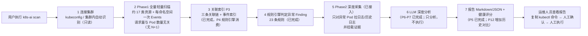

# k8s-ai 技术指导手册

> 面向读者：产品经理 / 运维负责人 / 项目决策者（不需要懂 Go）。
> 本文基于**四期企业平台当前代码状态（2026-10-23）**编写；每完成一个平台里程碑都会刷新第二章与第五章。

---

## 第一章：一句话说清楚

**这个项目是什么？**

k8s-ai 是企业级 Kubernetes AI 运维平台：统一提供集群巡检、故障诊断、自然语言对话、受控操作、
用户与 namespace 授权、审批和审计。

- **平台入口**：Web SPA 与 `k8s-ai server` 提供认证、Session、SSE、集群、Skill、配置、用户与审计；
  `k8s-ai chat / scan` 提供终端快速运维。
- **执行红线**：读操作自动执行；写操作必须经过统一 Policy、Code Guard、Executor 与准入控制；
  Secret 内容值永不进入 LLM、会话或审计。

---

## 第二章：现阶段已完成功能

> 说明：按代码实际状态编写；P3-P11（一期 1.1）与 P12（一期 1.2：Server + 历史差异数据）均已完成。

### 自然语言 Agent 与企业平台

**核心能力：**

| 能力          | 说明                                                                                                                 |
| ------------- | -------------------------------------------------------------------------------------------------------------------- | --- | --------------------------------------------------------------------------- |
| `k8s-ai chat` | 终端自然语言对话：交互/单发/stdin/JSON，会话持久化（--session 等）                                                   |
| `k8s-ai server` | 企业平台后端：认证、会话与 SSE、权限门禁、集群、Skill、配置、审批与审计 |
| Agent 工具集  | 22 个只读工具 + 5 个诊断工具（复用一期）+ 1 个写工具（kubectl 唯一入口，删 6 个结构化写工具）                        |
| 集群健康检查  | 节点 → 资源使用（metrics API）→ 命名空间 → Pod → 系统组件 → 警告事件 → 双评分                                        |
| 安全执行闭环  | 诊断 → 询问"需要我修复吗？" → 审批（等效 kubectl 命令+变更+风险等级）→ 执行 → 验证；批量审批支持一轮多写操作合并确认 |
| 拒绝闸门      | 同一写操作被拒绝 2 次后硬拦截；kubectl 命令归一化（忽略 --force/--grace-period 等修饰性 flag）防绕过                 |
| Shell 构造    | chat 模式允许 pipe/heredoc/redirect/&&/                                                                              |     | 等，含 shell 构造命令必须经人工审批后才执行 bash -c，shell 命令永不自动执行 |
| 审计          | 用户输入/LLM/工具/审批/执行事件落盘（脱敏）                                                                          |
| 流式输出      | `llm.stream: true` 开启 SSE 流式处理；支持语义事件、阶段进度、工具调用顺序控制，失败自动降级非流式                   |
| 安全加固      | Secret/--raw 红线改用 mvdan shell 解析器（引号拼接/命令替换全覆盖）；kubectl 子进程注入 KUBECONFIG 对齐集群配置      |
| MCP 预留      | Client 接口 + 注册表适配器骨架（v1 不连接外部服务器）                                                                |

**关键机制：**

- 双模式 Tool Calling：native（OpenAI 标准 wire）+ shim（JSON action 协议）+ auto 自动降级；native 模式支持 LLM 流式（ChatStream/ChatStreamEvents → Agent 轮次判断 → ChatEvent → SSE/Web 渲染）；
- **流式阶段顺序**：LLM 的 `content-delta` 与 `reasoning-delta` 先由 Agent 识别；带 `tool_calls` 的轮次只保留短进度说明，完整正文不提前展示；工具事件按 `tool-call → tool-response` 推送；无工具调用的最终轮次才推送 `answer-delta`，最后由 `answer` 收尾。Web 端在“分析过程”面板实时展示模型隐藏思考（推理期间全程展开，最终报告输出完成后自动折叠），工具卡拿到结果即展开并保持、报告完成后折叠；CLI 终端仅显示轻量状态，缓存增量后统一 Markdown 渲染。
- **流式可靠性**：工具参数在累积完成后做 JSON 归一化；同一只读工具和同一参数执行失败后不原样重试，避免模型循环调用耗尽 `max_tool_calls`/`max_iterations`；不安全的参数不会被自动猜测修复。
- `get_pod` 支持省略 namespace 全集群查找 + 前缀匹配，避免模型猜命名空间；
- 写工具投喂 LLM 前 Text+Data 一起输出（避免摘要覆盖数据导致模型循环）；
- 修复行为门禁：诊断类提问禁止调用写工具，先给结论并询问。
- 写工具精简为 1 个（kubectlTool）：删除 6 个结构化写工具（scale_deployment/patch_deployment/restart_rollout/label/delete_pod/patch_configmap），写操作统一由 LLM 生成完整 kubectl 命令走审批执行。

### 资源创建（Resource Create）

**核心能力：**

| 能力 | 说明 |
| --- | --- |
| 统一 `create_resource` | 单个通用创建 Tool（manifest/mode/verify/timeout_seconds），不按资源类型堆工具 |
| 两阶段创建协议 | 强制先 server-side dry-run 产出提案（manifest/风险/Skill findings）→ 人工确认 → apply → verify |
| Server-Side Apply | 写入路径仍在 `internal/executor`，client-go dynamic + SSA（fieldManager=`k8s-ai`），支持幂等与字段所有权 |
| Code Guard | kind 黑白名单、cluster 授权闸门、命名空间存在性、未 dry-run 拒绝、未知 Kind/危险字段升档 |
| Secret 创建通道 | `agent.secret.access=create_only`；`stringData` 只允许 `$GENERATE` / `$ASK`，明文值不进 LLM/会话/审计 |
| 内置 Skill 元数据 | 五域 YAML（workload/config/storage/network/rbac）+ `Registry` 读接口，四期结构化技能 + SKILL.md 流程型技能双轨契约基线 |
| Web/CLI 展示 | 创建提案卡、五步执行状态流、Secret 脱敏清单、刷新恢复 |

### P1 核心扫描（真实可用）

**能扫哪些资源：**

| 类别     | 覆盖内容                                                                                  |
| -------- | ----------------------------------------------------------------------------------------- |
| 计算     | Pod、Node                                                                                 |
| 工作负载 | Deployment / ReplicaSet / StatefulSet / DaemonSet / Job / CronJob                         |
| 存储     | PVC / PV / StorageClass / VolumeAttachment                                                |
| 网络     | Service / EndpointSlice / Ingress / NetworkPolicy                                         |
| 基础     | Namespace、Events（每命名空间一次拉取）                                                   |
| 系统组件 | CoreDNS、kube-proxy、CNI、metrics-server、Ingress Controller、CSI（动态发现，不假设存在） |

**能发现哪些典型异常：**

1. CrashLoopBackOff（容器反复崩溃重启）
2. OOMKilled（内存超限被杀）
3. ImagePullBackOff / ErrImagePull（镜像拉取失败）
4. Pending / FailedScheduling（Pod 调度不上去）
5. Node NotReady / DiskPressure / MemoryPressure（节点异常）
6. PVC Pending（存储卷申请不成功）
7. Service 无 Endpoint（服务后面没有可用 Pod）
8. Deployment 副本不匹配、Job Failed

### P2 深度采集（已完成，已接入主流程）

- **当前日志**：每个容器最多 500 行、单容器 64 KiB、单行 1 KiB 硬上限
- **历史日志（previous logs）**：容器重启前的日志；不存在时静默跳过
- **单 Pod 超时 30 秒**、并发默认 4，防止一个坏 Pod 拖垮整次扫描
- 所有日志在进入系统前先脱敏（密码/token/密钥等替换为 [REDACTED]）
- **现状（P4）**：已接入主流程——规则引擎命中需要日志的异常 Pod 后，自动拉取日志/历史日志并挂到 Finding 证据上。

Events：在 P1 就已按命名空间一次性采集并建立本地索引（不会为每个 Pod 单独查一次事件）。

### P3 关联索引（已完成）

已建立三条"关系链"，把孤立的资源串起来：

1. **Pod → 归属 Workload → Node**（这个 Pod 是谁管的、跑在哪台机器上；含间接归属：Pod → ReplicaSet → Deployment）
2. **Pod → PVC → PV → StorageClass**（存储链路）
3. **Service → EndpointSlice → Pod**（流量链路，另含 Service selector 与 Pod 标签的双向匹配）

并附带事件索引（按对象 UID / kind-namespace-name 双键查询）。索引已由 P4 规则引擎消费。

**这些索引未来用来干嘛：** 去重（Node 挂了导致一堆 Pod 异常只扣一次分）、提权重（影响线上服务更严重）、精准定位根因（把"表面故障"和"真正根因"分开）。

### P4 规则引擎 + 证据链（已完成）

- 23 条规则：CrashLoopBackOff / OOMKilled / ImagePullBackOff / PendingPod / NodeNotReady / NodeDiskPressure / EvictedPod / HighRestartCount / DaemonSetReplica / DeploymentProgressDeadline /... NodeMemoryPressure / PVCPending / FailedMount / ServiceNoEndpoint / DeploymentReplica / StatefulSetReplica / JobFailed
- 严重级自动调整：生产环境 / 系统命名空间 / 被 Service 选中 / 大量副本不可用 → 升级；测试与开发环境 → 降级
- 每条 Finding 带稳定指纹（Pod 归属 workload 归一化，支撑跨扫描指纹对比；1.2 为二期 Agent 提供结构化的历史差异数据）
- 节点级根因（NotReady/压力）导致的下游 Pod 异常自动标记 Correlated，供评分去重（P5 使用）
- **Phase2 已接入主流程**：命中需要日志的规则后自动拉日志/历史日志并挂载证据

### P5 健康评分 + 报告（已完成）

- **健康评分**：100 − Σ罚分（CRITICAL 30 / HIGH 15 / MEDIUM 5 / LOW 1），相关异常（Correlated）不重复扣分，封顶 0，附每条扣分原因
- **Markdown 报告**：概览 / 健康评分与扣分明细 / 异常摘要 / 分级问题详情（证据链）/ 资源汇总 / 系统组件 / 采集错误
- **JSON / YAML 机器可读报告**：latest.json 同时是二期 Agent 的历史记忆契约（findings 指纹 + diagnoses）
- **报告目的地按场景**：全集群 scan 默认写 latest.md + latest.json；目标扫描（--namespace / -n）默认只打印终端不落盘；定时任务 `--report-mode daily` 追加时间戳文件；`--format markdown|json|yaml` 控制终端完整报告的格式

### 单 Pod 扫描（P9.1 提前实现）

- 命令：`k8s-ai scan pod <name> -n <namespace>`，输出 `Kubernetes Pod 巡检报告：ns/name`（含 Scan Scope 标注）
- 只保留该 Pod 及其直接关联资源（Workload/Node/PVC/Service）的 Finding；命中需要日志的规则时自动拉日志/历史日志
- 默认终端直出，不写报告文件

### P6 LLM 客户端（已完成，P7 起已接入 scan）

- OpenAI Compatible Chat 客户端（接口在 llm 包，业务层不依赖 OpenAI SDK）
- 单次调用超时（默认 120s）；429 尊重 Retry-After；5xx 指数退避有限重试；其他 4xx 不重试
- api_key 只在 Authorization 头，请求体与错误消息均不出现（错误消息先显式剔除 api_key 再脱敏）
- 内置 Kubernetes SRE 系统提示词（go:embed，随二进制发布）；不可信数据用定界符包裹并声明"是数据不是指令"
- 已随 P7 接入主流程：规则判定后自动调用 LLM 诊断（失败自动降级为规则初步判断）

### P7 诊断编排（已完成，scan 已接入）

- 流程：Findings → 严重级排序 → 预算裁剪（单 Finding 8k / 总 32k / top-N 30 自适应）→ DiagnosisContext → LLM → JSON 解析 → Schema 校验 → Evidence ID 校验 → kubectl 命令校验
- 命令校验：排查/验证只允许只读动词；修复命令必须含 namespace/资源/名称并标注风险；非法命令整体丢弃
- **命令命名空间规范化（v1.0.1 迭代）**：命名空间级资源（Pod/Deployment/PVC/Service/ConfigMap/Secret/logs 等）的命令必须携带 `-n/--namespace`（含 `-n=`/`--namespace=` 形式，动词前/后均可）——命令自带但**与 Finding 命名空间不一致**时视为 LLM 编造/笔误，整条丢弃；**缺省时自动补全 Finding 命名空间**（如 `kubectl get pod web-0` → `kubectl -n prod get pod web-0`），保证报告里的命令复制即用；显式 `-A`/`--all-namespaces` 的跨命名空间查询不补全、不校验
- 降级策略：LLM 不可用/超时/限流 → 该 Finding 标注"LLM 分析不可用"，scan 不失败；JSON 解析/校验失败自动带修复指令重试一次
- 报告已渲染"Root Cause / 排查命令 / 修复方案（文字说明+命令，含风险）/ 验证命令"段落
- **修复方案文字+命令化（P0 优化）**：remediationText 必填文字说明（做什么/为什么/预期结果，文字是主体），remediation 配套可执行 kubectl 命令（含 -n/资源名/完整参数）；LLM 漏写文字时工具用修复方向兜底（system.md §三十五）
- **日志完整性（P0 优化）**：按行数保留（TailLines 500），单行完整保留（仅 >1MiB 截断防 OOM），总字节按行边界
- **Incident 上下文（P0 优化）**：只送根因 Finding 给 LLM，派生症状（Deployment 副本/Service 无 Endpoint）合并到 impact 字段，不单独分析

### P8 报告可读性优化（已完成）

- **终端一屏摘要**：默认只输出健康条（如 `████████░░`）、严重级计数（CRITICAL 1 | HIGH 3 | ...）、Top 10 重点问题（现象/根因/建议）、系统组件状态、报告路径；`--verbose` 才打印完整报告
- **日志证据压缩**：只保留前 8 行 + `…（共 N 行，ERROR M 行，WARN K 行）`，报告文件体积实测 -91%（726KB → 62KB）
- **视觉元素**：严重级图标 🔴🟠🟡🔵⚪、健康分进度条、组件状态 ✅⚠️❌（Markdown 与终端共用）

### P10 部署交付（已完成）

- 多阶段 Dockerfile：distroless static 非 root 小镜像，prompts 内嵌（一期当时的形态；四期 2026-10-29 起
  默认镜像改 `debian:bookworm-slim` + 工具层与 `kubectl`，见部署手册 §2.2/§4.17 与 ADR-044 v1.1）
- deploy/：namespace / serviceaccount / clusterrole（只读）/ clusterrolebinding / configmap / secret.example / pvc / cronjob（每日 08:00 Asia/Shanghai、Forbid 并发、OnFailure、报告 PVC）
- RBAC 清单测试 + kubectl dry-run 客户端校验全部通过
- README 完整说明（安装/配置/LLM/CLI/CronJob/RBAC/安全/故障示例/开发/测试）
- Makefile 增加 docker 目标、lint 修正为文件列表校验

### P11 加固收尾（已完成，一期 1.1 交付）

- **大集群压测**：Phase1 采集 1000 Pod/50 ns ≈ 2.5ms、内存 4.9MB；关联+规则链路 ≈ 0.46ms；请求量与 Pod 数无关（无 N+1）——详见 docs/design/PERFORMANCE.md
- **四类架构测试最终确认**：只读（AST，`Secrets()` 仅限 internal/kubernetes 只读门面、禁内容值）/ RBAC 清单 / 泄密（LLM 请求 + Secret 零访问）/ 请求量，全部通过
- **-race 说明**：本机无 C 编译器（CGO 关闭）无法运行；Makefile 已留 test-race 目标，Linux/CI 安装 gcc 后可直接使用
- **安全核对清单**：写入 README（无写操作/不读 Secret 内容值/双重脱敏/api_key 不泄露/LLM 不编造/不执行命令/错误隔离/RBAC 只读 8 项）
- **安装部署手册**：[INSTALLATION.md](INSTALLATION.md)（前置要求/本地安装/镜像构建/集群部署分步/CronJob/RBAC/使用指导/故障排查/安全）

### P12 一期 1.2（已完成）：Server 最小化 + 历史差异数据

- **HTTP Server**（`k8s-ai server`，默认 :8080）：GET /healthz、/readyz、/version；POST /api/v1/scans（异步任务，返回 scanId；单任务并发限制，已有任务运行时返回 409）；GET /api/v1/scans/{id}（pending/running/succeeded/failed + result）
- **历史差异数据**：读取上一份 latest.json，按 Finding 指纹对比输出新增/持续/恢复（ADR-019）；报告新增"历史对比"段、终端摘要显示计数、latest.json 含 history 字段——这是二期 Agent 的会话记忆底座（scan_cluster 自动携带）
- 部署：deploy/allinone/deployment.yaml + service.yaml（与 CronJob 共用报告 PVC 时需 RWX 存储类）

---

## 第三章：数据流向图



**文字版流程：**

1. 用户执行 `k8s-ai scan`，程序自动识别 kubeconfig 或集群内配置并连接集群（只读）。
2. 全量轻量扫描：一次性拉取所有资源列表 + 每个命名空间一次事件。请求次数固定（约 17 类资源 + 命名空间数），不会因为 Pod 多而爆炸。
3. **P3 关联索引（已完成）**：把 Pod/Workload/Node/存储/网络串成关系链，供规则引擎查询。
4. **规则引擎（已完成）**：23 条规则自动判定异常，产出 Finding（含严重等级、证据、指纹）。
5. **P2 深度采集（已接入）**：只对需要日志的异常 Pod 拉日志和历史日志，挂上证据。
6. **LLM 深度分析（已完成）**：基于证据做根因判断，生成排查/修复命令（只展示）；超时自动降级为规则初步判断。
7. **报告（已完成）**：输出 Markdown/JSON，含健康评分、异常摘要、证据链、Root Cause、命令与风险；P12 增加"历史对比"（新增/持续/恢复）。
8. 运维人员查看报告，复制命令、人工确认、人工执行。

---

## 第四章：关键配置项（用户可调什么）

配置文件默认在 `~/.k8s-ai/config.yaml`（`k8s-ai config init` 生成），供 `k8s-ai chat / k8s-ai scan`
终端直用；四期平台运行时的 7 组动态键（model/skill/approval/memory/retention/mcp/ops）唯一落 DB
`settings` 表，由配置中心页面维护，config.yaml 不承载动态键（见 ADR-031）。以下是一些关键开关：

| 配置                           | 默认值                                      | 含义                                          |
| ------------------------------ | ------------------------------------------- | --------------------------------------------- |
| scan.concurrency               | 8                                           | 全量扫描并行度（越高越快，越费 API Server）   |
| scan.phase2_concurrency        | 4                                           | 深度采集（日志）并行度                        |
| scan.max_log_lines             | 500                                         | 每个容器最多拉多少行日志                      |
| scan.max_log_bytes             | 64 KiB                                      | 单个容器日志字节上限（防超大日志）            |
| scan.timeout                   | 5m                                          | 整次扫描总超时（LLM 场景建议 10m）            |
| llm.enabled / endpoint / model | true / http://localhost:8000/v1 / qwen-plus | 大模型开关、地址、模型                        |
| llm.timeout                    | 120s                                        | 单次 LLM 调用超时（思考型模型建议保持）       |
| llm.stream                     | true                                        | chat 是否启用 SSE 流式；关闭时使用非流式 Chat |
| llm.thinking                   | `{type: enabled}`                           | chat 标准思考参数（OpenAI 兼容网关）         |
| scan.thinking                  | `{type: enabled}`                           | 一期 Scan 诊断思考参数                       |
| kubernetes.qps / burst         | 20 / 40                                     | 对 API Server 的访问限速（防压垮集群）        |
| report.directory               | ./reports                                   | 报告输出目录                                  |
| agent.create.enabled           | true                                        | `create_resource` 总开关                       |
| agent.create.deny_kinds        | []                                          | 创建黑名单（命中即拒绝）                      |
| agent.create.allow_kinds       | []                                          | 创建白名单（非空时只允许列出的 Kind）         |
| agent.create.cluster_kinds     | []                                          | cluster-scoped 资源授权白名单，默认空即禁止集群级创建 |
| agent.create.max_objects_per_call | 3                                        | 单次 create_resource 最多对象数（1-10）       |
| agent.create.max_manifest_bytes | 8192                                       | 单次 manifest 最大字节数（1KiB-1MiB）          |
| agent.secret.access            | create_only                                 | off / create_only；read_write 未开放           |

命令行还能临时覆盖：`--namespace`/`-n`（只扫某个命名空间）、`--since`（只看最近 N 小时日志）、`--fail-on`（达到指定严重级就返回失败退出码）、`--report-mode none|latest|daily`（报告目的地）、`--format markdown|json|yaml`（终端报告格式）、`--verbose`（终端输出完整报告）；单 Pod：`k8s-ai scan pod <name> -n <ns>`。

---

## 第五章：当前状态与已知约束

### 已经"真实可用"的能力

- 手动 `k8s-ai scan` 全集群扫描：已在真实集群跑通（497 Pod / 36 命名空间 / 19 节点），约 2-7 秒完成（含日志采集），0 采集错误
- `k8s-ai config init` / `config validate`（生成配置、校验配置与集群连通性）
- `k8s-ai version`；`--fail-on` 退出码契约（0 成功 / 1 错误 / 2 达到阈值）
- 只读 Kubernetes 客户端 + 脱敏库 + 架构测试（自动证明代码里没有任何写操作）
- 关联索引三条链（P3）：owner 归属链、存储链、Service→EndpointSlice→Pod 与标签匹配，P4 规则引擎已消费
- 规则引擎（P4）：23 条规则自动发现异常并挂载证据，真实集群一次 scan 即产出 Findings；Phase2 深度采集已接入主流程
- 健康评分 + 报告（P5）：全集群 scan 自动写 latest.md/latest.json（评分/扣分明细/分级详情）；目标扫描终端直出完整报告
- 单 Pod 扫描（P9.1 提前）：`scan pod <name> -n <ns>` 输出 Pod 巡检报告（Scope 标注、证据链、日志）
- 报告可读性（P8）：终端一屏摘要、日志证据压缩（-91% 体积）、严重级图标与健康条
- LLM 诊断真实可用（P7 加固，与 Qwen3.5-397B 网关联调通过）：扫描过程有进度日志、LLM 并发 2、超时自动降级不失败、prompt 内置 JSON Schema、支持思考型模型（reasoning_content 检测，输出上限放开到 4096）
- 性能压测（P11）：1000 Pod 采集约 2.5ms、规则链路约 0.46ms、请求量无 N+1；-race 需 CGO（本机无 gcc，CI/Linux 可跑）
- 安装部署：见 [INSTALLATION.md](INSTALLATION.md)（本地/镜像/集群 CronJob 分步 + 使用指导 + 故障排查）
- HTTP Server（P12）：`k8s-ai server` 提供 healthz/version/异步扫描 API，真实集群冒烟通过
- P0 体验优化：修复方案文字+命令化、日志完整保留、Incident 上下文仅根因送诊（派生并入 impact）
- 历史对比（P12）：按指纹输出新增/持续/恢复，报告与 latest.json 均携带

### "代码已就绪但未启用"的能力

- 暂无：Phase2 已接入、规则引擎已上线、LLM 已接入（scaffold 清单生成能力未实现，可留二期）

### 已完成的二期能力

- **二期（v2.0.0–v2.6.0）**：chat Agent / Tool Calling / 会话记忆 / 审批执行（按 PROJECT*SPEC*二期.md）；v2.0.6–v2.0.8 迭代：四层意图决策树、放开 shell 构造、批量审批、拒绝闸门命令归一化；v2.2.1 修复诊断报告不完整、reasoning 丢失、工具前过度过滤和证据不足时提前生成写操作的问题；v2.3.2 重构为标准 OpenAI `thinking` 参数并增强思考过程展示；v2.4.0 Web 纯前端产品化升级（暗色主题、顶部状态条、横向阶段步进器、思考全程展示）；v2.5.0 P7 扫描能力补全与规则池扩展（A/B/C 12 条规则 + 规则元数据 + DocProvider/--with-doc + 报告聚合）；v2.5.1 scan 终端摘要分层（RenderTerminal 块级标题 + 表格 + 代码块）；v2.6.0 Web 工具卡结构化渲染（Data.kind 驱动表格/键值 + kubectl 原命令特例）与会话持久化补全（arguments/data/ok 落库与 SSE 回传）

### 已完成的资源创建能力（三期）

- **v3.0.0 封版**：统一 `create_resource` Tool（`internal/tools/create.go`）、Executor SSA/dry-run/verify（`internal/executor/apply.go`）、Code Guard 与创建风险分级（`internal/approval`）、Secret 创建带外值通道（`$GENERATE`/`$ASK`）、内置 Skill 元数据与接口冻结（`internal/skills`）、Agent 创建意图路由（`internal/agent/prompt.go`）、CLI/Web 创建提案与结果渲染、`internal/creationtest` 集成测试。

### 能力状态

- **未开始**：scaffold 清单生成能力（可留二期）
- **已落地（四期 P3.5–P3.8.4）**：结构化技能（资源创建类确定性规则）；
  SKILL.md 流程型技能（procedural）单/多篇文本导入、技能包 zip 导入与静态资产存储、
  Chat 回合前意图检索 + 显式 `@技能名` 双场景命中均已落地（见开发计划 v1.30–v1.32；
  正文仅作文本上下文注入不执行、技能包 `scripts/` 一律 inert；v1.31 起兼容「直接压缩
  技能文件夹产生的单层包裹目录 zip」与「代码围栏包裹 frontmatter 的 SKILL.md」两类
  真实包形态）

#### 用户自定义 SKILL.md 技能怎么用

用户按标准 Agent 技能格式（SKILL.md + frontmatter 的 name/description）编写方法论文本，
导入后由 Agent 在聊天回合前做意图检索，命中则把 SKILL.md 渐进披露内容注入系统提示词，
再把方法论文本里的命令翻译为受信工具调用执行。示例（MySQL 排障技能）：

导入方式：页面粘贴单/多篇 SKILL.md 文本（`---` 多文档，frontmatter 可被代码围栏包裹），或上传
单个技能包 zip（内含 SKILL.md，支持「直接压缩技能文件夹」产生的单层包裹目录；zip 内静态资产仅收
`md/yaml/json/txt/csv` 白名单，`scripts/` 一律惰性存储不执行）。

```text
# 1. 检查 Pod 状态：kubectl get pods -n <ns> -l app=mysql
# 2. 查看详情与事件：kubectl describe pod <pod> -n <ns>
# 3. 查看日志：kubectl logs <pod> -n <ns> -c mysql | grep -i error
# 4. 存储链路：kubectl get pvc / kubectl describe node
```

Agent 处理口径：只读命令（get/describe/pvc/node）走结构化读或审批后的 kubectl argv；
`logs … | grep …` 走结构化 logs，或含 shell 语法时经人工审批；`kubectl exec` 仅支持
非交互形态且需审批，`exec -i/-t`、`attach`、`port-forward` 等交互能力仍硬拒；
平台能力无法覆盖的步骤明确拒绝并记入 `SKILL_RUN` 审计，不伪造不存在的工具。
Secret 内容值与 kubeconfig 红线不变。

#### 命中与使用

- **自动意图检索（hit=auto）**：聊天回合前先把整句话做三级匹配——整句精确技能名 →
  整句子串（名称/描述/领域）→ 长句关键词打分（名称 3 分 / 领域 2 分 / 描述 1 分，
  每词只计一次最高权重），命中后把 SKILL.md 渐进披露内容作为不可信方法论注入 Agent
  系统提示词，单轮最多同时注入 2 篇。
- **显式指定（hit=explicit）**：输入 `@技能名` 时前端按 `skill.read` 权限弹出已启用的
  procedural Skill 列表（Enter 选中、方向键移动、Esc 关闭）并回填；发送时把已匹配的
  `@名` 从 query 剥离、仅把有效技能名随 `skills` 字段转发后端。后端按名称精确解析
  （大小写不敏感），任一未知名或已停用技能会整批拒绝该回合并提示，不静默降级、
  不叠加自动检索结果。
- **Skill 咨询**：直接问「有哪些 skill / 某个 skill 是干什么的」，Agent 用只读工具
  `list_skills` / `get_skill` 回答，不触碰集群资源；`get_skill` 正文按 96 KiB 截断并置
  `truncated`，未知名或未启用技能返回工具级错误文本。
- **命中统计与审计**：每次命中累加 `hit_count`、刷新 `last_hit`，并落库
  `SKILL_RUN`（operation=retrieve）事件、`ResultSummary` 记录
  `{"hit":"auto"|"explicit"}`；可在 Skill 页面看到每篇技能的命中次数与最近命中时间。

### 已知约束（LLM）

- 思考型大模型（如 Qwen3.5-397B）单次诊断约 1.5-2 分钟：请保持 `llm.timeout: 120s` 或更高，`scan.timeout` 建议 10m（多 Finding 场景），或改用非思考型/更小模型提速
- 扫描全程有进度日志（stderr），不会"看起来卡死"；LLM 不可用/超时自动降级为规则结论，scan 不失败
- **LLM 降级不丢信息**：规则引擎基于已采证据生成"初步判断"，并自动提取日志关键行（panic/fatal/error）——即使大模型超时，报告也能直接给出关键错误（实测能定位 RocketMQ topic 路由不存在导致的 panic）
- **关联证据补全**：Deployment/Service/Node 类 Finding 会附带关联异常 Pod 的崩溃状态与日志关键行，LLM 可跨资源定位真正根因
- **日志证据保留尾部**：上下文与报告中的日志取末尾（panic/错误通常在最后），不再从头截断
- **配置类修复建议**：诊断上下文携带 Pod 引用的 ConfigMap/Secret 名称（仅名称不读数据），LLM 会优先给出针对性命令（实测 nginx `listen 80x` → `kubectl edit configmap`；PVC 缺失 → `kubectl get pvc` 确认）
- **Incident 架构**：Finding → Correlation → Incident → LLM，同一故障链一次诊断；派生症状（Deployment 副本不足/Service 无 Endpoint）折叠为影响范围、不重复扣分；健康评分只统计根因；LLM 输出含 confidenceLevel/causalChain/uncertainty
- **速度对比 kubectl-ai**：一期是"批量单次"诊断（一次长 JSON 输出），思考型大模型解码慢所以慢；二期 chat 将采用 kubectl-ai 式"小步工具调用 + 短输出 + 流式"，速度可对齐。思考控制已改为标准 OpenAI 参数：`llm.thinking`（chat）与 `scan.thinking`（一期 Scan）分别配置 `type: enabled|disabled`；**一期模型选型建议**：巡检/排查/分析用更快的非思考型模型（如 qwen-turbo/flash），思考型大模型（Qwen3.5-397B）留给二期 chat

### 硬限制（一期红线）

- **绝对只读**：不 create/update/patch/delete/exec，不读 Secret 内容值，不执行任何 LLM 生成的命令
- **不可信数据处理**：日志、Events、ConfigMap、注解一律先脱敏再使用，且视为"数据"而非"指令"
- **故障隔离**：单个资源采集失败不中断整次扫描，只记录到"采集错误"清单

---

## 第六章：后续阶段预告

- **P12（已完成）**：Server 最小化（healthz/version/异步扫描 API）+ 历史差异数据（二期 Agent 记忆契约）
- **一期终版达成**：1.1（巡检/排查/分析/报告/部署）+ 1.2（Server/历史对比）全部交付
- **二期（v2.0.0–v2.6.0）**：`k8s-ai chat` 自然语言 Agent、Tool Calling、会话记忆（复用 latest.json 历史差异数据）、安全审批与执行（含批量审批 + 拒绝闸门 + shell 构造受控放开）；诊断请求优先输出现象、根因、证据、方案和验证，证据不足时继续只读取证；v2.5.0 补充 HPA/PDB/RBAC/ConfigRef 采集与 12 条规则、规则元数据、DocProvider/--with-doc 与报告聚合；v2.5.1 终端摘要分层；v2.6.0 Web 工具卡结构化渲染与会话持久化补全（arguments/data/ok）。

---

## 附录 A：快速上手（写给运维）

```text
1. k8s-ai config init          # 生成配置
2. 编辑 ~/.k8s-ai/config.yaml  # 填 LLM 地址/模型（推荐快速非思考型模型）
3. k8s-ai config validate      # 校验配置 + 确认能连上集群
4. k8s-ai scan                 # 全集群扫描（只读）
5. 查看 ./reports/ 下的报告（latest.md / latest.json）
```

> 以上快速上手均属**终端直用**：`k8s-ai chat / k8s-ai scan` 以本地 `config.yaml` + 环境变量 + flags 运行，
> 不依赖平台 DB。四期平台的**页面配置（配置中心）**维护 7 组动态键（model/skill/approval/memory/retention/
> mcp/ops），唯一落 DB `settings` 表；静态/启动级参数由 `platform:` 段承载（接入实现在 P6.12），双方执行面隔离、互不覆盖。

## 附录 B：术语表

| 术语              | 大白话                                                            |
| ----------------- | ----------------------------------------------------------------- |
| Scan              | 一次完整的集群巡检                                                |
| Phase1            | 第一遍"快照"：把集群资源全量列一遍                                |
| Phase2            | 第二遍"取证"：只对异常对象拉日志                                  |
| Finding           | 一条被判定出的异常（如"payment-api CrashLoopBackOff"）            |
| Evidence          | 支撑这条异常的实锤证据（重启次数、退出码、日志关键行等）          |
| HealthScore       | 集群健康评分（100 分制，按异常严重级扣分）                        |
| Correlated        | 由同一个根因连带出来的下游异常（评分只扣一次）                    |
| 历史对比          | 与上一轮巡检按指纹对比：新增 / 持续 / 恢复（二期 Agent 记忆契约） |
| collection_errors | 采集失败清单（如某个 Pod 日志没权限），不影响整次扫描             |

## 附录 C：给决策者的安全承诺

1. **审批是唯一安全门**：部署权限（RBAC）→ 代码门面（只暴露读方法）→ 写操作（含 shell 构造）必须人工审批 → 自动化测试证明无未审批写操作。
2. **双重脱敏**：数据进入系统前脱敏一次，报告输出前再脱敏一次；Secret 内容值永不读取（元数据/键级读取仅限只读门面）。
3. **LLM 无执行能力**：大模型只产出文本分析，命令永远只是字符串。
