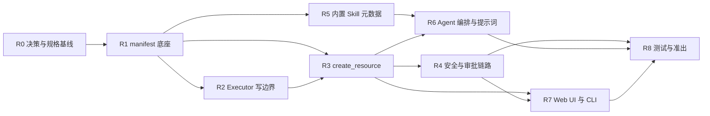

# k8s-ai 三期开发计划：资源创建能力（Resource Create）

- 版本：v1.6
- 日期：2026-09-24（v1.6 进度回填：2026-09-29）
- 状态：进行中（R0.2 + R1 + R2 + R3 + R4 已落地，R5 起未开始）
- 当前基线版本：v2.7.0（git tag 与 Makefile VERSION 一致；CHANGELOG / VERSIONING / PROJECT_STATUS 顶部仍停在 v2.6.0，由 R0.6 补齐）
- 目标版本：v3.0.0
- 进度快照（2026-09-29）：R4 安全与审批链路已落地——Secret 值通道打通（`$GENERATE` 由执行器用 crypto/rand 生成、
  `$ASK` 由人工在审批环节输入），明文值带外传递（`tools.WithSecretValues` 走 context，不进 LLM 上下文/会话文件/审计），
  免交互通道（`--skip-permissions`、Grant 自动放行、`--yes`）遇 `$ASK` 直接拒绝并建议改用 `$GENERATE`；
  审计新增 `secret.value_requested`（仅键名与来源）与 `secret.touched`（键名/长度/SHA-256 指纹/来源），审计文件与 SLS
  载荷均无明文；`agent.secret.access` 配置闸门只接受 `off`/`create_only`（`read_write` 启动即拒）；
  `kubectl create secret` 红线回归用例补齐；`create_resource.Describe` 输出人类可读审批卡
  （对象清单 + 变更说明 + Secret 脱敏清单）。`go test ./...`、`go vet ./...`、`gofmt` 全绿。
  下一步：R5 内置 Skill 元数据与接口契约；R2/R3/R4 真实集群端到端与 R8 准出需人工点验。
- 需求输入：[RESOURCE_CREATE_DESIGN.md](./RESOURCE_CREATE_DESIGN.md)、[APPROVAL_V2_DESIGN.md](./APPROVAL_V2_DESIGN.md)、AGENTS.md
- 编号说明：本计划用 **R0–R8** 作为主线编号。AGENTS.md 中预留的 Phase 3（MCP 外部工具、
  可观测性、多会话后端）不属本计划范围，属四期另一条线，此处不排期；AGENTS.md 的 Phase 口径在 R0.5 同步修订。

## 修订记录

| 版本 | 日期 | 修订人 | 说明 |
| --- | --- | --- | --- |
| v1.0 | 2026-09-24 | | 初版：基于 RESOURCE_CREATE_DESIGN.md 拆分 R0–R8，58 条任务，估 37.5 人日 |
| v1.1 | 2026-09-28 | | 启动前校订：按明细重算任务数与工作量（76 条 / 37.25 人日）；§3 里程碑与任务行归属对齐；决策清单补 D-11~D-14 并显式标出 8 项待签收；新增 R0.5（AGENTS.md 口径）与 R0.6（v2.7.0 文档欠账） |
| v1.2 | 2026-09-28 | | 决策签收：D-11 改为 CRD/未知 Kind 不限制（仅保留 deny_kinds 黑名单，未知 Kind 风险默认 HIGH）、D-12 定为 `create_only`、D-13 定为 kind 级分级；新增 D-15（Skill 注册表接口与用户自定义 Skill 目录必须预留）与 R5.9/R5.10/R6.6 三条接口任务；§1 非目标、R0.2/R1.5/R4.1/R4.2 口径、里程碑与工作量随之调整（79 条 / 38.75 人日） |
| v1.4 | 2026-09-28 | | 进度回填：R0.2、R1（R1.1~R1.10）、R2（R2.1~R2.12）已完成；R2.10 实现口径改为「dynamic 与 os/exec 同口径收窄到 executor，`Secrets()` 仍全仓禁入」；D-03 标注实现已按推荐值落地。R0.1/R0.3~R0.6 与 R3+ 未开始 |
| v1.3 | 2026-09-28 | | Skill 排期签收：通用 Skill 引擎与用户自定义 Skill 目录整体移到四期（三期资源创建能力落地后再讨论方案并排期）。D-15 改为「三期只冻结 Skill 数据模型与 Registry 读接口」；R5.9 收口为单条接口冻结任务（0.25d），删去 R5.10、R6.6，`agent.skills.*` 配置、用户 Skill 目录发现与门禁、Skill 目录注入 Agent 上下文全部移出三期；§3 里程碑、§6 出口标准、§7 落点、§8 风险、§9 工作量随之调整（77 条 / 37.50 人日） |
| v1.5 | 2026-09-28 | | 进度回填：R3（R3.1~R3.11）已完成。新增 `internal/tools/create.go`（create_resource 两步式：dry_run 提案 / apply 需同指纹提案）、`internal/tools/proposal.go`（会话级提案指纹存储）、`internal/approval/create_risk.go`（Kind/scope/危险字段风险分级）；`tools.GrantTargeter` + `Grant.NoGrant` 收窄可复用授权；`internal/service/chat.go` 装配 `agent.create.*` 与写通道 RESTConfig；`agent.secret.access=off` 由 manifestx 硬闸门落地；Secret 占位符 `@generate` → `$GENERATE`（YAML 安全）；tools/approval/service 三层新增单测，`go test ./...`、`go vet ./...` 全绿 |
| v1.6 | 2026-09-29 | | 进度回填：R4（R4.1~R4.9）已完成。R4.1/R4.2/R4.3 在 R3 期间随 `create_risk.go`、`create.go` 校验链与 decision 用例落地，本轮回补 kubectl 通道 forbidden 回归用例；新增 `internal/tools/secret_values.go`（`SecretValueKey`/`SecretValuePrompt`/`SecretValuePlanner`/`PendingSecretValues`、`secretTouches` 审计载荷、`WithSecretValues` 带外值通道）、`internal/executor/apply.go` 的 `materializeSecret`（`$GENERATE` 用 crypto/rand 生成、`$ASK` 取人工输入值、`data` 字段与模型自填值硬拒）与 `FingerprintSecretValue`；`agent.SecretValueApprover` + `loop.collectSecretValues`（缺值整批不提交、拒绝文案区分已输入与已放弃）、`service.ChatApprover.RequestSecretValue`（CLI 走 `term.ReadPassword` 不回显、Web 走密码输入框且值不回显）、`audit` 两个 Secret 事件、`config.validateSecretAccess`；`create_resource.Describe` 落地 R4.9 审批卡文案；新增 Secret 专项测试文件并扩展 tools/agent/service/config/approval 用例 |

---

## 1. 范围与非目标

**范围内**

- 通用创建 Tool `create_resource`（dry-run 先行、审批提案、创建后 verify）；
- manifest 底座（解析、GVK/白名单、静态校验、危险字段、指纹、Secret 值检测）；
- Executor 写边界扩展（dynamic client + Server-Side Apply + dry-run + verify），写入仍只在 `internal/executor`；
- 创建类风险分级、Code Guard、审批链路、Secret `create_only` 通道（值不透传 LLM）；
- 按域组织的内置创建 Skill 元数据（workload/config/storage/network/rbac）；
- Agent 创建意图路由与信息收集协议；Web UI / CLI 创建提案与结果呈现；
- Skill 数据模型与内置注册表读接口（`Skill` 模型 + `Registry` 读接口 + `Source` 字段 + `Reload()` 签名），为四期通用 Skill 引擎与用户自定义 Skill 目录预留不需返工的契约（D-15）；
- 测试、架构门禁、文档与版本准出。

**非目标（本计划不做）**

- 通用 Skill 引擎与用户自定义 Skill 目录整体移四期：Skill 作为 Agent 可调用能力、按需加载与热加载、用户 Skill 目录发现与来源标记、用户 Skill 门禁、Skill 目录注入 Agent 上下文、可执行 Skill，全部在三期资源创建能力交付后再讨论方案并排期（D-15）；三期只交付内置 Skill 元数据与接口契约冻结（R5.9）；
- Secret 内容值读取（`secret.access=read_write`）；
- 多对象失败自动回滚；
- Helm / GitOps / 蓝图市场、MCP 外部工具、可观测性接入、跨集群创建；
- 逐资源 `CREATE_*_TOOL` 与逐 Kind 工具（设计上已否决）。

---

## 2. 决策基线

| 编号 | 决策 | 结论 | 状态 |
| --- | --- | --- | --- |
| D-01 | 创建工具形态 | 单个通用 Tool `create_resource`，不逐资源建工具 | 已定 |
| D-02 | 创建调用模式 | `dry_run` / `apply` 两段式（MVP），`proposal_id` 优化后续 | 已定 |
| D-03 | 创建实现基座 | client-go dynamic + Server-Side Apply（fieldManager=k8s-ai），不依赖 kubectl 二进制；kubectl 通道保留兜底 | 推荐值待签收（R2 已按该推荐值落地，签收只确认不推翻） |
| D-04 | 已存在资源 | 不覆盖，返回 `already_exists` 并转 patch/update 提案 | 已定 |
| D-05 | 目标 namespace 不存在 | 拒绝创建，不自动建 namespace | 已定 |
| D-06 | 含值 Secret | 放开创建但值不透传 LLM（用户值/Executor 生成值 + 指纹审计）；读取保持红线 | 已定 |
| D-07 | Web 事件契约 | 复用 tool-call / tool-response 承载创建提案，不新增事件类型；执行状态复用 state 事件 | 推荐值待签收 |
| D-08 | --skip-permissions | 沿用现有非 shell 语义（会执行创建），创建类操作输出审计告警 | 推荐值待签收 |
| D-09 | 版本号 | v3.0.0（新增能力，向后兼容）；需在 VERSIONING.md 补 v3 段口径 | 推荐值待签收 |
| D-10 | 多对象与回滚 | 单次上限 3 对象 / 8KB，v1 不回滚，逐对象报告 | 已定 |
| D-11 | CRD / 未知 Kind | 不限制：CRD 与未知 Kind 默认可创建，只用 `deny_kinds` 黑名单封禁，cluster-scoped 走 `cluster_kinds` 授权闸门；未命中已知 Kind 表时风险默认 HIGH（必人工审批） | 已定 |
| D-12 | agent.secret.access 默认值 | `create_only`：可创建含值 Secret（值只走审批载荷或 Executor 生成，不进 LLM），读取保持红线 | 已定 |
| D-13 | 创建类风险与 Grant 可达性 | kind 级分级：已知良性 namespaced Kind → MEDIUM（可命中 Grant 不再询问）；cluster-scoped、危险字段、未知 Kind/CRD → HIGH（每次必批） | 已定 |
| D-14 | 三期需求规格载体 | 不新建 PROJECT_SPEC_三期.md，以 RESOURCE_CREATE_DESIGN.md 为需求基线并在 AGENTS.md 登记 | 已定 |
| D-15 | Skill 引擎与用户自定义 Skill 目录 | 排期后移：三期只做资源创建，Skill 侧只交付内置 5 域元数据 + 数据模型与 `Registry` 读接口冻结（R5.9）；通用 Skill 引擎、用户自定义 Skill 目录、Agent 可调用消费在四期实现，方案在三期 `create_resource` 落地后另开讨论 | 已定（排期已锁，实现细节随四期方案确定） |

已定 11 项（D-01/D-02/D-04~D-06、D-10~D-15），D-15 排期已锁。剩余待签收 4 项均为推荐值确认：
D-03（创建实现基座）、D-07（Web 事件契约）、D-08（`--skip-permissions` 语义）、D-09（版本号）。
阻塞面：D-03 → R2，D-07 → R7；D-15 已不阻塞三期任何任务（Q1~Q4 移到四期方案讨论）。

---

## 3. 里程碑

| 里程碑 | 内容 | 可演示成果 | 任务数 |
| --- | --- | --- | --- |
| M1 | R0 全部 + R1 全部 + R2 底座（R2.1/R2.2/R2.4）+ R3.4 | 一条 manifest 完成解析、白名单、校验、dry-run 与风险判定 | 20 |
| M2 | R2 写执行与 verify + R3 主体 + R4 风险分级与 Code Guard + R6.3 | 自然语言 → 创建提案 → 审批 → 创建 → verify 全链路（终端可演示） | 22 |
| M3 | R2.10/R2.12 架构与 RBAC + R4 Secret 通道 + R6 Agent 编排 + R7.5 | 含值 Secret 创建且值不进 LLM；创建意图与修复意图路由正确 | 12 |
| M4 | R5 全部 + R7 全部（除 R7.5） | Web 创建提案卡片与创建报告；5 个域的创建方法论生效；Skill 接口契约冻结且模型无执行动作 | 15 |
| M5 | R8 全部 | go test / go vet / 架构测试全绿，文档与版本准出 | 8 |

## 4. 依赖与并行



并行建议：R1 完成后 R2 与 R5 可并行；R3 与 R6 的提示词部分可并行；
R7 前端部分可在 R3 落地后启动（依赖契约不依赖安全实现）。

---

## 5. 任务分解

> 列说明：规模 S≈0.25d / M≈0.5d / L≈1d；状态取值：未开始 / 进行中 / 已完成 / 阻塞。

### R0 决策与规格基线（约 2.25d）

| 编号 | 任务项 | 交付物 / 涉及文件 | 验收标准 | 依赖 | 规模 | 预估 | 里程碑 | 状态 |
| --- | --- | --- | --- | --- | --- | --- | --- | --- |
| R0.1 | 设计评审与决策签收 D-01~D-15 | docs/RESOURCE_CREATE_DESIGN.md §10、本文档 §2 | D-03/D-07/D-08/D-09 四项推荐值有结论并回写文档（其余已定） | - | S | 0.25d | M1 | 未开始 |
| R0.2 | 创建配置项设计冻结 | internal/config/config.go：`agent.create.{enabled,deny_kinds,cluster_kinds,allow_kinds,max_objects_per_call,max_manifest_bytes}`（`allow_kinds` 默认为空＝不限制，见 D-11）、`agent.secret.access`（默认 `create_only`）；`agent.skills.*` 三期不引入，四期随 Skill 引擎再加 | 配置项命名/默认值/校验规则评审通过，含 `Validate()` 约束 | R0.1 | M | 0.5d | M1 | 已完成 |
| R0.3 | 创建风险分级映射表定稿 | internal/approval/risk.go 设计口径（kind/scope/字段 → MEDIUM/HIGH） | 表格覆盖常见 Kind + 敏感字段 + cluster-scoped，评审通过 | R0.1 | M | 0.5d | M1 | 未开始 |
| R0.4 | 测试与 E2E 冒烟场景清单 | docs/E2E_SMOKE.md 草案（创建/Secret/白名单/覆盖拒绝场景） | 每条任务都能对应至少一个可执行验证场景 | R0.1 | M | 0.5d | M1 | 未开始 |
| R0.5 | 三期治理口径修订 | AGENTS.md：Phase 口径改为 Phase 3（资源创建）、写边界补 dynamic + SSA 仍限 internal/executor、Secret 创建通道与读取红线并列、原 Phase 3 预留项与通用 Skill 引擎、用户自定义 Skill 目录一并改列四期 | 门禁文档与三期设计一致，架构测试注释与 RBAC 示例同步 | R0.1 | S | 0.25d | M1 | 未开始 |
| R0.6 | v2.7.0 文档欠账补齐 | CHANGELOG.md / VERSIONING.md / PROJECT_STATUS.md 补 v2.7.0（Approval v2）条目 | 三处版本口径与 git tag、Makefile VERSION 一致 | - | S | 0.25d | M1 | 未开始 |

### R1 manifest 底座（约 5.00d）

| 编号 | 任务项 | 交付物 / 涉及文件 | 验收标准 | 依赖 | 规模 | 预估 | 里程碑 | 状态 |
| --- | --- | --- | --- | --- | --- | --- | --- | --- |
| R1.1 | 新建 manifestx 包骨架 | 新建 internal/manifestx（`Parse` 返回 `[]Object{Object, GVK}`） | 包编译通过，导出类型稳定，无第三方新依赖 | R0.2 | M | 0.5d | M1 | 已完成 |
| R1.2 | YAML/JSON 与多文档解析 | internal/manifestx/decode.go | 单文档/多文档/空文档/注释/纯 JSON 用例全通过 | R1.1 | M | 0.5d | M1 | 已完成 |
| R1.3 | 模板表达式拒绝 | 同上 | 含 `{{ }}`、kustomize、helm 模板时返回明确错误码 | R1.2 | S | 0.25d | M1 | 已完成 |
| R1.4 | GVK → GVR 映射与 scope 判定 | 复用 kubernetes discovery/RESTMapper（internal/kubernetes） | 内置 Kind 与未知 Kind 均能判定；cluster-scoped 标记正确 | R1.2 | L | 1d | M1 | 已完成 |
| R1.5 | kind 黑名单与 scope 校验 | internal/manifestx/policy.go 消费 R0.2 配置（deny_kinds 拦截、cluster_kinds 授权、allow_kinds 可选收紧） | 黑名单拒绝、cluster 未授权拒绝、未知 Kind/CRD 放行并标记 unknown 三类场景各有单测 | R1.4, R0.2 | M | 0.5d | M1 | 已完成 |
| R1.6 | 必填字段与命名校验 | apiVersion/kind/metadata.name、metadata.namespace 缺省策略 | 缺失即 error，含字段路径与修复提示 | R1.2 | M | 0.5d | M1 | 已完成 |
| R1.7 | 危险字段扫描 | privileged / hostNetwork / hostPID / hostPath / 挂载 SA token | 命中输出结构化校验结果，可进入审批提案 | R1.2 | M | 0.5d | M1 | 已完成 |
| R1.8 | manifest 规范化与指纹 | canonical 序列化 + sha256（提案一致性用） | 同语义 manifest 指纹稳定，字段顺序无关 | R1.2 | S | 0.25d | M1 | 已完成 |
| R1.9 | Secret 值检测与指纹脱敏 | stringData/data 检测，产出 key/长度/sha256，不落明文 | 值不出现在返回值、日志、审计结构中 | R1.2 | M | 0.5d | M1 | 已完成 |
| R1.10 | manifestx 单元测试集 | internal/manifestx/*_test.go | `go test ./internal/manifestx/...` 绿，覆盖 R1.2–R1.9 | R1.9 | M | 0.5d | M1 | 已完成 |

### R2 Executor 写边界扩展（约 6.00d）

| 编号 | 任务项 | 交付物 / 涉及文件 | 验收标准 | 依赖 | 规模 | 预估 | 里程碑 | 状态 |
| --- | --- | --- | --- | --- | --- | --- | --- | --- |
| R2.1 | 类型与接口定义 | internal/executor/types.go：`ApplyRequest` / `ApplyResult` / `VerifyRequest` / `VerifyResult` | 类型评审通过，工具层不直接 import client-go | R1.8 | M | 0.5d | M1 | 已完成 |
| R2.2 | dynamic client 接入 executor | internal/executor 新增 dynamic client 构造，复用 internal/kubernetes 配置 | 多 context/kubeconfig 场景可构造；配置缺失时报错清晰 | R2.1 | M | 0.5d | M1 | 已完成 |
| R2.3 | Server-Side Apply 实现 | executor.Apply：dynamic + SSA，`fieldManager=k8s-ai` | fake dynamic client 下 create/update 行为正确 | R2.2 | L | 1d | M2 | 已完成 |
| R2.4 | dry-run 支持 | `dryRun=["All"]` 分支 | dry-run 不产生服务端变更，返回校验错误原样回传 | R2.3 | M | 0.5d | M1 | 已完成 |
| R2.5 | 对象存在性检查 | GetObject（dynamic Get） | 已存在/不存在两分支正确，namespace 不存在可区分 | R2.2 | S | 0.25d | M2 | 已完成 |
| R2.6 | verify 就绪判定策略表 | Deployment/STS/DS/Job/CronJob/PVC/Service/ConfigMap/Ingress | 每类 Kind 的判定单测通过（含未就绪） | R2.3 | L | 1d | M2 | 已完成 |
| R2.7 | verify Events 采样 | 未就绪时附带最近 Events | Events 截断与脱敏与现有输出一致 | R2.6 | M | 0.5d | M2 | 已完成 |
| R2.8 | 结果脱敏与大小限制 | 复用 `security.Redactor` 与 capped buffer | 敏感串脱敏、超限标记 Truncated | R2.3 | S | 0.25d | M2 | 已完成 |
| R2.9 | executor 单元测试 | internal/executor/*_test.go | `go test ./internal/executor/...` 绿 | R2.8 | M | 0.5d | M2 | 已完成 |
| R2.10 | 架构测试 Secret 写读分离规则 | tests/arch/readonly_test.go：口径调整为「写通道依赖整体收窄」——`k8s.io/client-go/dynamic` 与 `os/exec` 同口径只允许 internal/executor；`Secrets()` 仍全仓禁入 executor，Secret 创建走 unstructured + SSA，不触碰 typed Secrets 客户端，也不对已有 Secret 发起读取（避免把内容值带进进程） | 门禁生效（dynamic / os-exec 仅 executor 可用，`Secrets()` 仍禁）且现有用例仍绿 | R2.3 | M | 0.5d | M3 | 已完成 |
| R2.11 | 架构测试写边界回归 | tests/arch/readonly_test.go 确认 SSA 调用点仅在 executor | 新增代码不违反写边界 | R2.3 | S | 0.25d | M2 | 已完成 |
| R2.12 | RBAC 清单同步 | tests/arch/rbac_test.go 与 RBAC 示例文档（新增 create/patch secrets） | RBAC 测试绿，文档示例可用 | R2.10 | S | 0.25d | M3 | 已完成 |

### R3 create_resource Tool（约 5.75d）

| 编号 | 任务项 | 交付物 / 涉及文件 | 验收标准 | 依赖 | 规模 | 预估 | 里程碑 | 状态 |
| --- | --- | --- | --- | --- | --- | --- | --- | --- |
| R3.1 | Tool 契约与 InputSchema | internal/tools/create.go：`create_resource(manifest, mode, verify, timeout_seconds)` | schema 渲染正确，描述含读写与审批语义 | R1.10 | M | 0.5d | M2 | 已完成 |
| R3.2 | `IsReadOnly` 实现 | 同上：mode=dry_run→true，apply→false | 单测覆盖两种 mode 与非法 mode | R3.1 | S | 0.25d | M2 | 已完成 |
| R3.3 | `Risk` 与 `SchemaMetadata` | 调用 R0.3 映射 + MetadataDescriber | 提案风险与映射表一致 | R3.1 | M | 0.5d | M2 | 已完成 |
| R3.4 | dry_run 提案生成 | 解析→校验→存在性→dry-run→提案对象 | 返回对象清单、风险、校验结果、指纹 | R3.3, R2.4 | L | 1d | M1 | 已完成 |
| R3.5 | 提案一致性校验 | apply 时 manifest 指纹必须等于某次 dry_run | 未 dry_run 或 manifest 被改动时拒绝执行 | R3.4 | M | 0.5d | M2 | 已完成 |
| R3.6 | `already_exists` 分支 | 已存在不覆盖，返回转 patch/update 建议 | 单测覆盖存在/不存在/部分存在 | R3.4 | S | 0.25d | M2 | 已完成 |
| R3.7 | apply 执行与 verify | Executor.Apply + Verify，超时与取消 | 创建后可验证，verify 失败不影响已创建事实回报 | R3.5, R2.6 | L | 1d | M2 | 已完成 |
| R3.8 | 多对象与部分失败语义 | 逐对象结果、失败不自动回滚 | 多对象场景结果可读、可审计 | R3.7 | M | 0.5d | M2 | 已完成 |
| R3.9 | ToolResult 与错误码归一 | Text 摘要 + Data 结构 + 错误码 | LLM 可读且不泄露 Secret 值 | R3.8 | M | 0.5d | M2 | 已完成 |
| R3.10 | 注册与开关 | internal/service/chat.go 装配、disabled_tools、create.enabled 开关 | 开关生效；Web 工具列表正确 | R3.9 | S | 0.25d | M2 | 已完成 |
| R3.11 | Tool 单元测试 | internal/tools/create_test.go、metadata_test 扩展 | `go test ./internal/tools/...` 绿 | R3.10 | M | 0.5d | M2 | 已完成 |

### R4 安全与审批链路（约 5.00d）

| 编号 | 任务项 | 交付物 / 涉及文件 | 验收标准 | 依赖 | 规模 | 预估 | 里程碑 | 状态 |
| --- | --- | --- | --- | --- | --- | --- | --- | --- |
| R4.1 | 创建风险分级实现（kind 级分级） | internal/approval/risk.go：kind/scope/字段 → RiskLevel | 与 R0.3 表格一致：已知良性 namespaced MEDIUM；cluster-scoped、危险字段、未知 Kind HIGH | R0.3, R3.3 | M | 0.5d | M2 | 已完成 |
| R4.2 | Code Guard 门禁落地 | kind 黑名单、dry-run 强制、namespace 存在性、危险字段（executor/approval） | 四类门禁各有拒绝用例；未知 Kind 不得被误判为可自动放行 | R4.1, R2.3 | L | 1d | M2 | 已完成 |
| R4.3 | Policy 与模式回归 | internal/approval/decision.go + 用例（strict/smart 两种 Mode 与 Shell 闸门不受影响） | 现有审批行为无回归，含 shell 构造的命令仍不可自动放行 | R4.1 | M | 0.5d | M2 | 已完成 |
| R4.4 | Grant 与创建联动 | 创建首提必批；Grant 匹配键为 task/operation/kind/namespace 且上限 MEDIUM，需 D-13 先允许良性 Kind 降 MEDIUM | Grant 用例覆盖创建场景，HIGH 与 shell 仍不命中 | R4.1, D-13 | M | 0.5d | M3 | 已完成 |
| R4.5 | Secret `create_only` 值通道 | 审批载荷承载用户值 / Executor 生成随机值；LLM 只见 key 与占位符 | 值不进 LLM 上下文、会话、审计；创建结果可用 | R1.9, R4.2 | L | 1d | M3 | 已完成 |
| R4.6 | Secret 审计与指纹 | audit 事件记录 key/长度/sha256 与 `SECRET_TOUCHED` 标记 | 审计文件无明文值，指纹可复核 | R4.5 | M | 0.5d | M3 | 已完成 |
| R4.7 | `secret.access` 配置闸门 | config + 行为分支（off / create_only / read_write 仅关闭态） | 非 create_only 时创建含值 Secret 被拒 | R4.5 | S | 0.25d | M3 | 已完成 |
| R4.8 | kubectl 通道 Secret 红线回归 | internal/approval/policy.go 行为不变 | `kubectl create secret` 仍被硬拦，回归用例 | R4.5 | S | 0.25d | M3 | 已完成 |
| R4.9 | 创建提案人类可读描述 | CommandDescriber/提案渲染：对象清单 + 风险原因 + manifest 摘要 | 审批面板不再展示原始转义 JSON | R3.4 | M | 0.5d | M2 | 已完成 |

### R5 内置 Skill 元数据与接口契约（约 3.50d）

| 编号 | 任务项 | 交付物 / 涉及文件 | 验收标准 | 依赖 | 规模 | 预估 | 里程碑 | 状态 |
| --- | --- | --- | --- | --- | --- | --- | --- | --- |
| R5.1 | Skill 数据模型与内置加载 | internal/skills：Skill/Validation/RiskRule/Checks + `Source`（builtin / user）+ go:embed YAML + schema 校验 | schema 非法时启动即报错；5 域加载成功；模型不含任何执行动作字段 | R1.10 | M | 0.5d | M4 | 未开始 |
| R5.2 | `create-workload` 规则 | skills/create-workload.yaml | 镜像 tag 强制、requests/limits 建议、危险字段必确认 | R5.1 | M | 0.5d | M4 | 未开始 |
| R5.3 | `create-config` 规则 | skills/create-config.yaml | 数据来源与引用一致性校验；Secret 值走指纹通道 | R5.1 | S | 0.25d | M4 | 未开始 |
| R5.4 | `create-storage` 规则 | skills/create-storage.yaml | StorageClass 存在性、容量、accessModes、绑定检查 | R5.1 | M | 0.5d | M4 | 未开始 |
| R5.5 | `create-network` 规则 | skills/create-network.yaml | 端口/selector/type 校验、IngressClass 检查 | R5.1 | M | 0.5d | M4 | 未开始 |
| R5.6 | `create-rbac` 规则 | skills/create-rbac.yaml | 最小权限提示；cluster 级默认 HIGH | R5.1 | S | 0.25d | M4 | 未开始 |
| R5.7 | Skill 校验器接入 dry_run | create_resource dry-run 输出 Skill findings | findings 进入审批提案并可定位字段 | R5.6, R3.4 | M | 0.5d | M4 | 未开始 |
| R5.8 | verify 规则数据化 | post_checks 映射到 R2.6 策略表 | Kind→verify 策略由数据驱动，无硬编码分支扩散 | R5.7 | S | 0.25d | M4 | 未开始 |
| R5.9 | Skill 接口契约冻结（四期预留，不实现引擎） | internal/skills/registry.go：`Registry` 读接口（`List` / `ForGVK` / `MatchIntent`）+ `Skill.Source` + `Register` / `Reload` 签名；tests/arch 新增「Skill 模型无执行动作字段」规则 | 接口形态评审通过并由内置加载实现；`Reload()` 签名存在但可不接线（四期热加载用）；架构测试禁止 Skill 模型出现执行动作/写能力字段；三期不做用户 Skill 目录发现与门禁 | R5.1 | S | 0.25d | M4 | 未开始 |

#### D-15 附注：Skill 接口契约（三期冻结，四期实现引擎与用户 Skill 目录）

三期只做资源创建，不引入 Skill 引擎；但数据模型与接口形态必须一次定对，避免四期返工。
内置 Skill 与四期的用户 Skill 共用同一数据模型，模型内不含任何执行动作：

```go
// internal/skills
type Source string // builtin | user

type Skill struct {
    Name, Domain, Version string
    Kinds          []string   // GVK 匹配，CRD 用 group/Kind 全名
    RequiredInputs []string   // 驱动 Agent 追问，禁止编造默认值
    OptionalInputs []string
    Validation     []Rule     // 静态校验规则（severity: error | suggest）
    Risk           RiskRule   // default + elevate_when（只允许升档）
    PreChecks      []Check    // kind 必须命中内置 check 注册表
    PostChecks     []Check
    Source         Source     // builtin | user
    Path           string     // 用户 Skill 来源文件，用于审计与提案展示
}

type Registry interface {
    List() []Skill
    ForGVK(gvk schema.GroupVersionKind) []Skill
    MatchIntent(intent string) []Skill // 四期：Agent 意图 → Skill 目录
    Register(Skill) error              // go:embed 内置与用户目录共用入口
    Reload() error                     // 四期热加载预留，三期只保证接口存在
}
```

三期不新增 `agent.skills.*` 配置；`agent.skills.enabled`、`agent.skills.dirs`
（默认 `~/.k8s-ai/skills`、项目 `.k8s-ai/skills`）随四期用户 Skill 目录一并引入。

三期 Skill 侧交付就三件事：

1. 内置 5 域 Skill 走 go:embed 加载，经 `Registry.List` / `ForGVK` 供 dry-run 校验器与 verify 策略消费（R5.7/R5.8）；
2. `Skill.Source` 字段与 `Register` / `Reload` 签名先落到位，`Reload()` 允许返回未实现错误但不得缺失（R5.9）；
3. 架构测试锁定 Skill 模型无执行动作字段，写操作只有 `create_resource` → `internal/executor` 一条路。

四期在这份契约上补齐（三期资源创建能力交付后再讨论方案并排期）：用户自定义 Skill 目录发现与来源标记、
用户 Skill 门禁（声明式字段白名单、引用项必须命中内置注册表、风险只升不降、同名冲突拒绝加载）、
Skill 目录注入 system prompt、`load_skill` 只读按需加载、热加载生效、`k8s-ai skills list/validate`
子命令、用户 Skill 来源审计与可信级。

四期不得放宽的三条边界（三期已用数据模型与架构测试先行兜底）：

1. 用户 Skill 只能声明方法论与校验规则，不能声明执行动作；写操作仍然只有 `create_resource` → `internal/executor` 一条路。
2. 用户 Skill 只能提升风险等级，不能降级；引用的 rule / check kind 不存在时启动报错，不允许静默忽略。
3. 与内置 Skill 同名一律拒绝加载并报错，避免用户文件静默改写内置安全规则。

四期方案讨论时确认（不影响三期启动与准出）：

- Q1 用户 Skill 是否需要可执行形态（脚本/exec）：推荐否，三期四期都保持声明式，否则等于绕过写边界；
- Q2 与内置同名冲突：推荐拒绝加载并报错（需要覆盖时显式写 `override: true`）；
- Q3 用户 Skill 能否限定 scope/namespace：推荐不允许放宽，只能收紧；
- Q4 加载时机：推荐启动时加载 + 预留 `Reload()`，热加载在四期开。

与 D-11 的关系：CRD 放开后创建安全性更依赖 Skill 的校验与风险升档，所以三期内置 Skill 必须真正参与
校验和风险升档，不能只做静态描述；用户 Skill 目录是 CRD 场景（自建 Operator、Helm 产物）沉淀知识库的
主要通道，因此接口形态在三期冻结、实现在四期。

### R6 Agent 编排与提示词（约 2.00d）

| 编号 | 任务项 | 交付物 / 涉及文件 | 验收标准 | 依赖 | 规模 | 预估 | 里程碑 | 状态 |
| --- | --- | --- | --- | --- | --- | --- | --- | --- |
| R6.1 | 创建意图路由 | internal/agent/prompt.go 决策树新增创建分支 | 创建/诊断/修复/删除四类意图路由正确 | R3.1 | M | 0.5d | M3 | 未开始 |
| R6.2 | 信息收集协议 | required_inputs 驱动追问，禁止编造默认值 | 缺失字段必须追问；可给建议值但需确认 | R6.1 | M | 0.5d | M3 | 未开始 |
| R6.3 | 两阶段调用协议 | prompt 明确 dry_run→提案→确认→apply 顺序 | 不允许跳过 dry_run 直接 apply（工具侧兜底） | R6.2, R3.5 | S | 0.25d | M2 | 未开始 |
| R6.4 | 失败与拒绝语义 | 不原样重试、拒绝 2 次硬拦截沿用；Secret 值禁写入 kubectl 命令文案 | 现有熔断不被破坏；Secret 命令路径提示正确 | R3.9 | S | 0.25d | M3 | 未开始 |
| R6.5 | 提示词回归测试 | internal/agent/prompt 测试 + 决策树用例 | `go test ./internal/agent/...` 绿 | R6.4 | M | 0.5d | M3 | 未开始 |

### R7 Web UI 与 CLI 体验（约 3.50d）

| 编号 | 任务项 | 交付物 / 涉及文件 | 验收标准 | 依赖 | 规模 | 预估 | 里程碑 | 状态 |
| --- | --- | --- | --- | --- | --- | --- | --- | --- |
| R7.1 | 创建提案契约确认 | internal/service/chat.go（D-07 结论落地） | 事件契约文档化，前后端一致 | R3.4 | S | 0.25d | M4 | 未开始 |
| R7.2 | Web 创建提案卡片 | internal/webui/index.html | 对象清单、风险徽标+原因、manifest 折叠、校验 findings、审批按钮 | R7.1 | L | 1d | M4 | 未开始 |
| R7.3 | 执行状态流 | dry-run→pending→applying→verifying→done/failed | 状态与实际执行一致，异常态可见 | R7.2 | M | 0.5d | M4 | 未开始 |
| R7.4 | 创建结果卡 | 对象清单 + verify 摘要 + Events | 结果与工具返回一致，Secret 不回显值 | R7.3 | M | 0.5d | M4 | 未开始 |
| R7.5 | Secret 值渲染保护 | Web/CLI 渲染层 | 任何视图不出现 Secret 明文值 | R7.4 | S | 0.25d | M3 | 未开始 |
| R7.6 | CLI 终端提案与结果渲染 | internal/service + report 渲染 | 终端可读展示提案与创建结果 | R7.4 | M | 0.5d | M4 | 未开始 |
| R7.7 | 会话持久化与刷新恢复 | internal/session/session.go（manifest/verify 结果落库） | 刷新页面后提案与结果不丢失 | R7.4 | M | 0.5d | M4 | 未开始 |

### R8 测试、门禁与准出（约 4.50d）

| 编号 | 任务项 | 交付物 / 涉及文件 | 验收标准 | 依赖 | 规模 | 预估 | 里程碑 | 状态 |
| --- | --- | --- | --- | --- | --- | --- | --- | --- |
| R8.1 | 创建链路集成测试 | 新建 internal/creationtest（仿 approvaltest） | 串起工具→审批→executor 创建与 verify | R4.5, R3.7 | L | 1d | M5 | 未开始 |
| R8.2 | E2E 冒烟场景落地 | docs/E2E_SMOKE.md | R0.4 清单全部可复现，含失败场景 | R8.1 | M | 0.5d | M5 | 未开始 |
| R8.3 | 全量门禁 | `go test ./...` / `go vet ./...` / gofmt / tests/arch | 全绿；架构测试无新增违规 | R8.1 | M | 0.5d | M5 | 未开始 |
| R8.4 | 设计文档状态更新 | docs/RESOURCE_CREATE_DESIGN.md 状态与实现落点回写 | 文档与实现一致 | R8.3 | S | 0.25d | M5 | 未开始 |
| R8.5 | 文档同步 | CHANGELOG / VERSIONING / README / TECHNICAL_GUIDE / PROJECT_STATUS / PRESENTATION | 术语与能力口径统一，新增创建章节 | R8.4 | L | 1d | M5 | 未开始 |
| R8.6 | 配置样例与安装文档 | 配置模板、INSTALLATION.md | 新配置项有样例与说明 | R8.5 | M | 0.5d | M5 | 未开始 |
| R8.7 | 打包与版本发布 | Makefile `VERSION`（沿用既有脚本，输出 bin/，Linux amd64） | 按既有打包方式产出，版本注入正确 | R8.5 | M | 0.5d | M5 | 未开始 |
| R8.8 | 准出评审 | 准出清单勾选 + 演示脚本 | M1–M5 演示全部通过 | R8.7 | S | 0.25d | M5 | 未开始 |

---

## 6. 出口标准

```text
go test ./...           全绿（含 manifestx / executor / tools / approval / agent / skills）
go vet ./...            无告警
tests/arch              绿：写边界仅 executor、Secrets() 仅只读门面 + executor 写方法、
                        LLM 请求无 Secret 内容值、依赖方向不变
安全用例               黑名单拒绝、危险字段提升、未 dry-run 拒绝、已存在不覆盖、
                        kubectl create secret 仍硬拦、Secret 值不进 LLM/会话/审计
Skill 接口             内置 5 域 Skill 经 Registry 加载并按 ForGVK 命中；Skill 模型无执行动作字段
                        （架构测试）；Reload() 签名存在；用户 Skill 目录与门禁属四期，三期不验收
功能用例               manifest 创建→审批→创建→verify 全链路；多对象部分失败逐对象报告
体验用例               Web 提案卡与创建报告；CLI 渲染；会话刷新不丢
文档与版本             CHANGELOG/VERSIONING/README/TECHNICAL_GUIDE/PROJECT_STATUS 同步，
                        版本号按 D-09 结论发布
启动门禁               R0.1~R0.6 关闭：D-03/D-07/D-08/D-09 推荐值签收、AGENTS.md 三期口径同步、
                        v2.7.0 文档欠账补齐
```

## 7. 关键代码落点

| 位置 | 变更性质 |
| --- | --- |
| `internal/manifestx/`（新建） | manifest 解析、GVK、黑名单/scope 校验、危险字段、指纹 |
| `internal/executor/` | SSA + dry-run + GetObject + verify 策略；写边界不变 |
| `internal/tools/create.go`（新建） | `create_resource` Tool 与提案生成 |
| `internal/approval/` | 创建风险分级、Code Guard、Secret 通道、Grant 联动 |
| `internal/skills/`（新建） | 内置创建 Skill 元数据 + Skill 数据模型与 `Registry` 读接口；四期通用 Skill 引擎与用户 Skill 目录发现/门禁在此契约上实现 |
| `internal/agent/prompt.go` | 创建意图路由、信息收集、两阶段协议 |
| `internal/service/chat.go` | 工具装配、事件契约（D-07） |
| `internal/webui/index.html` | 创建提案卡、状态流、结果卡 |
| `internal/config/config.go` | `agent.create.*`、`agent.secret.access`（`agent.skills.*` 四期再加） |
| `tests/arch/` | Secret 写读分离规则、写边界与 RBAC 清单 |

## 8. 风险与应对

| 风险 | 影响 | 应对 |
| --- | --- | --- |
| Secret 值意外进入 LLM/会话/审计 | 数据红线 | 值只在审批载荷与 executor 内流转；R1.9/R4.6/R7.5 三道校验 + 架构测试兜底 |
| 架构测试写边界冲突 | 门禁失败 | R2.11 提前验证 SSA 调用点在 executor 内 |
| dry-run 与服务端行为不一致 | 提案不可信 | 强制 server-side dry-run；apply 前指纹一致性校验（R3.5） |
| 模型跳过信息收集直接创建 | 误创建 | prompt 协议 + 工具拒绝未 dry-run 的 apply + 审批人可见提案 |
| 多对象部分失败 | 状态混乱 | v1 不回滚，逐对象结果 + verify 报告 + 审计 |
| 事件契约变更影响前端 | 回归成本 | D-07 优先复用现有事件；变更需前端同批提交 |
| 四期引入 Skill 引擎/用户 Skill 目录时返工或开安全口子 | 返工 / 提权 | R5.9 提前冻结数据模型与 `Registry` 读接口；架构测试锁死 Skill 模型无执行动作字段；写路径仍只有 create_resource → internal/executor；四期方案讨论时补用户 Skill 门禁与来源审计 |

## 9. 工作量汇总

| 主线 | 人日 |
| --- | --- |
| R0 决策与规格基线 | 2.25 |
| R1 manifest 底座 | 5.00 |
| R2 Executor 写边界 | 6.00 |
| R3 create_resource Tool | 5.75 |
| R4 安全与审批链路 | 5.00 |
| R5 内置 Skill 元数据与接口契约 | 3.50 |
| R6 Agent 编排与提示词 | 2.00 |
| R7 Web UI 与 CLI | 3.50 |
| R8 测试与准出 | 4.50 |
| **合计** | **37.50** |

说明：按串行估算（单人，77 条任务，含 R0.5/R0.6 两条文档基线任务与 R5.9 一条 Skill 接口冻结任务；
通用 Skill 引擎与用户自定义 Skill 目录已移出三期，不计入本表），
并行推进 R1/R5、R3/R6 可压缩约 3–4 人日。
纯新增代码约 1.6–2.1k 行 Go + Web UI 渲染改动。
