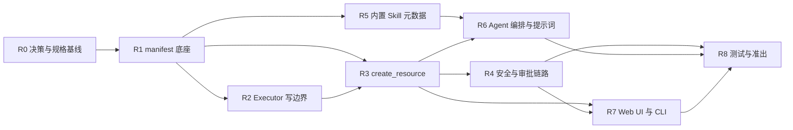

# k8s-ai 三期开发计划：资源创建能力（Resource Create）

- 版本：v1.0
- 日期：2026-09-24
- 状态：待启动
- 当前基线版本：v2.7.0（Makefile `VERSION`）
- 目标版本：v3.0.0
- 需求输入：[RESOURCE_CREATE_DESIGN.md](./RESOURCE_CREATE_DESIGN.md)、[APPROVAL_V2_DESIGN.md](./APPROVAL_V2_DESIGN.md)、AGENTS.md
- 编号说明：本计划用 **R0–R8** 作为主线编号。AGENTS.md 中预留的 Phase 3（MCP 外部工具、
  可观测性、多会话后端）不属本计划范围，属三期另一条线，此处不排期。

## 修订记录

| 版本 | 日期 | 修订人 | 说明 |
| --- | --- | --- | --- |
| v1.0 | 2026-09-24 | | 初版：基于 RESOURCE_CREATE_DESIGN.md 拆分 R0–R8，58 条任务，估 37.5 人日 |

---

## 1. 范围与非目标

**范围内**

- 通用创建 Tool `create_resource`（dry-run 先行、审批提案、创建后 verify）；
- manifest 底座（解析、GVK/白名单、静态校验、危险字段、指纹、Secret 值检测）；
- Executor 写边界扩展（dynamic client + Server-Side Apply + dry-run + verify），写入仍只在 `internal/executor`；
- 创建类风险分级、Code Guard、审批链路、Secret `create_only` 通道（值不透传 LLM）；
- 按域组织的内置创建 Skill 元数据（workload/config/storage/network/rbac）；
- Agent 创建意图路由与信息收集协议；Web UI / CLI 创建提案与结果呈现；
- 测试、架构门禁、文档与版本准出。

**非目标（本计划不做）**

- 通用 Skill 引擎与用户自定义 Skill 目录（仅落内置 Skill 配置，框架化另列计划）；
- Secret 内容值读取（`secret.access=read_write`）；
- 多对象失败自动回滚；
- Helm / GitOps / 蓝图市场、MCP 外部工具、可观测性接入、跨集群创建；
- 逐资源 `CREATE_*_TOOL` 与逐 Kind 工具（设计上已否决）。

---

## 2. 决策基线

| 编号 | 决策 | 结论 | 状态 |
| --- | --- | --- | --- |
| D-01 | 创建工具形态 | 单个通用 Tool `create_resource`，不逐资源建工具 | 已定 |
| D-02 | 创建调用模式 | `dry_run` / `apply` 两段式（MVP），`proposal_id` 优化后续 | 已定 |
| D-03 | 创建实现基座 | 使用client-go dynamic + Server-Side Apply（`fieldManager=k8s-ai`），不依赖 kubectl 二进制；kubectl 通道保留兜底 | 已定 |
| D-04 | 已存在资源 | 不覆盖，返回 `already_exists` 并转 patch/update 提案 | 已定 |
| D-05 | 目标 namespace 不存在 | 拒绝创建，不自动建 namespace | 已定 |
| D-06 | 含值 Secret | 放开创建但值不透传 LLM（用户值/Executor 生成值 + 指纹审计）；读取保持红线 | 已定 |
| D-07 | Web 事件契约 | 推荐复用 `tool-call` / `tool-response` 承载创建提案，不新增事件类型 | 已定 |
| D-08 | `--skip-permissions` | 沿用现有非 shell 语义，创建类操作输出审计告警 | 已定 |
| D-09 | 版本号 | 推荐 v3.0.0（新增能力，向后兼容） | 已定 |
| D-10 | 多对象与回滚 | 单次上限 3 对象 / 8KB，v1 不回滚，逐对象报告 | 已定 |

待确认项（D-03 / D-07 / D-08 / D-09）建议 R0 一次评审锁定，避免阻塞 R2/R4/R7。

---

## 3. 里程碑

| 里程碑 | 内容 | 可演示成果 |
| --- | --- | --- |
| M1 | R0+R1+R2 | 一条 manifest 完成解析、白名单、校验、dry-run 与风险判定 |
| M2 | R3+R4（审批部分） | 自然语言 → 创建提案 → 审批 → 创建 → verify 全链路（终端可演示） |
| M3 | R4（Secret）+R6 | 含值 Secret 创建且值不进 LLM；创建意图与修复意图路由正确 |
| M4 | R5+R7+R8 | Web 创建提案卡片与创建报告；5 个域的创建方法论生效 |
| M5 | R8 | `go test` / `go vet` / 架构测试全绿，文档与版本准出 |

## 4. 依赖与并行



并行建议：R1 完成后 R2 与 R5 可并行；R3 与 R6 的提示词部分可并行；
R7 前端部分可在 R3 落地后启动（依赖契约不依赖安全实现）。

---

## 5. 任务分解

> 列说明：规模 S≈0.25d / M≈0.5d / L≈1d；状态取值：未开始 / 进行中 / 已完成 / 阻塞。

### R0 决策与规格基线（0.5d 起，合计约 1.75d）

| 编号 | 任务项 | 交付物 / 涉及文件 | 验收标准 | 依赖 | 规模 | 预估 | 里程碑 | 状态 |
| --- | --- | --- | --- | --- | --- | --- | --- | --- |
| R0.1 | 设计评审与决策签收 D-01~D-10 | docs/RESOURCE_CREATE_DESIGN.md §10 | 4 项待确认决策全部有结论并回写文档 | - | S | 0.25d | M1 | 未开始 |
| R0.2 | 创建配置项设计冻结 | internal/config/config.go：`agent.create.{enabled,allow_kinds,deny_kinds,cluster_kinds,max_objects_per_call,max_manifest_bytes}`、`agent.secret.access` | 配置项命名/默认值/校验规则评审通过，含 `Validate()` 约束 | R0.1 | M | 0.5d | M1 | 未开始 |
| R0.3 | 创建风险分级映射表定稿 | internal/approval/risk.go 设计口径（kind/scope/字段 → MEDIUM/HIGH） | 表格覆盖常见 Kind + 敏感字段 + cluster-scoped，评审通过 | R0.1 | M | 0.5d | M1 | 未开始 |
| R0.4 | 测试与 E2E 冒烟场景清单 | docs/E2E_SMOKE.md 草案（创建/Secret/白名单/覆盖拒绝场景） | 每条任务都能对应至少一个可执行验证场景 | R0.1 | M | 0.5d | M1 | 未开始 |

### R1 manifest 底座（约 4.75d）

| 编号 | 任务项 | 交付物 / 涉及文件 | 验收标准 | 依赖 | 规模 | 预估 | 里程碑 | 状态 |
| --- | --- | --- | --- | --- | --- | --- | --- | --- |
| R1.1 | 新建 manifestx 包骨架 | 新建 internal/manifestx（`Parse` 返回 `[]Object{Object, GVK}`） | 包编译通过，导出类型稳定，无第三方新依赖 | R0.2 | M | 0.5d | M1 | 未开始 |
| R1.2 | YAML/JSON 与多文档解析 | internal/manifestx/decode.go | 单文档/多文档/空文档/注释/纯 JSON 用例全通过 | R1.1 | M | 0.5d | M1 | 未开始 |
| R1.3 | 模板表达式拒绝 | 同上 | 含 `{{ }}`、kustomize、helm 模板时返回明确错误码 | R1.2 | S | 0.25d | M1 | 未开始 |
| R1.4 | GVK → GVR 映射与 scope 判定 | 复用 kubernetes discovery/RESTMapper（internal/kubernetes） | 内置 Kind 与未知 Kind 均能判定；cluster-scoped 标记正确 | R1.2 | L | 1d | M1 | 未开始 |
| R1.5 | kind 白名单 / deny / cluster_kinds 校验 | internal/manifestx/policy.go 消费 R0.2 配置 | allow/deny/CRD/cluster 四类场景各有单测 | R1.4, R0.2 | M | 0.5d | M1 | 未开始 |
| R1.6 | 必填字段与命名校验 | apiVersion/kind/metadata.name、metadata.namespace 缺省策略 | 缺失即 error，含字段路径与修复提示 | R1.2 | M | 0.5d | M1 | 未开始 |
| R1.7 | 危险字段扫描 | privileged / hostNetwork / hostPID / hostPath / 挂载 SA token | 命中输出结构化校验结果，可进入审批提案 | R1.2 | M | 0.5d | M1 | 未开始 |
| R1.8 | manifest 规范化与指纹 | canonical 序列化 + sha256（提案一致性用） | 同语义 manifest 指纹稳定，字段顺序无关 | R1.2 | S | 0.25d | M1 | 未开始 |
| R1.9 | Secret 值检测与指纹脱敏 | stringData/data 检测，产出 key/长度/sha256，不落明文 | 值不出现在返回值、日志、审计结构中 | R1.2 | M | 0.5d | M1 | 未开始 |
| R1.10 | manifestx 单元测试集 | internal/manifestx/*_test.go | `go test ./internal/manifestx/...` 绿，覆盖 R1.2–R1.9 | R1.9 | M | 0.5d | M1 | 未开始 |

### R2 Executor 写边界扩展（约 5.75d）

| 编号 | 任务项 | 交付物 / 涉及文件 | 验收标准 | 依赖 | 规模 | 预估 | 里程碑 | 状态 |
| --- | --- | --- | --- | --- | --- | --- | --- | --- |
| R2.1 | 类型与接口定义 | internal/executor/types.go：`ApplyRequest` / `ApplyResult` / `VerifyRequest` / `VerifyResult` | 类型评审通过，工具层不直接 import client-go | R1.8 | M | 0.5d | M1 | 未开始 |
| R2.2 | dynamic client 接入 executor | internal/executor 新增 dynamic client 构造，复用 internal/kubernetes 配置 | 多 context/kubeconfig 场景可构造；配置缺失时报错清晰 | R2.1 | M | 0.5d | M1 | 未开始 |
| R2.3 | Server-Side Apply 实现 | executor.Apply：dynamic + SSA，`fieldManager=k8s-ai` | fake dynamic client 下 create/update 行为正确 | R2.2 | L | 1d | M2 | 未开始 |
| R2.4 | dry-run 支持 | `dryRun=["All"]` 分支 | dry-run 不产生服务端变更，返回校验错误原样回传 | R2.3 | M | 0.5d | M1 | 未开始 |
| R2.5 | 对象存在性检查 | GetObject（dynamic Get） | 已存在/不存在两分支正确，namespace 不存在可区分 | R2.2 | S | 0.25d | M2 | 未开始 |
| R2.6 | verify 就绪判定策略表 | Deployment/STS/DS/Job/CronJob/PVC/Service/ConfigMap/Ingress | 每类 Kind 的判定单测通过（含未就绪） | R2.3 | L | 1d | M2 | 未开始 |
| R2.7 | verify Events 采样 | 未就绪时附带最近 Events | Events 截断与脱敏与现有输出一致 | R2.6 | M | 0.5d | M2 | 未开始 |
| R2.8 | 结果脱敏与大小限制 | 复用 `security.Redactor` 与 capped buffer | 敏感串脱敏、超限标记 Truncated | R2.3 | S | 0.25d | M2 | 未开始 |
| R2.9 | executor 单元测试 | internal/executor/*_test.go | `go test ./internal/executor/...` 绿 | R2.8 | M | 0.5d | M2 | 未开始 |
| R2.10 | 架构测试 Secret 写读分离规则 | tests/arch/readonly_test.go：executor 内 `Secrets()` 仅允许 Create/Update/Patch/Apply，禁 Get/List/Watch | 规则生效且现有用例仍绿 | R2.3 | M | 0.5d | M3 | 未开始 |
| R2.11 | 架构测试写边界回归 | tests/arch/readonly_test.go 确认 SSA 调用点仅在 executor | 新增代码不违反写边界 | R2.3 | S | 0.25d | M2 | 未开始 |
| R2.12 | RBAC 清单同步 | tests/arch/rbac_test.go 与 RBAC 示例文档（新增 create/patch secrets） | RBAC 测试绿，文档示例可用 | R2.10 | S | 0.25d | M3 | 未开始 |

### R3 `create_resource` Tool（约 4.5d）

| 编号 | 任务项 | 交付物 / 涉及文件 | 验收标准 | 依赖 | 规模 | 预估 | 里程碑 | 状态 |
| --- | --- | --- | --- | --- | --- | --- | --- | --- |
| R3.1 | Tool 契约与 InputSchema | internal/tools/create.go：`create_resource(manifest, mode, verify, timeout_seconds)` | schema 渲染正确，描述含读写与审批语义 | R1.10 | M | 0.5d | M2 | 未开始 |
| R3.2 | `IsReadOnly` 实现 | 同上：mode=dry_run→true，apply→false | 单测覆盖两种 mode 与非法 mode | R3.1 | S | 0.25d | M2 | 未开始 |
| R3.3 | `Risk` 与 `SchemaMetadata` | 调用 R0.3 映射 + MetadataDescriber | 提案风险与映射表一致 | R3.1 | M | 0.5d | M2 | 未开始 |
| R3.4 | dry_run 提案生成 | 解析→校验→存在性→dry-run→提案对象 | 返回对象清单、风险、校验结果、指纹 | R3.3, R2.4 | L | 1d | M1 | 未开始 |
| R3.5 | 提案一致性校验 | apply 时 manifest 指纹必须等于某次 dry_run | 未 dry_run 或 manifest 被改动时拒绝执行 | R3.4 | M | 0.5d | M2 | 未开始 |
| R3.6 | `already_exists` 分支 | 已存在不覆盖，返回转 patch/update 建议 | 单测覆盖存在/不存在/部分存在 | R3.4 | S | 0.25d | M2 | 未开始 |
| R3.7 | apply 执行与 verify | Executor.Apply + Verify，超时与取消 | 创建后可验证，verify 失败不影响已创建事实回报 | R3.5, R2.6 | L | 1d | M2 | 未开始 |
| R3.8 | 多对象与部分失败语义 | 逐对象结果、失败不自动回滚 | 多对象场景结果可读、可审计 | R3.7 | M | 0.5d | M2 | 未开始 |
| R3.9 | ToolResult 与错误码归一 | Text 摘要 + Data 结构 + 错误码 | LLM 可读且不泄露 Secret 值 | R3.8 | M | 0.5d | M2 | 未开始 |
| R3.10 | 注册与开关 | internal/service/chat.go 装配、disabled_tools、create.enabled 开关 | 开关生效；Web 工具列表正确 | R3.9 | S | 0.25d | M2 | 未开始 |
| R3.11 | Tool 单元测试 | internal/tools/create_test.go、metadata_test 扩展 | `go test ./internal/tools/...` 绿 | R3.10 | M | 0.5d | M2 | 未开始 |

### R4 安全与审批链路（约 4.5d）

| 编号 | 任务项 | 交付物 / 涉及文件 | 验收标准 | 依赖 | 规模 | 预估 | 里程碑 | 状态 |
| --- | --- | --- | --- | --- | --- | --- | --- | --- |
| R4.1 | 创建风险分级实现 | internal/approval/risk.go：kind/scope/字段 → RiskLevel | 与 R0.3 表格一致，含 cluster-scoped 与敏感字段提升 | R0.3, R3.3 | M | 0.5d | M2 | 未开始 |
| R4.2 | Code Guard 门禁落地 | kind 白名单、dry-run 强制、namespace 存在性、危险字段（executor/approval） | 四类门禁各有拒绝用例 | R4.1, R2.3 | L | 1d | M2 | 未开始 |
| R4.3 | Policy 与模式回归 | internal/approval/decision.go + 用例（strict/smart/shell 不受影响） | 现有审批行为无回归，shell 仍不可自动放行 | R4.1 | M | 0.5d | M2 | 未开始 |
| R4.4 | Grant 与创建联动 | 创建首提必批；smart 下同 task/kind/ns 的 MEDIUM 后续可命中 Grant | Grant 用例覆盖创建场景 | R4.1 | M | 0.5d | M3 | 未开始 |
| R4.5 | Secret `create_only` 值通道 | 审批载荷承载用户值 / Executor 生成随机值；LLM 只见 key 与占位符 | 值不进 LLM 上下文、会话、审计；创建结果可用 | R1.9, R4.2 | L | 1d | M3 | 未开始 |
| R4.6 | Secret 审计与指纹 | audit 事件记录 key/长度/sha256 与 `SECRET_TOUCHED` 标记 | 审计文件无明文值，指纹可复核 | R4.5 | M | 0.5d | M3 | 未开始 |
| R4.7 | `secret.access` 配置闸门 | config + 行为分支（off / create_only / read_write 仅关闭态） | 非 create_only 时创建含值 Secret 被拒 | R4.5 | S | 0.25d | M3 | 未开始 |
| R4.8 | kubectl 通道 Secret 红线回归 | internal/approval/policy.go 行为不变 | `kubectl create secret` 仍被硬拦，回归用例 | R4.5 | S | 0.25d | M3 | 未开始 |
| R4.9 | 创建提案人类可读描述 | CommandDescriber/提案渲染：对象清单 + 风险原因 + manifest 摘要 | 审批面板不再展示原始转义 JSON | R3.4 | M | 0.5d | M2 | 未开始 |

### R5 内置创建 Skill 元数据（约 3d）

| 编号 | 任务项 | 交付物 / 涉及文件 | 验收标准 | 依赖 | 规模 | 预估 | 里程碑 | 状态 |
| --- | --- | --- | --- | --- | --- | --- | --- | --- |
| R5.1 | Skill 元数据结构与加载 | internal/skills：Skill/Validation/RiskRule/Checks + go:embed YAML + 校验 | schema 非法时启动即报错；5 域加载成功 | R1.10 | M | 0.5d | M4 | 未开始 |
| R5.2 | `create-workload` 规则 | skills/create-workload.yaml | 镜像 tag 强制、requests/limits 建议、危险字段必确认 | R5.1 | M | 0.5d | M4 | 未开始 |
| R5.3 | `create-config` 规则 | skills/create-config.yaml | 数据来源与引用一致性校验；Secret 值走指纹通道 | R5.1 | S | 0.25d | M4 | 未开始 |
| R5.4 | `create-storage` 规则 | skills/create-storage.yaml | StorageClass 存在性、容量、accessModes、绑定检查 | R5.1 | M | 0.5d | M4 | 未开始 |
| R5.5 | `create-network` 规则 | skills/create-network.yaml | 端口/selector/type 校验、IngressClass 检查 | R5.1 | M | 0.5d | M4 | 未开始 |
| R5.6 | `create-rbac` 规则 | skills/create-rbac.yaml | 最小权限提示；cluster 级默认 HIGH | R5.1 | S | 0.25d | M4 | 未开始 |
| R5.7 | Skill 校验器接入 dry_run | create_resource dry-run 输出 Skill findings | findings 进入审批提案并可定位字段 | R5.6, R3.4 | M | 0.5d | M4 | 未开始 |
| R5.8 | verify 规则数据化 | post_checks 映射到 R2.6 策略表 | Kind→verify 策略由数据驱动，无硬编码分支扩散 | R5.7 | S | 0.25d | M4 | 未开始 |

### R6 Agent 编排与提示词（约 2d）

| 编号 | 任务项 | 交付物 / 涉及文件 | 验收标准 | 依赖 | 规模 | 预估 | 里程碑 | 状态 |
| --- | --- | --- | --- | --- | --- | --- | --- | --- |
| R6.1 | 创建意图路由 | internal/agent/prompt.go 决策树新增创建分支 | 创建/诊断/修复/删除四类意图路由正确 | R3.1 | M | 0.5d | M3 | 未开始 |
| R6.2 | 信息收集协议 | required_inputs 驱动追问，禁止编造默认值 | 缺失字段必须追问；可给建议值但需确认 | R6.1 | M | 0.5d | M3 | 未开始 |
| R6.3 | 两阶段调用协议 | prompt 明确 dry_run→提案→确认→apply 顺序 | 不允许跳过 dry_run 直接 apply（工具侧兜底） | R6.2, R3.5 | S | 0.25d | M2 | 未开始 |
| R6.4 | 失败与拒绝语义 | 不原样重试、拒绝 2 次硬拦截沿用；Secret 值禁写入 kubectl 命令文案 | 现有熔断不被破坏；Secret 命令路径提示正确 | R3.9 | S | 0.25d | M3 | 未开始 |
| R6.5 | 提示词回归测试 | internal/agent/prompt 测试 + 决策树用例 | `go test ./internal/agent/...` 绿 | R6.4 | M | 0.5d | M3 | 未开始 |

### R7 Web UI 与 CLI 体验（约 3d）

| 编号 | 任务项 | 交付物 / 涉及文件 | 验收标准 | 依赖 | 规模 | 预估 | 里程碑 | 状态 |
| --- | --- | --- | --- | --- | --- | --- | --- | --- |
| R7.1 | 创建提案契约确认 | internal/service/chat.go（D-07 结论落地） | 事件契约文档化，前后端一致 | R3.4 | S | 0.25d | M4 | 未开始 |
| R7.2 | Web 创建提案卡片 | internal/webui/index.html | 对象清单、风险徽标+原因、manifest 折叠、校验 findings、审批按钮 | R7.1 | L | 1d | M4 | 未开始 |
| R7.3 | 执行状态流 | dry-run→pending→applying→verifying→done/failed | 状态与实际执行一致，异常态可见 | R7.2 | M | 0.5d | M4 | 未开始 |
| R7.4 | 创建结果卡 | 对象清单 + verify 摘要 + Events | 结果与工具返回一致，Secret 不回显值 | R7.3 | M | 0.5d | M4 | 未开始 |
| R7.5 | Secret 值渲染保护 | Web/CLI 渲染层 | 任何视图不出现 Secret 明文值 | R7.4 | S | 0.25d | M3 | 未开始 |
| R7.6 | CLI 终端提案与结果渲染 | internal/service + report 渲染 | 终端可读展示提案与创建结果 | R7.4 | M | 0.5d | M4 | 未开始 |
| R7.7 | 会话持久化与刷新恢复 | internal/session/session.go（manifest/verify 结果落库） | 刷新页面后提案与结果不丢失 | R7.4 | M | 0.5d | M4 | 未开始 |

### R8 测试、门禁与准出（约 4.75d）

| 编号 | 任务项 | 交付物 / 涉及文件 | 验收标准 | 依赖 | 规模 | 预估 | 里程碑 | 状态 |
| --- | --- | --- | --- | --- | --- | --- | --- | --- |
| R8.1 | 创建链路集成测试 | 新建 internal/creationtest（仿 approvaltest） | 串起工具→审批→executor 创建与 verify | R4.5, R3.7 | L | 1d | M5 | 未开始 |
| R8.2 | E2E 冒烟场景落地 | docs/E2E_SMOKE.md | R0.4 清单全部可复现，含失败场景 | R8.1 | M | 0.5d | M5 | 未开始 |
| R8.3 | 全量门禁 | `go test ./...` / `go vet ./...` / gofmt / tests/arch | 全绿；架构测试无新增违规 | R8.1 | M | 0.5d | M5 | 未开始 |
| R8.4 | 设计文档状态更新 | docs/RESOURCE_CREATE_DESIGN.md 状态与实现落点回写 | 文档与实现一致 | R8.3 | S | 0.25d | M5 | 未开始 |
| R8.5 | 文档同步 | CHANGELOG / VERSIONING / README / TECHNICAL_GUIDE / PROJECT_STATUS / PRESENTATION | 术语与能力口径统一，新增创建章节 | R8.4 | L | 1d | M5 | 未开始 |
| R8.6 | 配置样例与安装文档 | 配置模板、INSTALLATION.md | 新配置项有样例与说明 | R8.5 | M | 0.5d | M5 | 未开始 |
| R8.7 | 打包与版本发布 | Makefile `VERSION`（沿用既有脚本，输出 bin/，Linux amd64） | 按既有打包方式产出，版本注入正确 | R8.5 | M | 0.5d | M5 | 未开始 |
| R8.8 | 准出评审 | 准出清单勾选 + 演示脚本 | M1–M5 演示全部通过 | R8.7 | S | 0.25d | M5 | 未开始 |

---

## 6. 出口标准

```text
go test ./...           全绿（含 manifestx / executor / tools / approval / agent / skills）
go vet ./...            无告警
tests/arch              绿：写边界仅 executor、Secrets() 仅只读门面 + executor 写方法、
                        LLM 请求无 Secret 内容值、依赖方向不变
安全用例               白名单拒绝、危险字段提升、未 dry-run 拒绝、已存在不覆盖、
                        kubectl create secret 仍硬拦、Secret 值不进 LLM/会话/审计
功能用例               manifest 创建→审批→创建→verify 全链路；多对象部分失败逐对象报告
体验用例               Web 提案卡与创建报告；CLI 渲染；会话刷新不丢
文档与版本             CHANGELOG/VERSIONING/README/TECHNICAL_GUIDE/PROJECT_STATUS 同步，
                        版本号按 D-09 结论发布
```

## 7. 关键代码落点

| 位置 | 变更性质 |
| --- | --- |
| `internal/manifestx/`（新建） | manifest 解析、GVK、白名单、校验、危险字段、指纹 |
| `internal/executor/` | SSA + dry-run + GetObject + verify 策略；写边界不变 |
| `internal/tools/create.go`（新建） | `create_resource` Tool 与提案生成 |
| `internal/approval/` | 创建风险分级、Code Guard、Secret 通道、Grant 联动 |
| `internal/skills/`（新建） | 内置创建 Skill 元数据与校验器 |
| `internal/agent/prompt.go` | 创建意图路由、信息收集、两阶段协议 |
| `internal/service/chat.go` | 工具装配、事件契约（D-07） |
| `internal/webui/index.html` | 创建提案卡、状态流、结果卡 |
| `internal/config/config.go` | `agent.create.*`、`agent.secret.access` |
| `tests/arch/` | Secret 写读分离规则、写边界与 RBAC 清单 |

## 8. 风险与应对

| 风险 | 影响 | 应对 |
| --- | --- | --- |
| Secret 值意外进入 LLM/会话/审计 | 数据红线 | 值只在审批载荷与 executor 内流转；R1.9/R4.6/R7.5 三道校验 + 架构测试兜底 |
| 架构测试写边界冲突 | 门禁失败 | R2.11 提前验证 SSA 调用点在 executor 内 |
| dry-run 与服务端行为不一致 | 提案不可信 | 强制 server-side dry-run；apply 前指纹一致性校验（R3.5） |
| 模型跳过信息收集直接创建 | 误创建 | prompt 协议 + 工具拒绝未 dry-run 的 apply + 审批人可见提案 |
| 多对象部分失败 | 状态混乱 | v1 不回滚，逐对象结果 + verify 报告 + 审计 |
| 事件契约变更影响前端 | 回归成本 | D-07 优先复用现有事件；变更需前端同批提交 |

## 9. 工作量汇总

| 主线 | 人日 |
| --- | --- |
| R0 决策与规格基线 | 1.75 |
| R1 manifest 底座 | 4.75 |
| R2 Executor 写边界 | 5.75 |
| R3 create_resource Tool | 4.5 |
| R4 安全与审批链路 | 4.5 |
| R5 内置 Skill 元数据 | 3.0 |
| R6 Agent 编排与提示词 | 2.0 |
| R7 Web UI 与 CLI | 3.0 |
| R8 测试与准出 | 4.75 |
| **合计** | **34.0** |

说明：按串行估算（单人），并行推进 R1/R5、R3/R6 可压缩约 3–4 人日。
纯新增代码约 1.5–2.0k 行 Go + Web UI 渲染改动。
