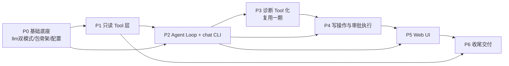

# k8s-ai 二期开发计划与排期

- 版本：v1.0
- 日期：2026-08-23
- 状态：待执行
- 关联文档：PROJECT_SPEC_二期.md（v3.0）、AGENTS.md、docs/design/ARCHITECTURE.md、docs/design/ADR.md

## 修订记录

| 版本 | 日期 | 修订人 | 说明 |
|---|---|---|---|
| v1.0 | 2026-08-23 | Codex | 初版：基于 v3.0 需求规格拆分 P0–P6 阶段 |
| v1.1 | 2026-08-23 | Codex | P0 基础底座、P1 只读 Tool 层、P2 Agent Loop + chat CLI 已完成（M1/M2 达成），补进度跟踪 |
| v1.2 | 2026-08-23 | Codex | P3 诊断 Tool 化已完成（M3 达成）；按澄清修订借鉴/复用策略（代码可复用，文档统一写"借鉴"） |
| v1.3 | 2026-08-23 | Codex | P4 写操作与审批执行已完成（M4 达成）：approval 风险分级、executor（kubectl argv + client-go）、写 Tool、审批→执行→验证闭环 |
| v1.4 | 2026-08-23 | Codex | P5 Web UI 已完成（M5 达成）：k8s-ai web（REST + SSE + 会话管理 + 审批卡片 + 内嵌页面），借鉴记录入 CREDITS.md |
| v1.5 | 2026-08-23 | Codex | P5 体验迭代：修复回答重复（answer 事件单一来源）；集群健康检查协议（多维度调查 + 规则评分与 LLM 整体评估双轨）；新增 get_node_usage 节点资源用量工具（metrics API，k8s.io/metrics，不依赖 kubectl）；tools wire 格式对齐 OpenAI 标准（function 包裹） |
| v1.6 | 2026-08-23 | Codex | P5 体验迭代 2：健康评分双轨（规则评分 + LLM 综合评分 0-100 + 差异解释）；Web UI 重做（无重边框、消息全宽流式、You/AI 标签）；工具调用卡片化（Show output 折叠查看执行命令与结果）；一期兼容改动提交 e248698（二期代码未提交） |
| v1.7 | 2026-08-23 | Codex | P5 体验迭代 3：修复 markdown 表格重复渲染（解析器每行重复建表）；get_pod 支持省略 namespace 全集群查找 + 前缀匹配（解决模型猜命名空间/Deployment 名查 Pod 导致的工具反复调用与 max_iterations）；提示词加调查效率与回答收敛约束（诊断输出=现象→根因→排查→修复） |
| v1.8 | 2026-08-23 | Codex | P5 体验迭代 4（对照 kubectl-ai 定位硬伤）：ToolResult 投喂 LLM 时 Text 摘要覆盖 Data 数据（get_pods 只输出 "pods=20" 导致模型反复调同一工具至 max_iterations）；修复为 Text+Data 一起投喂、日志正文放 Text 原样输出；同问题复测收敛（约 90s 完成诊断） |
| v1.9 | 2026-08-23 | Codex | P5 体验迭代 5（对照 kubectl-ai 补齐排查链路）：新增 get_configmap/get_configmaps（配置类根因必查项）、patch_configmap、delete_pod 写工具；get_pod 内联最近 Events（describe 效果）；提示词补充配置类故障排查顺序（get_pod→get_previous_logs→get_configmap→patch_configmap→restart_rollout/delete_pod） |
| v2.0 | 2026-08-23 | Codex | P5 体验迭代 6：修复行为门禁（诊断类提问禁止调用写工具，先给结论+方案并询问"需要我修复吗？"，用户同意后才走写工具+审批）；get_pod 带 namespace 时也支持前缀回退（Deployment 名查 Pod）；评估结论：保留结构化工具 + kubectl 兜底双轨，不抛弃 |
| v2.1 | 2026-08-23 | Codex | P5 体验迭代 7：审批卡片可读化（CommandDescriber：每个写工具输出人类可读 kubectl 命令 + 变更说明，替代原始转义 JSON 参数）；端到端验证"询问→诊断→修复→验证"闭环（listen 80x 故障：patch_configmap→restart_rollout→get_pods 验证 Running 1/1） |
| v2.2 | 2026-08-24 | Codex | P5 体验迭代 8：Web 工具调用卡片美化（借鉴 kubectl-ai 状态着色设计：执行中蓝点脉冲/完成绿点/出错红点 + 状态文字、命令等宽色块、Show output 旋转箭头折叠、输出等宽可滚动）；新增耗时显示与复制按钮（非照搬）；页面 JS 用 node --check 校验 |
| v2.3 | 2026-08-24 | Codex | P6 收尾完成：审计接入 Agent 主流程（用户输入/LLM/工具/审批事件落盘脱敏）；MCP Client 接口 + 注册表适配器；RBAC 写权限示例；README/INSTALLATION/CHANGELOG/TECHNICAL_GUIDE/PROJECT_STATUS/E2E_SMOKE 文档；max_iterations 默认 15；web 执行中状态；版本 v2.0.0 |

## 0. 进度状态（2026-08-23）

```text
[x] P0 基础底座          已完成：AGENTS.md/架构测试更新、llm 双模式 Tool Calling、
                              agent/tools/session/audit 包骨架、agent/webui/mcp 配置
[x] P1 只读 Tool 层      已完成：Reader Get* 补齐 + 19 个只读 Tool + 注册表接入 + fake 测试
[x] P2 Agent Loop + CLI  已完成：Agent Loop（native/shim/auto）、上下文预算、审批接口、
                              ChatService（CLI/Web 复用）、chat CLI（交互/单发/stdin/JSON/会话）
[x] P3 诊断 Tool 化      已完成：scan_cluster/scan_pod/diagnose_pod/diagnose_node/diagnose_workload
                              全部复用一期 ScanService.Run（无重复实现），service 注册接入
[x] P4 写操作与审批执行  已完成：approval（风险分级/deny_ops/策略）、executor（kubectl argv 无 shell +
                               client-go 写）、kubectl/scale/patch/restart/label 写 Tool、
                               审批 y/a/n + skip-permissions、执行后验证（deployment 状态核对）
[x] P5 Web UI            已完成：k8s-ai web（/api/sessions CRUD + SSE 流 + send-message/approve +
                               会话侧栏 + Markdown 渲染 + 审批卡片，go:embed 内嵌页面）
[ ] P6 收尾交付          未开始
```

---

## 1. 阶段依赖总览



可并行项：

- audit 包（P0.6）可在 P1 期间并行补事件覆盖；
- Web UI 前端（P5.2）可在 P3 期间并行启动（依赖消息契约，不依赖写操作）；
- MCP 接口（P6.2）为纯接口占位，可随时并行。

单人开发默认串行，计划按串行估算。

## 2. 里程碑

| 里程碑 | 对应阶段 | 可演示成果 |
|---|---|---|
| M1 | P0–P1 | `k8s-ai chat "为什么 payment-api 一直重启？"` 能调只读 Tool 并给出基于 Evidence 的回答（LLM 直答，无诊断 Tool）— **达成** |
| M2 | P2 | chat CLI 完整：交互 / 单发 / stdin / JSON / 会话（new/list/resume/delete），Agent Loop 受上限约束 — **达成** |
| M3 | P3 | `scan_cluster` / `diagnose_pod` 等复用一期能力，chat 能输出专业 SRE 诊断 — **达成** |
| M4 | P4 | 写操作闭环：Plan 展示 → y/a/n 确认 → 执行（kubectl argv / client-go）→ 验证；`--skip-permissions` 自动化模式 — **达成** |
| M5 | P5 | `k8s-ai web`：浏览器多会话 chat、SSE 流式、Markdown 渲染、审批卡片 — **达成** |
| M6 | P6 | 审计 / MCP 接口 / RBAC / 文档 / 全量测试全绿，二期可交付 |

## 3. 总排期估算

假设单人全职、每天有效 6–7 小时，按阶段估算（含测试与文档，±30%）：

| 阶段 | 内容 | 预估（人日） | 累计 | 状态 |
|---|---|---|---|---|
| P0 | 基础底座（llm 双模式 / 包骨架 / 配置 / 规则更新） | 4 | 4 | ✅ 完成 |
| P1 | 只读 Tool 层（Reader 补齐 + 19 个 Tool + 注册表） | 5 | 9 | ✅ 完成 |
| P2 | Agent Loop + chat CLI（消息/状态/会话/预算） | 5 | 14 | ✅ 完成 |
| P3 | 诊断 Tool 化（scan_cluster / diagnose_*） | 4 | 18 | ✅ 完成 |
| P4 | 写操作与审批执行（kubectl argv + client-go + 验证） | 6 | 24 | ✅ 完成 |
| P5 | Web UI（SSE + 会话管理 + 审批卡片） | 6 | 30 | ✅ 完成 |
| P6 | 收尾交付（审计 / MCP / RBAC / 文档 / 全量测试） | 4 | 34 |

合计约 **34 人日**，按 5 天/周约 **6.8 周**；加缓冲按 **8 周**排。

## 4. 分阶段详细任务

### P0 基础底座（4 人日）✅ 已完成（2026-08-23）

目标：二期规则落地 + LLM Tool Calling 双模式 + 新包骨架 + 配置扩展，为后续所有阶段提供地基。

| # | 任务 | 产出/验收 | 预估 |
|---|---|---|---|
| P0.1 | AGENTS.md 二期规则修订（读写允许 + 人类确认 + 无任意 shell + Secret 不进 LLM/会话/审计）；tests/arch 更新（写方法仅限 executor、禁止 bash -c、依赖方向、Secrets 禁入 LLM） | 规则与架构测试通过 | 0.5d |
| P0.2 | llm Tool Calling wire：请求带 `tools`、响应解析 `tool_calls`、`role: tool` 回传；shim JSON action 协议（thought/action/answer）；`agent.tool_calling: native\|shim\|auto` | native/shim 单测通过 | 1d |
| P0.3 | agent 包骨架：Message/MessageType/Source/AgentState/Agent 结构（借鉴 kubectl-ai conversation.go / api/models.go） | 类型定义 + 单测 | 0.5d |
| P0.4 | tools 包骨架：Tool 富接口（Execute/IsReadOnly/Risk）、ToolResult（截断/脱敏/定界）、Registry（借鉴 kubectl-ai tools.go） | 接口 + 注册表单测 | 0.5d |
| P0.5 | session 包：Store 接口 + memory/file 实现 + SessionManager（借鉴 kubectl-ai sessions/*）；脱敏落盘 | CRUD + 恢复单测 | 0.5d |
| P0.6 | audit 包：Recorder 接口 + 文件实现 + 事件类型（借鉴 kubectl-ai journal）；写入前脱敏 | 事件落盘 + 脱敏单测 | 0.5d |
| P0.7 | config 扩展：agent/webui/mcp 配置节 + 默认值 + 校验；service 组合根暴露 ChatService | config 单测通过 | 0.5d |

出口标准：`go test ./...` 绿；`agent.tool_calling` 双模式均有解析测试；AGENTS.md 与架构测试已更新。

### P1 只读 Tool 层（5 人日）✅ 已完成（2026-08-23）

目标：一期 Kubernetes 只读能力转化为 18 个 Tool，全部有测试。

| # | 任务 | 产出/验收 | 预估 |
|---|---|---|---|
| P1.1 | kubernetes.Reader 补齐 Get*：StatefulSet/DaemonSet/ReplicaSet/Endpoints/PVC/PV/StorageClass/Namespace/Events | Reader 接口 + 客户端方法 + fake 测试 | 1d |
| P1.2 | 资源查询 Tool：get_pod/get_pods/get_node/get_nodes/get_deployment/get_statefulset/get_daemonset/get_replicaset/get_service/get_namespace/get_resources | 工具实现 + 入参校验测试 | 1.5d |
| P1.3 | 日志 Tool：get_logs/get_previous_logs（container/tail_lines/since_seconds，禁止 follow，复用一期截断） | 工具实现 + 截断/上限测试 | 1d |
| P1.4 | 网络/存储/事件 Tool：get_endpoints/get_endpointslices/get_pvc/get_pv/get_storageclass/get_events | 工具实现 + 字段裁剪测试 | 1d |
| P1.5 | ToolResult 统一处理：截断 → security.Redactor 脱敏 → `<untrusted_k8s_data>` 定界；注册表 Schemas 渲染 | 脱敏/定界单测 | 0.5d |

出口标准：18 个 Tool 全部注册且 fake clientset 测试通过；结果统一脱敏定界。

### P2 Agent Loop + chat CLI（5 人日）✅ 已完成（2026-08-23）

目标：`k8s-ai chat` 可用，多轮 Tool Calling 稳定，会话可持久化。

| # | 任务 | 产出/验收 | 预估 |
|---|---|---|---|
| P2.1 | Agent Loop：native + shim 双模式执行、max_iterations/max_tool_calls/timeout、工具错误隔离、LLM 重试 | Loop 单测（上限/空响应/错误继续） | 1.5d |
| P2.2 | 上下文构建与预算：result_max_bytes/turn_max_bytes/history_turns、历史裁剪、不可信定界 | 预算/裁剪单测 | 0.5d |
| P2.3 | chat CLI 交互模式：提示符、thinking/Tool 调用行/回答渲染、y/a/n 输入（复用一期终端进度组件思路） | 交互流程可跑 | 1d |
| P2.4 | chat CLI 单发/stdin/`--format json` + session flags（--session/--new-session/--list-sessions/--delete-session） | 各模式可用 + JSON 契约测试 | 1d |
| P2.5 | 元命令：`exit` / `clear` 在 Agent 内处理 | 可用 | 0.5d |
| P2.6 | CLI 集成测试（cobra 命令 + mock LLM/Tool） | 测试通过 | 0.5d |

出口标准：M2 演示通过；非交互写操作默认拒绝（P4 前以 Plan-only 呈现）。

### P3 诊断 Tool 化（4 人日）✅ 已完成（2026-08-23）

目标：一期 Scanner/Rule/Evidence/Diagnosis/Incident/History 全部包装为 Tool。

| # | 任务 | 产出/验收 | 预估 |
|---|---|---|---|
| P3.1 | scan_cluster Tool：包装 service.ScanService.Run + incident + history 差异，输出摘要 | 工具 + 复用测试 | 1d |
| P3.2 | scan_pod Tool：单 Pod 目标巡检 | 工具 + 测试 | 0.5d |
| P3.3 | diagnose_pod：关联补全（correlation）+ Phase2 日志 + 规则 Finding + 一期诊断（LLM/降级） | 工具 + 契约测试 | 1d |
| P3.4 | diagnose_node / diagnose_workload：故障链聚合（incident） | 工具 + 测试 | 1d |
| P3.5 | 长任务进度：复用一期 LongTask 桥接到消息总线 | 进度事件测试 | 0.5d |

出口标准：M3 演示通过；诊断结果字段与一期 JSON 契约一致；无重复扫描实现。

### P4 写操作与审批执行（6 人日）✅ 已完成（2026-08-23）

目标：读写不限制、写操作带人类确认、执行后验证。

| # | 任务 | 产出/验收 | 预估 |
|---|---|---|---|
| P4.1 | approval 包：风险分级（SAFE..CRITICAL）、require_approval、y/a/n、ApprovedWrites、deny_ops | 决策单测 | 1d |
| P4.2 | executor/kubectl：命令 argv 解析（引号处理、拒绝 `| & ; > < $ () \`` 等元字符）、动词白名单、交互命令拒绝、exec.Command 直调、输出上限 | fake kubectl 二进制测试 | 1.5d |
| P4.3 | 通用 kubectl Tool：LLM 生成命令 → 解析 → 风险 → 审批 → 执行（复用 P4.2） | 工具 + 端到端测试 | 1d |
| P4.4 | executor/kubernetes + 结构化写 Tool：scale_deployment / patch_deployment / restart_rollout / label（client-go，仅 executor 允许写） | fake clientset 测试 | 1d |
| P4.5 | 写流程集成：Plan 展示 → user-choice-request → 确认 → 执行 → 验证（rollout status/Pod Ready/restartCount/Events） | 场景 C/D 端到端测试 | 1d |
| P4.6 | 非交互策略：默认拒绝输出 Plan；`--skip-permissions` 显式放行 + 审计标记 | 策略测试 | 0.5d |

出口标准：M4 演示通过；架构测试确认写方法仅限 executor、无 bash -c。

### P5 Web UI（6 人日）✅ 已完成（2026-08-23）

目标：`k8s-ai web` 浏览器 chat，多会话 + 流式 + 审批。

| # | 任务 | 产出/验收 | 预估 |
|---|---|---|---|
| P5.1 | webui server：REST 路由 + SSE Broadcaster（借鉴 kubectl-ai htmlui.go） | httptest 通过 | 1d |
| P5.2 | AgentManager 集成（sessionID → Agent）+ SessionManager 共享 Store | 多会话并发可用 | 1d |
| P5.3 | index.html 改造：中文界面、k8s-ai 品牌、会话侧栏、Markdown 渲染（sanitize）、深色主题 | 页面可交互 | 2d |
| P5.4 | 审批卡片 + 流式展示：agent-state/text/tool-call/user-choice-request 事件渲染 | 端到端演示 | 1d |
| P5.5 | Web 安全与测试：默认 127.0.0.1、输入/输出 sanitize、SSE 断线重连、审批接口测试 | 测试通过 | 1d |

出口标准：M5 演示通过；浏览器完成典型场景 A/B/C/D。

### P6 收尾交付（4 人日）

目标：审计完善、MCP 接口、RBAC、文档、全量测试。

| # | 任务 | 产出/验收 | 预估 |
|---|---|---|---|
| P6.1 | audit 事件覆盖补全（plan/approval/execution/verification）+ 脱敏测试 | 事件覆盖测试 | 0.5d |
| P6.2 | mcp 包：Client 接口 + 配置结构 + 注册表适配器骨架（不接 SDK） | 接口 + 配置测试 | 0.5d |
| P6.3 | deploy/ RBAC 写权限示例（默认注释）+ Dockerfile 镜像 kubectl 依赖说明 + k8s-ai web 部署示例 | 清单可用 | 0.5d |
| P6.4 | README / INSTALLATION / TECHNICAL_GUIDE / CREDITS（Apache-2.0 借鉴清单）更新 | 文档齐全 | 1d |
| P6.5 | 全量测试：go test ./... / go vet ./... / gofmt、架构测试、一期回归 | 全绿 | 1d |
| P6.6 | CHANGELOG + 版本号 + 构建脚本更新 | 版本可用 | 0.5d |

出口标准：M6 演示通过；DoD（需求规格 §26）全部满足。

## 5. 出口标准汇总

每阶段完成必须满足：

```text
go test ./...   绿（本阶段新增 + 一期回归）
go vet ./...    绿
架构测试        绿（写方法仅限 executor、无 bash -c、依赖方向、Secret 禁入 LLM）
文档           涉及的新命令/配置同步更新
```

## 6. 测试与质量保障

- 全部使用 Mock/fake：fake clientset、mock LLM、fake kubectl 二进制、httptest。
- 关键测试文件规划：

```text
internal/llm/toolcall_test.go          # native + shim 双模式
internal/tools/k8s/*_test.go           # 18 个只读 Tool
internal/tools/kubectl_test.go         # argv 解析/白名单/无元字符
internal/tools/write_test.go           # 结构化写 Tool（fake clientset）
internal/tools/diagnosis_test.go       # scan_cluster / diagnose_*
internal/agent/loop_test.go            # 上限/错误隔离/空响应
internal/agent/approval_test.go        # y/a/n/skip/deny_ops
internal/executor/kubectl_test.go      # fake kubectl 二进制
internal/executor/kubernetes_test.go   # client-go fake 写操作
internal/session/store_test.go         # memory/file + 脱敏
internal/webui/server_test.go          # REST + SSE + choose-option
internal/security/redact_test.go       # 审计/会话/LLM 零敏感值（回归扩展）
tests/arch/readonly_test.go            # 二期边界更新
```

## 7. 风险与假设

| 风险 | 应对 |
|---|---|
| LLM 网关不支持原生 tools | shim 模式兜底（`agent.tool_calling: auto`） |
| kubectl 版本/缺失 | 配置 `kubernetes.kubectl_path`（默认 PATH 查找）；executor 错误信息回传 LLM |
| Web UI 前端工作量 | 直接复用 kubectl-ai 的 Web chat 实现（htmlui.go/index.html/SSE），保留 Apache-2.0 许可头并在 CREDITS.md 记录；文档统一表述为"借鉴" |
| 写操作误执行 | require_approval 默认开启；deny_ops 可选硬拦截；审计全记录；验证闭环 |
| 本机 Go 工具链缺失 | 用户自行安装（已确认） |

## 8. 交付清单

```text
代码：internal/{agent,tools,approval,executor,session,audit,webui,mcp} + llm/kubernetes/config/service 扩展
测试：上述全部包单测 + 集成测试 + 架构测试
文档：README、INSTALLATION、TECHNICAL_GUIDE、CREDITS、CHANGELOG、版本
部署：deploy/ RBAC 写权限示例（默认注释）、web 部署示例
```
